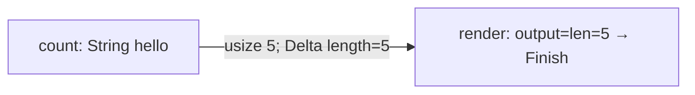
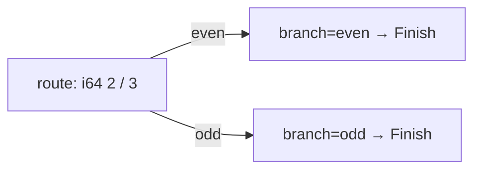
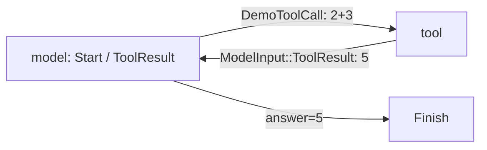
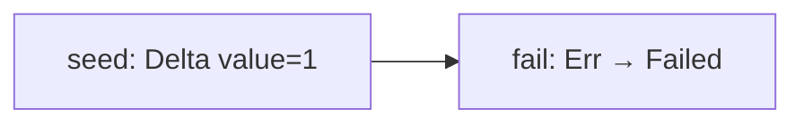
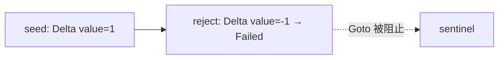
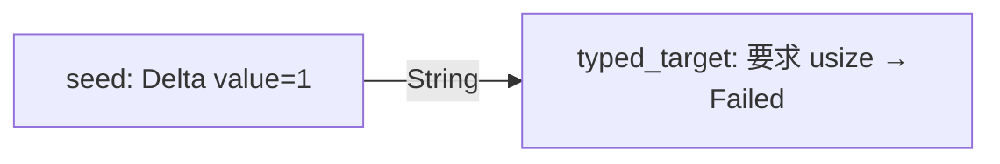

# CLI 测试图

启用 `omniops-bots-test` 后，`cluster-demo` 在 CLI 内用 Rust 装配节点，调用 core 的真实 `Cluster`、`Run` 和 `Scheduler`。每次执行使用新的内存 State，节点通过 `Outcome` 的 `control` 字段返回 Goto/Finish；箭头表示节点返回的 Goto 路径，不是静态边 API。

所有案例使用确定性节点，不读取 Provider 配置，不需要 API key、模型服务、工具服务或数据库。`react-loop` 的 model/tool 是普通演示节点，不产生真实 Generation 或模型用量。默认构建不提供此命令。

## 七个可运行案例

从 workspace 根运行：

```sh
cargo run -p omniops-bots-cli --features omniops-bots-test -- cluster-demo chain
cargo run -p omniops-bots-cli --features omniops-bots-test -- cluster-demo branch-even
cargo run -p omniops-bots-cli --features omniops-bots-test -- cluster-demo branch-odd
cargo run -p omniops-bots-cli --features omniops-bots-test -- cluster-demo react-loop
cargo run -p omniops-bots-cli --features omniops-bots-test -- cluster-demo node-error
cargo run -p omniops-bots-cli --features omniops-bots-test -- cluster-demo delta-error
cargo run -p omniops-bots-cli --features omniops-bots-test -- cluster-demo input-error
```

正常 I/O 下，每条命令 stdout 恰好一行摘要，由实际 Run/State 读取；stderr 留给安全错误诊断和遥测。失败案例也真实返回失败，退出码是 1；未知/缺失场景退出 2，帮助和版本退出 0。摘要输出失败同样退出 1，不重新执行图。

| 场景 | stdout（末尾均有换行） | 退出码 | stderr 错误分类 |
| --- | --- | --- | --- |
| chain | `status=completed length=5 output=len=5` | 0 | — |
| branch-even | `status=completed branch=even` | 0 | — |
| branch-odd | `status=completed branch=odd` | 0 | — |
| react-loop | `status=completed model_calls=2 tool_calls=1 answer=5` | 0 | — |
| node-error | `status=failed node=fail value=1` | 1 | `NodeExecution` |
| delta-error | `status=failed node=reject value=1` | 1 | `StateDeltaRejected` |
| input-error | `status=failed node=typed_target value=1` | 1 | `InputTypeMismatch` |

## 六张图

异构链：count 的 Delta 先提交，render 才能同时读到 Input 5 和 State.length 5；Finish 前写入最终 output。



互斥分支：两个目标都注册，route 根据输入 2 或 3 选择一个 Goto。



模型—工具循环：每次实际调用用 Delta 更新计数，第二次 model 同时看到工具结果与先前的 State 更新。



节点失败：保留 seed 已提交的 value=1，完整 Error 由 Scheduler 返回，Run 记录 fail 位置。



Delta 失败：reject 返回非法 Delta 和 Goto，State 拒绝增量，sentinel 不执行。



Input 类型失败：seed 的增量已提交；框架在调用 typed_target 的 body 前拒绝 String。



## 观测与验证

复用 CLI 已有 Collector 初始化和 3 秒总预算关闭流程：Run span/开始/完成为 INFO，步骤 span/开始/完成为 DEBUG，失败为 WARN，正常丢弃的活跃 future 以 DEBUG 记录本地取消。步骤包含查找、输入适配、执行与 Delta 结算；取消不会增加业务阶段或恢复能力。

字段仅包含固定事件、阶段、路由类别、安全 NodeId 和错误分类；NodeId 编码控制字符并限制最终 256 UTF-8 字节。State、Input、Payload、Delta、错误正文与 source 链不进入诊断或遥测。Scheduler 指标后续再定。没有遥测配置时仅本地 stderr；导出失败或遥测背压不改变业务摘要、顺序或退出码。

```sh
SQLX_OFFLINE=true cargo test -p omniops-bots-cli --test cluster_demo --features omniops-bots-test --locked
SQLX_OFFLINE=true cargo test -p omniops-bots-cli --test cluster_demo --no-default-features --locked
```

进程测试核对七个案例的精确摘要、分类和退出码，并检查 feature 门控、参数、重跑的确定性、遥测健康度与关闭的摘要输出。core 的测试覆盖没有初始化观测时的驱动、Delta 原子性、类型错误不进入 body 和取消语义。
