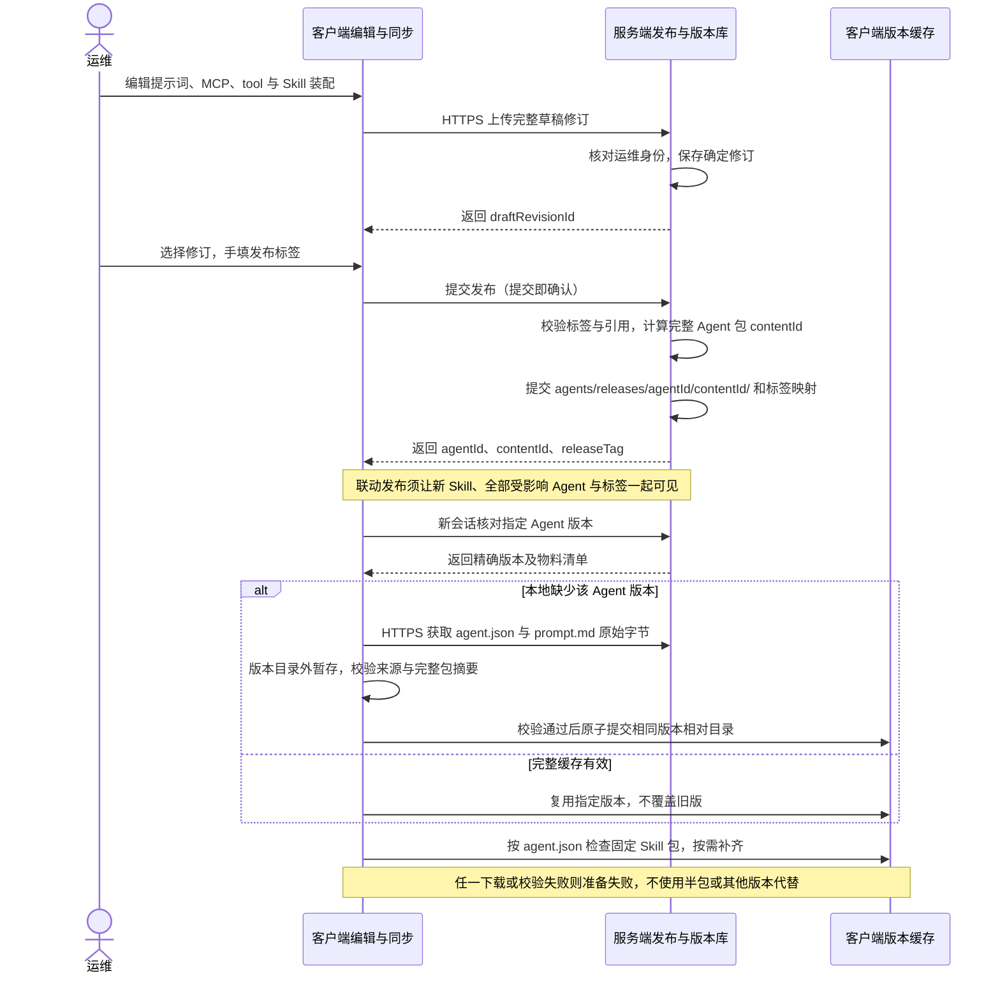
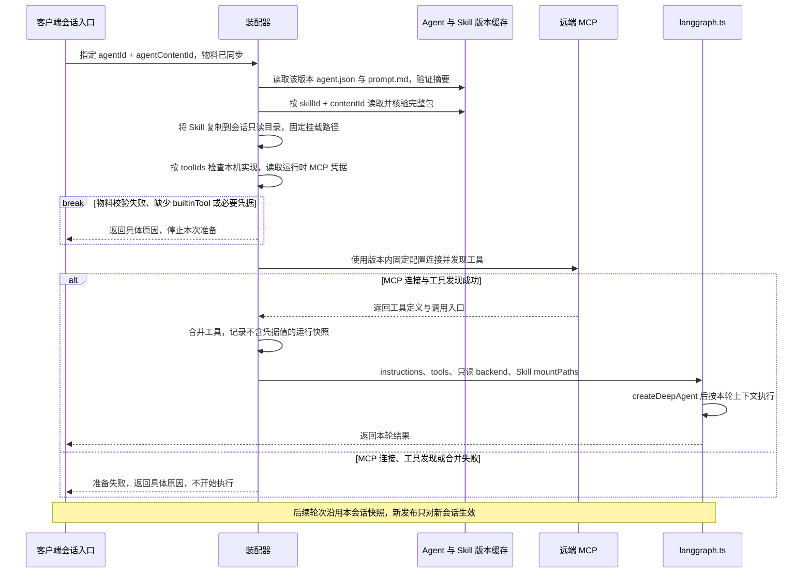

# Agent 版本文件布局：客户端与服务端统一约定

客户端与服务端使用同一套 Agent 正式版本目录和文件内容。每个版本由一份系统提示词和一份装配清单组成，固定 MCP 连接配置、builtinTool 选择与 Skill 内容版本引用。服务端保存已发布历史，客户端按需下载；运行时再将这些引用解析为实际能力。

**这是官方发布与同步的目标格式，尚未接入当前 runtime。** 当前本地 Agent 仍保存在 `agents/<agentId>.json`，会话固定快照已实现；两者与本文正式版本的关系见文末。

## 同一版本在两端怎样存放

```text
<数据根目录>/agents/
└── releases/
    └── chrome-operator/              # 稳定的 agentId
        ├── tags.json                 # 人工标签 → Agent contentId
        ├── <contentId-A>/            # 一个不可变的完整 Agent 版本
        │   ├── agent.json            # Skill、tool、MCP 装配清单
        │   └── prompt.md             # 本版本系统提示词的完整正文
        └── <contentId-B>/            # 修改后发布的新版本
            ├── agent.json
            └── prompt.md
```

| 对象 | 服务端 | 客户端 |
| --- | --- | --- |
| 数据根目录 | 部署配置目录，例如 `/srv/omniops-data` | 默认 `~/.omnimind-ops`；可配置其他根目录 |
| 正式 Agent 版本 | `<服务端根>/agents/releases/<agentId>/<contentId>/` | `<客户端根>/agents/releases/<agentId>/<contentId>/` |
| 版本内容 | `agent.json`、`prompt.md` | 同一相对路径、完全相同的文件字节 |
| 标签索引 | `agents/releases/<agentId>/tags.json` | 同一相对路径，缓存服务端确认的映射 |
| 引用的 Skill 包 | `skills/releases/<skillId>/<skillContentId>/` | 同一相对路径，按需下载并独立校验 |

`contentId` 是实际 64 位小写十六进制 SHA-256 摘要，示例中的 A、B 是占位符。`agentId` 是稳定资源身份，历史讨论中的“生成新 Agent ID”指生成新的装配内容 ID；API 版本路由使用 `agentId + contentId`，远端调用使用 `agentId + agentContentId`，其中 `agentContentId` 就是该版本的 `contentId`。

客户端不下载全部历史，但已经下载的完整版本保留，不覆盖、不自动清理。标签清单可以包含尚未缓存的版本；选择或调用某个版本时再补齐它及所需 Skill。运行目录另存于 `runs/`，不会写回正式版本。

## 提示词和装配清单怎样保存

`prompt.md` 保存完整 UTF-8 系统提示词正文，没有额外 YAML 头或第二份 `instructions`。文件内容直接成为 Agent 指令；运行引擎所需的通用工具约束仍随桌面端实现交付。换行、空格和正文原样保存，不在下载或装配时改写。

`agent.json` 保存以下内容，示例中的摘要须替换为真实内容 ID：

```json
{
  "schemaVersion": 1,
  "name": "Chrome 运维助手",
  "description": "使用指定 Skill 与工具执行浏览器运维任务。",
  "promptFile": "prompt.md",
  "toolIds": ["inspect_browser", "read_playwright_script"],
  "mcpServers": [
    {
      "id": "ops-api",
      "name": "运维服务",
      "description": "服务端提供的运维能力。",
      "url": "https://ops.example.invalid/mcp",
      "credentialEnv": "OMNIOPS_MCP_TOKEN"
    }
  ],
  "skills": [
    {
      "skillId": "chrome-ops",
      "contentId": "<skillContentId>",
      "mountPath": "/skills/chrome-ops/"
    }
  ]
}
```

| 内容 | 保存位置与约束 | 运行时处理 |
| --- | --- | --- |
| 系统提示词 | `prompt.md`；`agent.json.promptFile` 在本期固定为 `prompt.md` | 读取正文，写入会话固定配置的 `instructions`，传给 `langgraph.ts` |
| MCP 配置 | `agent.json.mcpServers` 保存本版本完整的非敏感配置，包含服务 ID、名称、描述、URL 和可选凭据环境变量名 | 按固定 URL 使用现有 Streamable HTTP 接入；从运行环境取得凭据，连接并发现工具 |
| builtinTool | `agent.json.toolIds` 保存确定的工具 ID 列表 | 从本次桌面版本查找实现，缺失则失败并提示更新 |
| Skill 引用 | `agent.json.skills` 保存 `skillId + contentId + mountPath`；正式版本只引用官方确定包 | 从独立 Skill 版本目录取完整包，复制到会话快照并挂载到指定虚拟路径 |
| 名称与描述 | `agent.json.name`、`description`，作为这个版本的内容保存 | 展示版本信息，随版本固定 |

同一个清单中的 MCP ID、tool ID 和 Skill 身份不能重复；Skill 挂载路径必须位于 `/skills/` 下且彼此不冲突。正式 Agent 不保存可变的本地 `skillIds`、未发布草稿路径或 `latest` 引用。Skill 人工标签通过外部版本清单展示，不能代替内容 ID；同一个 Skill 包可被多个 Agent 版本引用，无须在每个 Agent 目录再复制一份。

**MCP 配置跟随 Agent 固定，MCP 服务实现不纳入本项目版本控制。** 官方清单不能只保存 `mcpServerIds` 并在运行时套用可变的全局配置，否则历史 Agent 会悄悄换连接目标。本地 MCP 配置目录后续编辑不改变已发布 Agent；调整其 URL、凭据引用或其他清单字段时须发布新的 Agent 版本。服务端提供的 MCP 使用相同规则。

MCP 密钥和 Token 的实际值不写入任何发布文件、内容摘要或运行快照；`credentialEnv` 只保存环境变量名。URL 中也不携带凭据。凭据轮换不生成 Agent 版本；实时发现的 MCP 工具定义、服务实现和行为不随 Agent 发布冻结，实际发现的能力另记运行快照。builtinTool 同样只固定选择，不把工具代码放进 Agent 目录或另发工具版本。

## 内容 ID 与标签怎样生成

正式 Agent 以 `agent.json` 和 `prompt.md` 这两个文件组成的完整包计算 `contentId`，使用与 [Skill 包摘要](./skill-version-layout.md)相同的文件清单算法：

1. 校验清单结构、提示词及固定引用；本期正式包只允许这两个文件，不包含子目录、发布元数据或执行产物。
2. 对每个文件记录 POSIX 相对路径、`kind: "file"`、原始字节数和 SHA-256；按路径的 UTF-16 代码单元顺序排列条目。
3. 对条目对象的键递归按同一顺序排序，再按与 `JSON.stringify` 一致的紧凑 JSON 编码，无末尾换行；计算 UTF-8 字节的 SHA-256。
4. 服务端发布时计算，客户端下载后对原始文件独立重算。`agent.json` 的排版与 `prompt.md` 的换行也是文件字节，改动后摘要会改变；两端不能各自重新序列化或格式化再落盘。

因此，提示词、Skill 内容 ID、挂载路径、所选 tool 和非敏感 MCP 配置都受同一个版本摘要约束。名称、描述及 schema 字段也属于包内容。Agent 自身的 `agentId`、`contentId`、发布标签、发布时间和上传者放在版本目录之外的发布记录中；不把 `contentId` 写进自己的被摘要文件。绝对存储路径、模型与推理参数、桌面版本、凭据值以及运行时发现的 MCP 工具目录均不参与正式包摘要。

`tags.json` 的格式与 Skill 一致：

```json
{
  "v.1.0.0": "<contentId-A>",
  "v.1.0.1": "<contentId-B>"
}
```

标签由运维手填，正式发布后不能重用或改指向；新标签也不复制相同内容的版本包。仅改提示词或配置时可单独发布 Agent。Skill 正式发布时，服务端修改受影响 Agent 清单中的确定 Skill 内容 ID，保留其他文件与装配内容，生成新的 Agent 内容 ID，并与运维填写的新标签一起完成联动发布。草稿保存不联动，按周发布已确认的资产改进，不增加审核环节。

## 草稿、私有 Agent 与运行快照

| 对象 | 位置与规则 |
| --- | --- |
| 服务端官方草稿修订 | `agents/drafts/<agentId>/revisions/<draftRevisionId>/`，保存该次完整 `agent.json` 与 `prompt.md`；修订保存后不改写，不产生正式标签 |
| 客户端已下载草稿修订 | 相同相对目录及文件字节，按需缓存；只有服务端判定的运维人员可读取维护用草稿 |
| 客户端官方草稿工作副本 | `agents/drafts/<agentId>/working/`，可编辑；上传时固定这次完整内容，不因继续编辑而改变已提交修订 |
| 客户端私有 Agent | 保持当前 `agents/<localAgentId>.json` 单文件，可自由编辑、不设正式标签、不要求服务端镜像保存 |
| 会话运行快照 | `runs/<sha256(threadId)>/assembly.json` 与 `skills/<mountName>/`，固定实际配置和完整 Skill 副本；日志、截图及结果另存 |

两端一致的是同一正式版本或同一已保存草稿修订。客户端未同步编辑、私有 Agent 与运行记录承担各自职责；它们不需要占用服务端正式版本目录。草稿可用于临时实验，正式发布则必须解析为可取得的官方 Skill 版本，或同次联动发布的新包。

## 运行模型一：发布并同步完整 Agent 版本



标签和发布元信息不混入版本包；暂存和传输容器也放在版本目录外。服务端公布版本前，完整 Agent 包及其引用的 Skill 必须可取得。收到已存在标签的不同指向或同一内容 ID 下不一致的文件时，客户端拒绝本次同步并保留原缓存。

## 运行模型二：从版本文件装配到 langgraph.ts



`langgraph.ts` 接收装配完成的运行对象，不扫描 `agents/releases` 或 `skills/releases` 来猜测版本。`prompt.md` 转为 `snapshot.agent.configuration.instructions`；Skill 引用解析为固定 `snapshot.skills` 和会话只读文件；`toolIds` 与 `mcpServers` 解析为实际工具。模型参数和桌面版本记录实际运行条件，不倒写到发布文件。

## 当前实现与接入边界

当前 [`assembly.ts`](../desktop/runtime/assembly.ts) 读取 `agents/<agentId>.json`，其中 `configuration` 含 `name`、`description`、`instructions`、`toolIds`、`skillIds`、`mcpServerIds`。该记录的内容 ID 只对当前配置计算；首次会话另将实际 Skill 摘要与完整 MCP 配置纳入 `assemblyContentId`。**这两个现有摘要都不能直接当作本文正式 Agent 包的内容 ID。** 当前 MCP 可编辑目录为 `config/mcp.json`，正式版本接入后必须从版本内清单取得 MCP 配置。

后续接入需实现两端正式包读写与摘要校验、草稿修订、发布和下载，再将已校验的发布文件转换为现有装配器需要的固定配置；不能继续让官方版本走可变全局 MCP ID 解析。现有私有 Agent 保存和会话快照无需增加正式标签。对应 API 见 [10 · 服务端 API](./requirements-walkthrough/10-服务端API.md)，当前运行链路见 [Skill 存储与运行加载](./skill-storage-and-loading.md)。本文只明确存储和加载契约，不实现上述接入。
