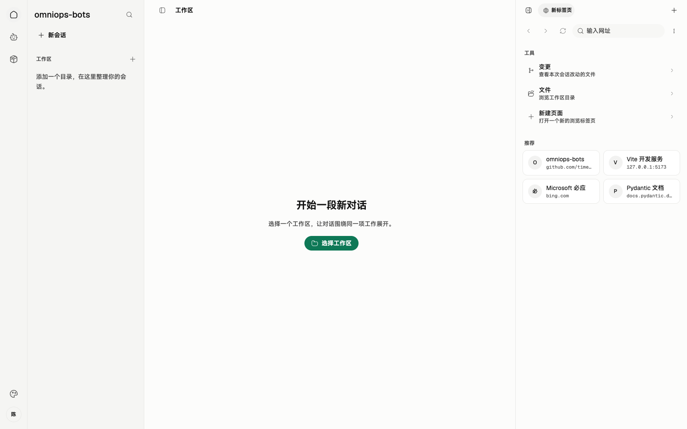

# 00 总体架构

串讲重点：**服务端编排流程、管理官方物料；客户端编辑实验、装配执行。** 本组文档描述已确认的 MVP 目标，不表示能力已经实现。

## US

### 现有页面与缺口

*实拍现有 Web 演示界面；资源与执行数据来自演示适配器。*

沿用导航与工作台结构。待补：现有账号身份与运维权限、服务端连接和重连状态。

1. 作为运维人员，我希望在客户端编辑、实验并发布 Skill 和 Agent，让团队使用确定的版本。
2. 作为普通用户，我希望同步并使用官方能力，也能自由编辑自己的本地资源。
3. 作为流程编排方，我希望把客户端 Agent 当作工具调用，由它在 Chrome 完成实际操作。
4. 作为用户，我希望知道运行了什么、结果是什么，并在断线后仍能交付已有结果。

## 简要设计

现有内部 LangGraph 服务继续管理流程上下文，将客户端 Agent 调用封装成工具。桌面端连接服务，在客户端管理的专用 Chrome 中执行运维操作。Tauri 承担桌面包装，本次不引入其他 Rust 业务模块作为前置条件。

| 边界 | 承载内容 |
| --- | --- |
| HTTPS | 草稿上传、正式发布、版本清单、物料下载 |
| WebSocket | 调用、取消、任务状态、最终结果、快照与接收确认 |
| 客户端本地 | 未同步编辑、已下载历史版本、会话快照和执行记录 |

官方 Agent、Skill 由服务端管理；本地资源自由编辑，服务端不调用本地 Agent。

## 服务端

- 复用已有账号与 Token，识别并校验运维权限；普通用户不能写入官方资源。
- 保存官方草稿修订和不可变发布版本，提供清单与文件包。
- Skill 正式发布时联动生成受影响 Agent 的新版本，标签全部由运维人员手填，不增加审核。
- 编排调用、传入上下文、按调用 ID 取消，接收结果并确认；忙时如何再调度由服务端决定。

## 客户端

- 提供本地编辑、草稿实验和运维上传入口；官方已发布配置只读。
- 新会话同步清单，按需下载缺失物料；调用前核对版本，失败不拿旧版代替。
- 运行前固定装配快照，检查所需内置工具；同一 Chrome 每轮只执行一个任务，忙时直接返回。
- 展示过程、保存结果并补传；只向服务端发送状态、最终结果和运行快照。

## 详细设计

[打开可交互架构图](./diagrams/00-overview.html)

按图串讲一次远端调用：服务端发起 → 客户端核对版本、补齐物料 → 固定快照并执行 → 本地保存结果 → 回传并等待确认。每次调用新建独立会话，服务端传入上下文；客户端任务会话只读，但可按任务要求操作 Chrome。

断线期间执行继续，重连只补传、不重跑。进程重启后未完成任务报告“执行中断、结果未知”。服务端高可用、业务输入输出协议与内部调度不在本次范围。

串讲验收围绕“编辑发布 → 同步装配 → 调用执行 → 结果恢复”四条完整业务流程，观察结果而非展开内部实现。[规格依据：Issue #3](https://github.com/time-gift24/omniops-bots/issues/3)。
