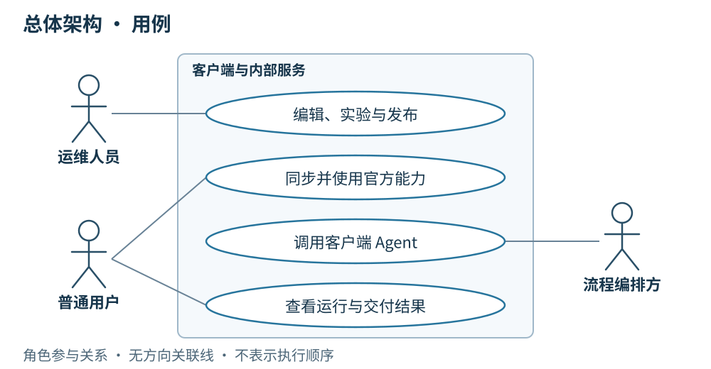

# 00 客户端总体设计

**我们要构建一个让运维人员快速迭代物料、验证效果并执行任务的桌面客户端。** 运维人员在客户端修改 Skill、补充文件、调整 Agent 提示词与装配，选一个 Agent 就能在本地实验；看到结果后继续修改，自己确认可用，再上传并发布确定版本，让团队使用这次改进。

**日常工作主线是：发现问题 → 在客户端编辑 → 本地实验与修正 → 运维本人确认 → 上传发布版本 → 新会话使用并反馈。** 客户端承载这段完整工作过程；服务端配合保存草稿修订和正式版本、校验运维身份并分发物料。未上传的编辑也能实验，上传保存草稿与正式发布是两个动作，发布提交即表示运维本人已经确认。

用户也可直接选择 Agent 执行运维任务，由 Agent 通过 **Playwright 操作随客户端交付的内置 Chrome** 完成。这里的“内置 Chrome”实际采用 CEF／Chromium 内核，页面直接展示在客户端工作台中。

**我们的核心资产是受版本控制、可持续演进的 Agent 提示词与 Skill。** 提示词沉淀任务目标、操作边界和结果要求，Skill 完整文件包沉淀可复用的运维方法、操作步骤和参考资料。团队按周将实际任务中的反馈转化为改进，经本地编辑、按需实验后发布新的确定版本，逐步提高 Agent 的任务完成能力。

客户端支持用户主动发起会话，也能连接已有内部服务，接收远端 Agent 调用并回传结果。本设计围绕客户端的界面、资源管理、运行与恢复展开；各章最后列出服务端需要配合提供的能力。

## US

### 界面设计

*macOS 桌面包实拍：Playwright 已在右侧内置 CEF 页面填入 `abcd`，未提交搜索。使用本地测试模型与测试页面；工具调用和浏览器操作真实执行。*

客户端由左侧导航、中央内容区和右侧工作台组成。导航组织会话、Agent 与 Skill；中央区域承载编辑和对话；工作台展示浏览器与执行过程。账号区域展示用户身份与运维权限，连接状态区分已连接、重连中和离线。

1. 作为运维人员，我希望发现任务中的不足后，直接在客户端修改 Skill 文件或 Agent 提示词，选 Agent 试跑、查看结果并继续调整；自己确认后上传发布，让团队使用确定版本。
2. 作为普通用户，我希望同步并使用官方能力，也能自由编辑自己的本地资源。
3. 作为用户，我希望客户端能接收服务端任务，由 Playwright 在内置 Chrome 完成操作，并在同一个工作台查看真实页面、执行过程与结果。
4. 作为用户，我希望知道运行了什么、结果是什么，并在断线后仍能交付已有结果。
5. 作为用户，我希望客户端出问题后能上传指定 thread 的诊断材料，并取得服务端确认接收的编号。

## 简要设计

客户端把资源管理和任务执行放在同一个工作空间中：用户编辑、实验和选择 Agent，客户端准备所需物料，在专用 Chrome 中执行，并保存可查看、可补传的结果。Tauri 承担桌面包装，本次不引入其他 Rust 业务模块作为前置条件。

### 运维人员的一次物料改进

例如，运维人员发现一次巡检遗漏了新的页面检查项，就在客户端打开对应 Skill 的官方草稿工作副本，补充操作步骤和参考文件，再勾选现有 Agent 作为模板实验。实验直接使用当前完整内容，在内置 Chrome 中执行；运维人员对照过程与结果继续修改，原 Agent 和已发布 Skill 保持不变。

| 工作步骤 | 运维在客户端做什么 | 得到什么 |
| --- | --- | --- |
| 就地编辑 | 修改 `SKILL.md`、上传或替换包内文件，按需调整 Agent 提示词与装配 | 可继续编辑的本地内容或官方草稿，无须每改一个文件就上传服务端 |
| 快速实验 | 在 Skill 页面勾选 Agent，发起独立实验；结合结果继续改、再试 | 每次实验固定完整快照，过程与产物可查看；未上传的内容也能试跑 |
| 本人确认 | 运维确认这次内容可用于正式任务，选择本次发布范围并手填标签 | 明确要上传发布的完整内容；不增加审核人或强制实验通过门槛 |
| 上传发布 | 上传确定的完整草稿修订并提交正式发布；已上传且未变化的修订可直接使用 | 服务端校验权限与标签，保存不可变版本；Skill 与受影响 Agent 的新标签一次联动发布 |
| 使用与反馈 | 新会话同步并装配所选版本，从实际任务中发现下一次改进 | 团队复用已确认的运维方法，旧会话沿用原快照，历史版本保留 |

周内可以反复编辑与实验，也可以按需上传保存草稿；**只有运维明确提交正式发布，改进才成为可供团队同步使用的官方版本。** 团队按周汇总已确认的改进发布，上传本身不增加审批环节。客户端负责把迭代做得便捷，服务端负责把已确认版本保存完整、分发准确。

| 客户端能力 | 主要行为 | 服务端需配合 |
| --- | --- | --- |
| 资源管理 | 快速修改 Skill 文件与 Agent 提示词、装配，反复本地实验，运维确认后上传发布 | 校验身份权限，保存完整草稿修订与不可变发布版本，分发已确认物料 |
| 同步装配 | 核对版本、按需下载、保留历史包、固定运行快照 | 通过 HTTPS 提供版本清单与物料 |
| 浏览器执行底座 | 随包提供 Playwright 与内置 Chrome，按会话绑定独立页面并保留专用登录态 | 通过任务协议调用客户端；浏览器与网站登录态保留在本机 |
| 任务执行 | 接收手动输入或远端调用，经 builtinTool 和 Playwright 在内置 Chrome 中执行 | 通过 WebSocket 发送调用、上下文与取消请求 |
| 结果交付 | 展示过程，本地保存状态、结果与快照，断线后补传 | 接收状态、最终结果与快照，确认收到 |
| 桌面更新 | 检查、下载、验签，在空闲时由用户确认安装 | 提供更新清单和已签名整包下载 |
| 运维诊断 | 将指定 thread 的 SQLite checkpoint、运行快照与记录导出，经预览后上传 | 校验并持久保存诊断包，返回回执，提供只读排查入口 |

客户端保留未同步编辑、已下载历史版本、会话快照与执行记录。本地资源可自由编辑；官方已发布资源同步后只读，服务端只调用官方 Agent。

### Playwright 与内置 Chrome

**执行链路：用户或服务端任务 → 客户端 LangGraph Agent → 所选 builtinTool → Playwright → 本地 CDP → 内置 Chrome 页面。** 模型负责决定步骤，Playwright 负责页面检查和操作，内置浏览器承载真实网站与登录态；右侧工作台展示的就是被操作的页面。

| 组成 | 职责 |
| --- | --- |
| Tauri 业务界面 | 管理 Agent、Skill、会话与执行记录；与网站浏览器视图分开 |
| 本地 Node.js／LangGraph runtime | 装配固定快照、调用模型与所选工具，按会话管理并发运行、停止和超时 |
| Playwright | 通过宿主提供的本地 CDP 地址和精确页面 ID 连接浏览器，执行页面检查与脚本；页面匹配失败时结束本次操作 |
| 内置 Chrome（CEF／Chromium） | 原生宿主管理并嵌入工作台的真实浏览器，使用应用专用 profile 保存 Cookie 与登录态 |

Node.js、Playwright 和 CEF 随桌面整包交付，用户无需另行安装 Chrome 或自动化运行环境。业务界面仍使用 Tauri 的系统 WebView；网站页面使用内置 CEF 浏览器，不把业务 UI 当作运维目标页面。浏览器版本与工具实现由桌面版本确定，更新规则见第 05 章。

页面检查、脚本保存与执行都在本机完成。脚本执行时保存源码快照并核对调用方指定的内容摘要，结果、截图等产物关联执行记录；脚本沿用该轮绑定的页面。任务从准备到停止排空期间只占用所属页面，不锁住其他会话页面；工作台可切换查看不同会话或手动页面，切换不会改变已启动任务的目标。用户对运行中页面的手动导航和输入等待该会话本轮结束，其他空闲页面仍可操作。遇到人工登录或验证，本轮结束；用户在同一浏览器完成操作后显式发起新一轮。停止不回滚已发生的外部操作，也不自动续跑。

**打包客户端已具备内置浏览器截图保存能力。** `run_playwright_script` 在脚本结束时尝试截取同一个 CEF 页面的当前视口，将 `screenshot.png` 保存到该会话的脚本执行产物目录；普通脚本报错也会尝试保存。取消／超时导致进程强制结束或浏览器崩溃时，截图可能缺失。当前会话展示工具结果，截图文件留在本地产物中，尚未直接作为聊天图片显示。

专用 profile 与用户日常浏览器隔离，网站 Cookie、登录态及本地 CDP 地址不作为服务端任务材料上传。故障时按第 09 章导出指定 thread 的脱敏证据，不上传整个浏览器 profile。

当前本地链路的代码依据：[浏览器连接](../../desktop/runtime/browser/browser.mjs)、[页面匹配](../../desktop/runtime/browser/browser-target.mjs)、[脚本执行](../../desktop/runtime/browser/script-workspace.mjs)、[macOS 原生视图](../../crates/omniops-bots-desktop/src/native_browser.rs)与 [Windows 原生视图](../../crates/omniops-bots-desktop/src/native_browser_windows.rs)。服务端远端调用仍为待接入能力，接口汇总见[服务端 API](./10-服务端API.md)。

### 核心资产如何积累与演进

| 对象 | 沉淀内容 | 版本与演进方式 |
| --- | --- | --- |
| Agent 提示词 | 角色、目标、操作边界、决策要求与输出要求 | 作为 Agent 装配的一部分保存；正式修改生成新的 Agent 内容 ID 和人工发布标签，不另建一套提示词发布体系 |
| Skill 完整包 | `SKILL.md`、操作说明、引用资料、脚本及随包资源 | 完整包生成内容 ID；已发布包不可变，新版本保留旧包，Agent 明确引用所需版本 |
| Agent 装配清单 | 提示词、固定 Skill 版本、builtinTool 选择和 MCP 配置 | 将核心资产组合为可运行的 Agent；装配变化生成新 ID，并手填 `v.1.0.0` 形式的标签 |
| 运行快照与执行记录 | 本次使用的装配、运行条件、过程与结果 | 为问题定位和下一轮改进提供依据；快照不建立发布版本，实验产物不混入 Skill 包 |

客户端提供核心资产的编辑、实验与使用入口；服务端统一保存官方草稿修订和不可变发布历史。提示词只改目标或行为要求时，可以复用原有 Skill 版本；Skill 正式发布时，一并更新受影响 Agent 的引用与内容 ID，并由运维手填各自的新标签。保存草稿不触发联动发布。

MCP 提供远端执行能力，配置随 Agent 同步；MCP 服务本身不进入本项目版本体系。builtinTool 提供桌面执行能力，实现随桌面应用更新。每周改进提示词和 Skill 不要求同时发布桌面端；只有确需新的内置能力时才安排桌面更新。

### 按周迭代发布

| 阶段 | 运维在客户端完成的工作 | 形成的结果 |
| --- | --- | --- |
| 周内迭代 | 结合实际任务结果定位不足，修改 Agent 提示词或 Skill 草稿，按需选 Agent 实验 | 可继续修改的草稿、独立保存的实验记录；未完成内容留在草稿中 |
| 每周发布 | 选择本周本人已确认的改进，上传确定的完整修订，手填本次 Skill 与受影响 Agent 的新标签，提交正式发布 | 一次确定的资产更新；只改提示词则发布 Agent，Skill 改动则联动发布受影响 Agent；无变化的物料继续复用 |
| 发布后使用与反馈 | 新会话核对并装配所选新版，观察执行结果，把新问题纳入下一周 | 旧会话保持原快照，发布历史可追溯，改进持续积累 |

按周发布是团队的迭代节奏，不增加审核人、审批流或强制实验门槛；运维提交即表示本人已确认。标签始终人工输入，周次和日期不替代发布标签，也不自动覆盖历史版本。没有已确认变更时不创建空版本。

客户端与外部服务的结构关系

[打开结构关系图](./diagrams/00-overview.html)

## 客户端

- 展示登录身份、运维权限和连接状态，复用已有 Token 连接服务端；WebSocket 断线后退避重连。
- 提供 Skill 文件编辑与上传、Agent 提示词及装配调整、选 Agent 实验的连贯入口；未上传内容也能反复实验，官方已发布配置只读。
- 围绕提示词和 Skill 的每周改进保存草稿、实验记录及发布引用，展示本次 Agent 实际装配；发布过程不增加审批。
- 新会话同步清单，按需下载缺失物料；调用前核对版本，失败不拿旧版代替。
- 运行前固定装配快照，检查所需内置工具；Playwright 按会话绑定内置 Chrome 的指定页面，不同会话可并发；同会话已有运行、其页面正在手动导航或并发容量已满时返回忙。
- 展示过程、保存结果并补传；正常任务交付只向服务端发送状态、最终结果和运行快照。
- 用户需要排查时，另行选择一个 thread，通过 HTTPS 上传脱敏后的 SQLite checkpoint、过程与关联材料。服务端确认接收后展示诊断编号，具体见[运维与诊断上传](./09-运维与诊断上传.md)。

## 详细设计

以下运行模型按消息发生顺序描述客户端行为；各图是独立场景。准备失败、忙或执行中断的路径分别见同步与执行章节。

### 场景一：运维快速迭代，确认后上传发布

前提：运维从实际任务反馈中发现一项 Skill 改进需求，在客户端编辑工作副本。图中展示选择 Agent 做本地实验、本人确认后手填标签并上传发布的过程；实验结果不满足预期时，继续在本地修改并发起新实验，直到运维决定发布。实验按需进行，不是发布审批门槛。

[打开顺序图：运维迭代与确认发布](./diagrams/runtime/00-weekly-evolution.html)

图中的“按需保存完整草稿修订”只保存编辑进度，不发布、不联动 Agent；这一步也可以在本地实验之后进行。正式发布前固定本次完整修订，服务端以该修订生成版本，之后继续编辑不会改变已提交内容。只改提示词时发布新的 Agent 并复用原 Skill；Skill 改动则与受影响 Agent 一起发布，所有新标签由运维手填。

结果：一次本地改进成为团队可复用、可追溯的正式资产，新会话使用所选新版，旧会话保持原快照。周内反复迭代，按周发布已确认内容，执行反馈继续推动下一次改进。图示为目标业务流程；当前草稿实验与本地完整会话快照已实现，官方发布同步仍待接入，完成情况见第 08 章。

### 场景二：用户主动发起会话

前提：用户选择官方 Agent，准备检查成功，本会话没有活动轮次且并发容量可用。本地 Agent 使用本地装配；引用官方 Skill 时仍需补齐对应版本。

[打开顺序图：用户主动发起会话](./diagrams/runtime/00-manual.html)

结果：客户端保存并展示本轮结果，等待用户继续输入时释放运行容量；同一会话保留页面并继续使用开始时的快照，其他会话可以并发执行。

### 场景三：客户端接收远端调用

前提：客户端收到对官方 Agent 的调用，指定版本准备成功且并发容量可用；新会话绑定独立页面。

[打开顺序图：远端独立任务与结果确认](./diagrams/runtime/00-remote.html)

结果：每次调用新建独立、只读会话，逐条过程在客户端展示。结果与快照先落本地，再向服务端回传，确认前保留。断线继续执行，重连只补传；重启后未完成任务报告“执行中断、结果未知”。

验收从客户端操作或远端调用进入，覆盖“编辑发布 → 同步装配 → 调用执行 → 结果恢复”的完整结果。[规格依据：Issue #3](https://github.com/time-gift24/omniops-bots/issues/3)。

## 服务端配合

为支持上述客户端能力，已有内部服务需要提供：

- **身份与权限**：复用已有账号与 Token，返回用户身份与运维权限，并校验官方资源写入；普通用户不能写入官方资源。
- **草稿、发布与同步**：接收运维在客户端确认后提交的完整内容；按需保存草稿修订，正式发布时保存不可变版本并提供 HTTPS 清单与文件包。Skill 正式发布联动受影响 Agent，所有标签由运维人员手填，提交即确认，不增加审核。
- **资产持续演进**：保留每周发布涉及的提示词、Skill 和 Agent 装配关系，让客户端能够查看新旧版本及本次改进；不为周发布新增定时自动发版、MCP 发布或独立提示词版本系统。
- **调用与结果确认**：LangGraph 将客户端 Agent 作为工具调用，通过 WebSocket 传入上下文、按调用 ID 取消，接收状态、结果、快照并确认；客户端返回忙时由服务端安排后续调用。
- **桌面更新来源**：提供更新清单和已签名整包下载，供客户端检查、下载与校验。
- **诊断接收**：接收用户指定 thread 的诊断包，校验并持久保存后返回回执，支持运维按编号只读查看；不会因此恢复或重新执行任务。

服务端高可用和内部编排实现另行定义；客户端依赖的 HTTPS API、WebSocket 消息和接收确认契约统一见 [10 · 服务端 API](./10-服务端API.md)。
