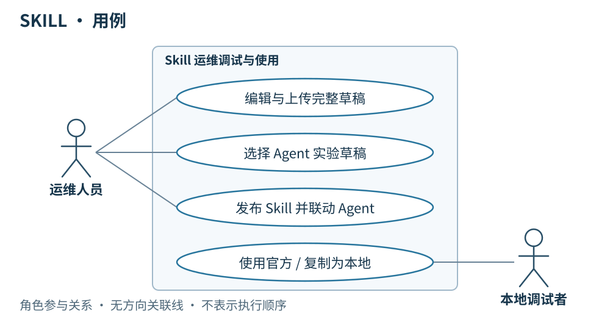
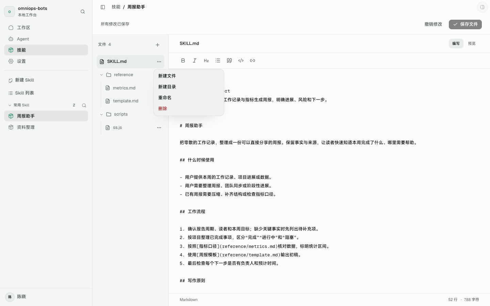
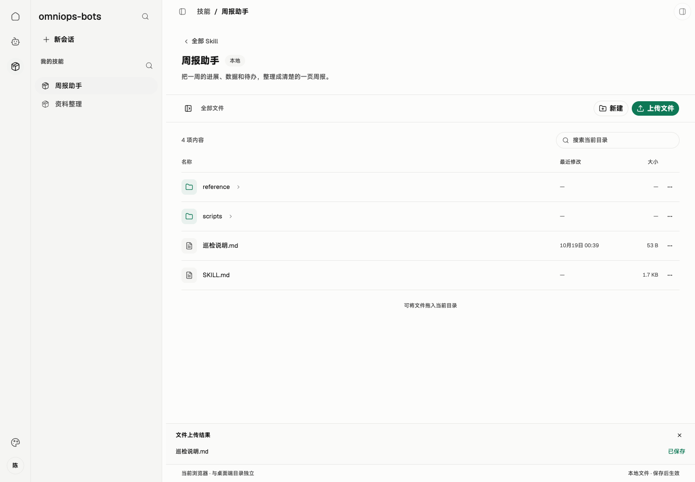
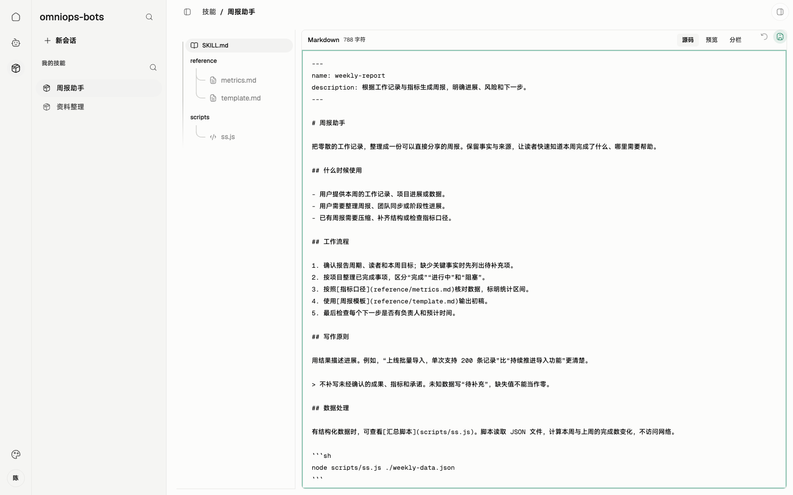
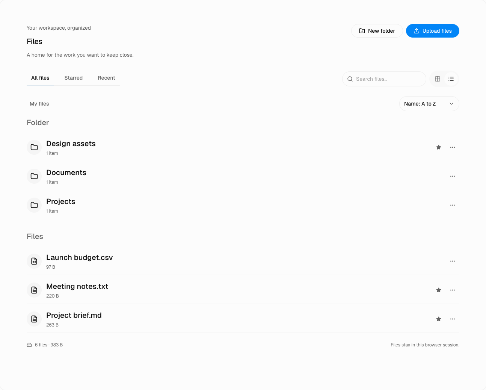

# 01 · SKILL

> 串讲重点：客户端提供 Skill 列表与包内文件管理，支持文件级上传、编辑和实验；运维人员上传完整草稿、发布完整文件包，服务端配合保存和分发。

## US

### 界面设计

*本次实现的 Web 界面实拍，图中使用演示数据。浏览器预览保存到 IndexedDB，桌面客户端保存到当前用户的 `.omnimind-ops/skills`。*

Skill 页面分为两层：列表管理 Skill，进入一个 Skill 后管理包内目录与文件。资源标明本地或官方来源，版本记录以完整文件包为单位。用户上传、查看和编辑具体文件，在页面选择 Agent 发起草稿实验；运维人员可上传草稿，并手填 Skill 与受影响 Agent 的标签完成联动发布。

1. 作为运维人员，我在客户端编辑草稿并按需上传，让服务端集中保存修订。
2. 作为运维人员，我在 Skill 页面勾选一个 Agent，即可实验尚未上传的草稿。
3. 作为运维人员，我手填 Skill 和受影响 Agent 的新标签，一次完成正式发布。
4. 作为用户，我使用官方已发布 Skill；需要修改时复制成本地 Skill，保留官方原件。
5. 作为用户，我能在列表中找到、新建或复制 Skill，进入后向指定目录上传文件，并看到每个文件的保存结果。

## 简要设计

客户端围绕“编辑 → 实验 → 上传或发布”组织 Skill 操作。用户可以自由编辑、保存本地 Skill，不设发布标签；在页面勾选现有 Agent，就能运行尚未上传的草稿。实验前固定完整快照，日志、截图等实验产物另存。

客户端按**整个文件包**保存和装配 Skill，包括说明、脚本、引用资料和随包资源。官方发布包只读，普通用户可同步、查看和使用；运维人员可上传草稿修订、发布新版本。服务端配合集中保存这些官方物料，客户端保留未同步编辑、下载缓存和已下载的历史版本。

### 页面方案：Skill 列表 → 包内文件管理

已安装 [`@beui-pro/file-manager-workspace`](https://pro.beui.dev/components/file-manager)，接入 Skill 列表与包内文件管理。目录导航、搜索、文件列表、预览和上传交互使用客户端的暖灰底色、绿色强调、细边框及 Geist / MiSans 字体。

*本次实现的 Web 界面实拍：可浏览目录、搜索文件、上传、新建、重命名和删除；官方已发布包只读。*

已完成列表管理、文件级上传、文本编辑及真实内容持久化。下表保留完整页面目标，其中官方草稿维护、历史版本切换、选 Agent 实验、服务端草稿上传与联动发布尚未接入。当前页面不提供这些操作的假成功入口。

| 页面区域 | 内容与操作 |
| --- | --- |
| Skill 列表 | 标题「Skill」；按名称搜索；全部、本地、官方筛选；默认列表，每行显示名称、简述、来源，以及本地已保存 / 未同步编辑 / 草稿修订 / 正式标签等对应状态。点击进入该 Skill。 |
| 列表主操作 | 「新建 Skill」创建本地 Skill；官方资源提供「复制为本地」。运维人员可进入官方草稿维护，普通用户没有官方写入入口。 |
| 包内文件管理 | 面包屑显示「Skill / 名称 / 当前目录」；目录导航和文件列表显示名称、类型、大小及操作结果。选中文件后阅读或编辑，保留源码、预览、分栏三种阅读方式。 |
| 可编辑内容 | 「上传文件」支持选择或拖入多个文件，加入当前目录；「新建文件」「新建文件夹」及重命名、删除作用于当前本地内容或官方草稿。上传说明、脚本、图片及附件均保留实际文件内容和相对路径；不支持预览的文件仍可保存。 |
| 官方发布版本 | 展示人工标签和版本轨迹；目录与文件只读，可查看、复制为本地或由运维人员转入草稿维护。切换版本不覆盖本地已下载历史包。 |
| 草稿操作区 | 「选择 Agent 实验」固定当前完整快照；运维人员另有「上传草稿」「发布」。文件尚在写入或有未处理失败时，不把它们当作已保存内容进入实验、上传或发布。 |

列表没有 Skill 时显示「新建 Skill」；搜索无结果时允许清除筛选。文件区为空时显示当前目录及上传入口。加载和失败状态留在对应列表或目录中，不把失败伪装成空内容。窄窗口收起目录导航，保留面包屑、文件名、状态和上传入口；操作可通过键盘完成，保存与失败结果用文字说明。

组件自带的收藏、最近访问和演示存储统计不进入本期 MVP。已替换组件原版的临时上传存储：浏览器使用 IndexedDB；桌面通过现有 JavaScript runtime 写入真实 Skill 文件目录，重启后可读取。

*浏览器实测上传 Markdown 文件、修改后保存，刷新页面仍能读取。桌面文件系统另由 runtime 测试验证；此图不是桌面运行截图。*

目录与版本规则、当前运行加载路径及后续完整快照装配见[客户端 Skill 文件管理、版本与运行加载](../skill-storage-and-loading.md)。本地包放在 `skills/local/<localId>`；官方版本放在 `skills/releases/<skillId>/<contentId>`，人工标签通过 `tags.json` 映射到内容 ID。正式发布和同步校验仍由后续服务端接入完成。

### 文件上传与版本的边界

服务端和客户端按相同的 `skills/releases/<skillId>/<contentId>/` 存放正式完整包，`SKILL.md` 直接位于版本目录内；`skills/releases/<skillId>/tags.json` 保存人工标签到内容 ID 的映射，位于各版本包之外。服务端保留正式历史，客户端只下载所需版本并保留已有缓存。草稿修订使用独立的 `drafts/<skillId>/revisions/<draftRevisionId>/`，未同步工作副本另放 `working/`。两端目录对照和运行顺序见 [Skill 版本文件布局](../skill-version-layout.md)。

| 动作 | 写入位置与结果 | 权限 |
| --- | --- | --- |
| 上传文件 / 编辑 / 重命名 / 删除 | 改变当前可编辑 Skill 的本地内容；尚未同步的修改保留在本机，不生成发布标签 | 本地资源可自由修改；官方草稿维护仅运维人员 |
| 上传草稿 | 把当前完整文件包保存为服务端草稿修订；不联动 Agent | 服务端确认的运维人员 |
| 正式发布 | 固定完整包快照，提交 Skill 与受影响 Agent 的手填新标签，完成联动发布 | 服务端确认的运维人员 |

文件级上传不产生独立文件版本，也不直接改写已发布包。同名文件先展示目标路径，由用户选择替换或跳过，不静默改名；目录失效则停止对应写入，不把文件改放到根目录。批量上传分别显示成功和失败，失败项可重试，原文件与其他已成功项保留。重命名、删除前展示目标路径并提醒可能影响包内引用，不自动改写其他文件的内容。

早期编辑界面与组件参考

早期单文件编辑器截图。当前包内编辑继续提供源码、预览和分栏模式；完整草稿实验与发布尚未接入。

*上游组件参考，来源：pro.beui.dev/components/file-manager；英文内容为组件示例。*

## 客户端

- 提供 Skill 列表、新建本地 Skill、官方复制本地，以及包内文件和目录管理；官方发布版本保持只读。
- 文件级上传保存真实文件内容、相对路径与当前草稿变更，支持文本和二进制资源；不把浏览器临时地址当作已持久化文件。
- 提供编辑、保存、实验、上传草稿与发布入口；清楚区分本地已保存、未同步编辑、服务端草稿修订与正式发布标签。
- 实验只需在页面选择现有 Agent，临时装配当前草稿，运行前固定完整快照，在本地实验会话中展示过程与结果。
- 未上传草稿也可实验，不修改模板 Agent，不要求发布标签或实验通过证明。
- 新会话按 Agent 清单下载缺失包；保留已下载旧版本，不自动覆盖或清理。已有会话继续使用初始快照。

## 详细设计

### 运行模型一：向当前 Skill 上传文件

**条件：** 用户从 Skill 列表进入本地 Skill，或运维人员进入官方草稿，选择目标目录后上传文件。该操作先写入本机，符合客户端保留未同步编辑的约定。

[打开交互顺序图：Skill 文件级上传](./diagrams/runtime/01-skill-file-upload.html)

**结果：** 客户端在实际写入完成后更新文件列表及保存状态，重启后可读取。官方草稿显示未同步编辑；用户按需选择实验，运维人员按需上传完整草稿或正式发布。普通用户的本地文件操作不触发服务端写入。

### 运行模型二：同名替换失败，保留原文件

**条件：** 上传文件与目标目录中的文件同名。客户端先询问替换或跳过；本图展示选择替换但本地写入失败的情况。

[打开交互顺序图：同名冲突与写入失败](./diagrams/runtime/01-skill-file-conflict.html)

**结果：** 原文件保持可读，失败项展示原因，不能标为已保存。用户重试时仍以明确的目标路径写入；选择跳过则不写入该项。批次中其他已成功文件不撤销。新建、编辑、重命名和删除失败也保留可恢复的原内容与当前未保存编辑，不生成新的完整包版本。

### 运行模型三：在客户端实验草稿

**条件：** 用户在 Skill 页面勾选现有 Agent 作为模板；草稿可以尚未上传。客户端准备好其他物料、完成工具检查，并在并发容量可用时绑定实验会话自己的页面后开始实验。

[打开交互顺序图：Skill 草稿实验](./diagrams/runtime/01-skill-experiment.html)

**结果：** 实验使用运行前固定的完整装配快照，过程与结果展示在本地实验会话。原 Agent 和已发布 Skill 不变，不要求发布标签；日志、截图等产物另存，不混入 Skill 文件包。

### 运行模型四：上传草稿修订

**条件：** 运维人员选择上传当前完整 Skill 文件包。客户端先固定已保存草稿的完整快照，再使用现有登录与 Token 上传，权限由服务端判断；上传开始后的继续编辑不改变本次快照。

[打开交互顺序图：Skill 草稿上传](./diagrams/runtime/01-skill-draft-upload.html)

**结果：** 成功后客户端显示服务端保存的草稿修订。此时不发布 Skill，也不联动 Agent；权限不符或上传失败时展示原因，本地草稿仍保留。对于官方 Skill，普通用户只同步、查看和使用已发布版本；本地 Skill 仍可自由管理。

### 运行模型五：正式联动发布

**条件：** 运维人员决定发布完整 Skill 快照，并手填 Skill 与所有受影响官方 Agent 的新标签，统一使用 `v.1.0.0` 形式。提交表示已经确认，不设置审核或强制实验门槛。

[打开交互顺序图：Skill 与 Agent 联动发布](./diagrams/runtime/01-skill-publish.html)

**结果：** 服务端一次完成 Skill 发布、受影响 Agent 装配更新、新 Agent ID 生成及手填标签保存；客户端显示本次发布结果。权限或标签校验失败则显示原因，不显示发布成功。已发布内容不可变，标签不能改指向、覆盖或重用。

本地 Agent 可直接装配官方已发布 Skill。需要修改官方内容时，复制成本地 Skill；维护官方内容则编辑草稿并发布新版。两条路径都不改写历史发布包，也不自动清理旧版本。

## 服务端配合

为支持客户端的草稿保存、发布与同步，服务端需要配合：

- 基于现有登录与 Token 返回用户身份和运维权限，并校验草稿上传、创建版本、正式发布请求。
- 接收包含目录、相对路径及真实文件内容的完整草稿修订与不可变发布包，提供版本清单和 HTTPS 下载。文件级编辑发生在客户端，不新增文件级发布或服务端审批流程。
- 正式版本、草稿修订与客户端使用相同的相对目录和包内结构；发布时按客户端一致的算法生成内容 ID，标签与系统发布元信息保存在包外，不通过传输改变文件字节。
- 向客户端提供正式发布所影响的官方 Agent；按新 Skill 版本更新装配、生成新 Agent ID。
- 接收客户端提交的 Skill 标签及各受影响 Agent 的手填新标签，一次完成联动发布。保存草稿不联动 Agent。
