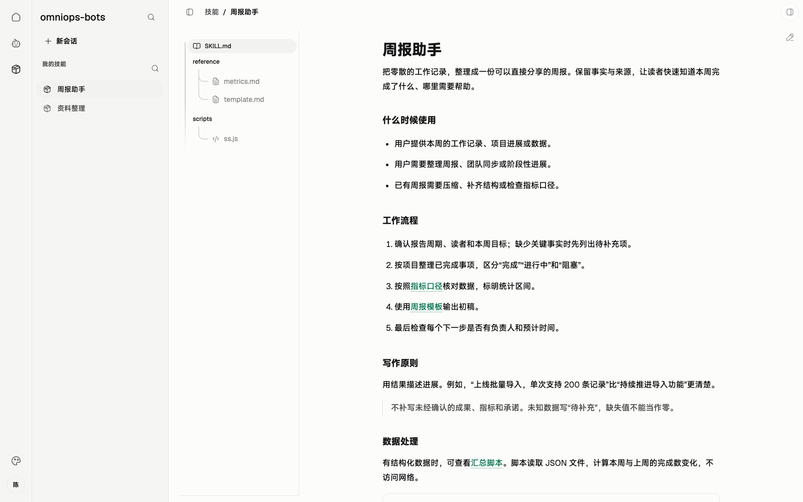

# 01 · SKILL

> 串讲重点：Skill 是完整文件包；实验先固定快照，正式发布再联动 Agent。

## US

### 现有页面与缺口

*实拍现有 Web 演示界面；资源与执行数据来自演示适配器。*

沿用文件阅读和草稿编辑。待补：官方/本地、完整包版本、选择 Agent 实验、上传草稿与联动发布；当前保存草稿仍是本地单文件保存。

1. 作为运维人员，我在客户端编辑草稿并按需上传，让服务端集中保存修订。
2. 作为运维人员，我在 Skill 页面勾选一个 Agent，即可实验尚未上传的草稿。
3. 作为运维人员，我手填 Skill 和受影响 Agent 的新标签，一次完成正式发布。
4. 作为用户，我使用官方已发布 Skill；需要修改时复制成本地 Skill，保留官方原件。

## 简要设计

Skill 的版本单位是**整个文件包**，包括说明、脚本、引用资料和随包资源。实验、发布都对应确定的完整快照，日志、截图等实验产物另存。

本地 Skill 可自由编辑，不设发布标签。官方 Skill 的草稿修订、正式版本由服务端保存；客户端保留未同步编辑和下载缓存。普通用户只同步、查看、使用官方已发布版本，仍可编辑自己的本地 Skill。

## 服务端

- 复用现有登录与 Token，判定运维权限；草稿上传、创建版本、正式发布均由服务端校验。
- 保存完整草稿修订与不可变发布包，提供版本清单和 HTTPS 下载。
- 正式发布时列出受影响的官方 Agent，按新 Skill 版本生成新装配、新 Agent ID。
- 接收运维人员手填的 Skill 标签及各受影响 Agent 的新标签，一次完成联动发布。保存草稿不联动 Agent。

## 客户端

- 提供编辑、保存、实验、上传与发布入口；官方发布版本保持只读。
- 实验只需在页面选择现有 Agent，临时装配当前草稿，运行前固定完整快照，复用本地会话界面。
- 未上传草稿也可实验，不修改模板 Agent，不要求发布标签或实验通过证明。
- 新会话按 Agent 清单下载缺失包；保留已下载旧版本，不自动覆盖或清理。已有会话继续使用初始快照。

## 详细设计

查看现有草稿编辑器

当前支持编辑、预览和本地保存；完整包修订、服务端上传与发布仍需补齐。

[打开交互图：Skill 生命周期](./diagrams/01-skill.html)

**沿图讲三条路径：**

1. **编辑 → 实验**：本地编辑形成完整实验快照，选择 Agent 后运行；实验产物留在执行记录中，不混入 Skill 包。
2. **编辑 → 上传草稿**：运维人员按需上传，服务端保存修订；此时不产生 Agent 联动发布。
3. **草稿 → 正式发布**：手填 `v.1.0.0` 形式的新标签，并补齐受影响 Agent 的新标签；发布后内容不可变，标签不能改指向、覆盖或重用。

本地 Agent 可以直接装配官方已发布 Skill。修改官方内容走“复制成本地 Skill”；维护官方内容走“编辑草稿并发布新版”。两条路径都不改写历史发布包。MVP 不增加审核、强制实验门槛、自动标签或历史清理。
