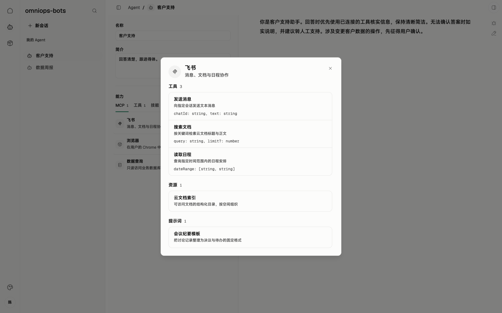
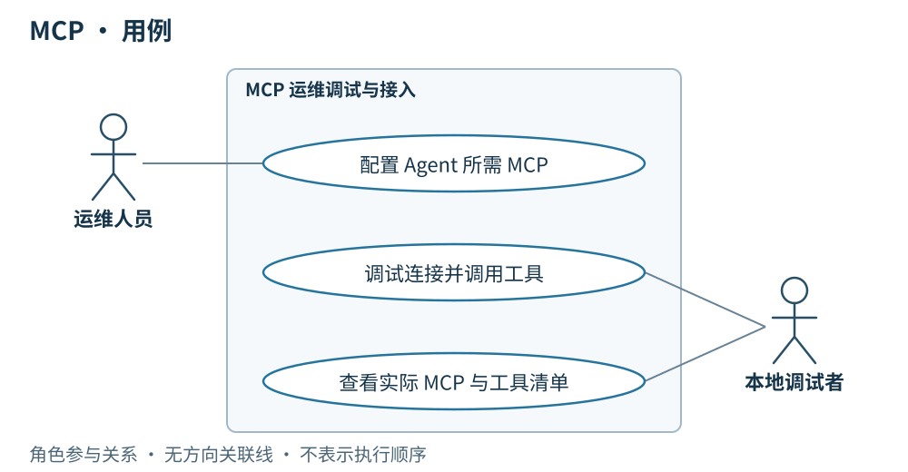

# 02 · MCP

> 串讲重点：线上用户在服务端 Console 操作，服务端 Agent 以任务调用客户端；客户端后台按 Agent 配置连接远端 MCP、调用工具并回传结果，完整配置和调用过程留在运维调试工作台。

## US

### 运维调试界面设计

*客户端运维调试工作台实拍，图中使用演示数据；线上客户端仅提供连接状态等基础信息。*

MCP 位于客户端调试工作台的 Agent 能力配置区，支持选择服务、查看工具/资源/提示词清单，以及展示连接配置或引用、连接状态和失败原因。官方 Agent 的配置只读；配置随 Agent 同步，MCP 服务本身不纳入发布版本。

1. 作为运维人员，我为官方 Agent 配好所需 MCP，供客户端随官方 Agent 后台同步并装配。
2. 作为线上用户，我在服务端 Console 发起业务，由服务端 Agent 下发任务，客户端后台连接远端 MCP，包括内部服务提供的 MCP，执行所需操作。
3. 作为线上用户，我在 Console 查看任务结果和失败信息；运维调试时可在客户端查看当次启用的 MCP、工具清单和调用过程，追溯实际能力。

## 简要设计

运维调试时，在客户端的 Agent 能力区选择 MCP、查看能力清单；线上任务由服务端 Agent 从 Console 业务流程中发起，客户端在后台运行 Agent 时，按装配配置连接对应的远端 MCP 并调用工具。MCP 可以来自内部服务，也可以来自其他已配置的远端地址。

官方 Agent 所需的 MCP 连接配置或引用随 Agent 一并同步，客户端保持只读；本地 Agent 使用自己的配置。配置选择参与 Agent 内容 ID，更改官方装配需要形成新的 Agent 版本。**外部 MCP 服务实现本身不进入本项目的版本与发布体系**，不固定其工具行为或发布周期。

## 客户端

- 随官方 Agent 同步所需 MCP 连接配置，按当次装配建立远端连接并使用工具。
- 官方 Agent 的 MCP 配置保持只读；本地 Agent 按自身配置使用 MCP。
- 后台保存工具调用过程，向服务端回传任务结果与失败信息，供线上用户在 Console 查看；完整过程在客户端运维调试会话中展示，运行快照记录启用的 MCP 与工具清单。
- 密钥和 Token 不进入运行快照；配置的同步不意味着将凭据写入可观测记录。

## 详细设计

### 运行模型一：连接成功并调用 MCP

**条件：** 客户端已固定本轮使用的 Agent 装配；官方 MCP 配置或引用随 Agent 同步，本地 Agent 使用自己的配置。所需远端 MCP 可用。

[打开交互顺序图：MCP 连接与调用](./diagrams/runtime/02-mcp-call.html)

**结果：** 客户端取得能力清单后在后台执行所需工具调用并记录过程，将工具结果纳入回传服务端的任务结果，供 Console 展示；运维调试工作台可查看完整过程。运行快照记录启用的 MCP 与工具清单，不包含密钥和 Token。图中的 Agent 物料是当次装配，不表示每次工具调用都重新同步。

### 运行模型二：所需 MCP 连接失败

**条件：** 本轮所需 MCP 无法连接或鉴权失败。线上调用方是服务端 Agent；本地手动调用只用于运维调试。

[打开交互顺序图：MCP 连接失败](./diagrams/runtime/02-mcp-failure.html)

**结果：** 客户端不进入该 MCP 的工具调用，记录失败原因并按任务结果回传规则通知服务端，由 Console 呈现；运维调试工作台可查看失败详情。连接成功后若实际工具调用失败，同样记录该调用错误并纳入本轮失败结果，不把失败伪装为成功。

MCP 可以由内部服务或其他远端服务提供。服务端作为配置来源、MCP 作为工具服务，是两个职责，部署在同一处也不合并其含义。MVP 不增加 MCP 发布标签、服务实现下载、独立升级器或监控平台；具体鉴权方式和传输参数随实际接入确定。

## 服务端配合

为支持客户端获取配置、连接 MCP，服务端需要配合：

- 将官方 Agent 所需 MCP 配置或引用纳入 Agent 物料，提供同步。
- 校验官方配置写入者的运维权限，向普通用户提供已发布配置。
- 若由内部服务提供 MCP，提供可供客户端连接的接入点；其内部实现和发布流程不在本规格范围内。

线上用户在服务端 Console 操作；服务端 Agent 经 LangGraph 编排，以独立任务调用客户端 Agent。客户端后台承担实际执行及 MCP 调用，回传结果。MCP 的来源不改变这一边界。
