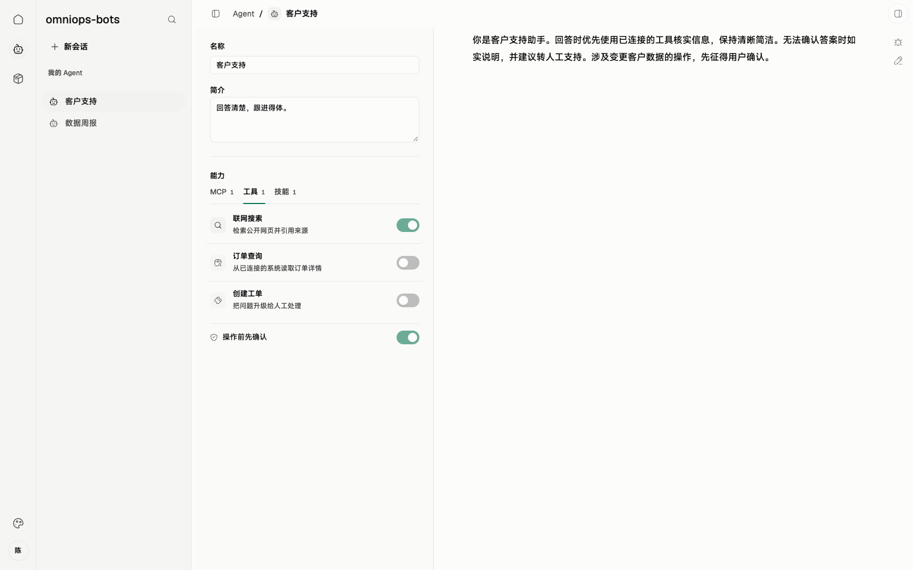
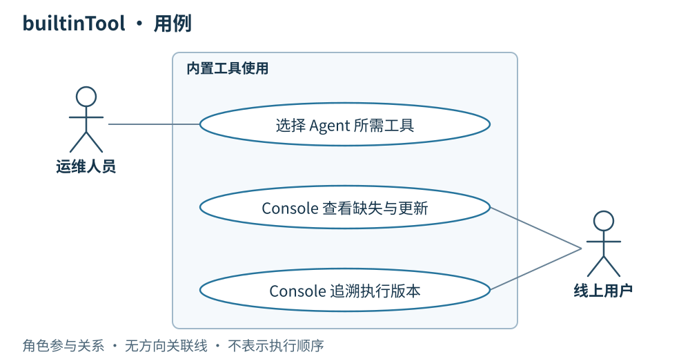

# 03 · builtinTool

> 串讲重点：内置工具随桌面端交付；Agent 选择要用的工具，运行前检查是否具备。

## US

### 现有页面与缺口

*实拍现有 Web 演示界面；资源与执行数据来自演示适配器。*

沿用工具选择。待补：运行前的缺失工具提示和桌面更新入口。截图中的“操作前先确认”属于旧演示，不是本期新增的审核要求。

1. 作为运维人员，我为 Agent 选择所需内置工具，让装配明确表达执行需要。
2. 作为用户，我运行 Agent 前获知缺少的工具，按提示更新桌面端。
3. 作为用户，我查看当次工具清单和桌面端版本，追溯实际执行环境。

## 简要设计

builtinTool 的实现随桌面应用版本交付，不建立独立工具包发布与同步系统。Agent 装配记录选定的工具，所选 builtinTool 是 Agent 内容 ID 的组成部分。

**Agent 版本固定工具选择；桌面端版本说明实际实现。** 同一个 Agent 在不同桌面版本上运行时，运行快照保留实际桌面端版本和工具清单，满足追溯需要，不另造一套工具发布标签。

## 服务端

- 保存官方 Agent 所需的 builtinTool 清单，随 Agent 物料同步。
- 通过已有 Agent 发布流程管理工具选择；官方装配改变后生成新的 Agent ID，并由运维人员手填发布标签。
- 接收客户端因缺少所需工具而返回的失败结果，由既有流程决定后续处理。
- 不向客户端单独分发 builtinTool 实现，不将工具更新混入 Skill 文件包同步。

## 客户端

- 根据已安装桌面版本提供可用内置工具，执行前检查 Agent 所需工具是否齐全。
- 缺少任一所需工具时直接失败，明确提示缺失原因及更新桌面端；不带着不完整装配开始执行。
- 工具齐全后按 Agent 装配执行，并在客户端展示工具调用过程。
- 运行快照记录启用的工具清单和桌面端版本；调用状态、错误与起止时间仍放入执行记录。

## 详细设计

[打开交互图：内置工具可用性检查](./diagrams/03-builtintool.html)

**沿图讲一次运行前检查：** 读取 Agent 所需工具清单，对照客户端实际可用工具；齐全则继续运行，缺失则结束本次任务并提示更新桌面端。完成更新后由用户或服务端重新发起调用，不自动重跑失败任务。

Skill 缺失与 builtinTool 缺失采取不同处理：Skill 仍按物料同步规则下载所需完整文件包；builtinTool 通过桌面应用更新获得。二者最终都服务于同一份 Agent 装配，但交付渠道各自明确。

本章只确认工具可用性检查与交付职责。桌面版本检查、下载和安装见 [05 · 桌面端更新](./05-桌面端更新.md)；MVP 不增加内置工具独立安装、热更新或单独版本仓库。
