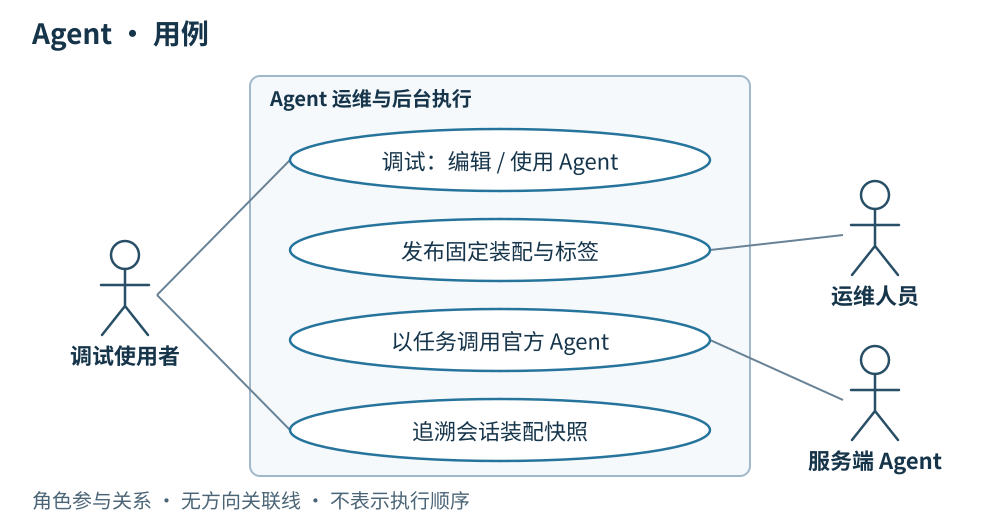

# 04 · Agent：装配、发布与会话

> 串讲重点：客户端将确定的提示词、Skill 完整包、builtinTool 与远端 MCP 组装成一次可运行的 Agent；核心资产按版本演进，每周发布已确认的改进。

## US

### 界面设计

*界面实拍，图中使用演示数据。*

Agent 页面包含名称、描述、系统提示词及 MCP、builtinTool、Skill 装配配置。资源标明本地或官方来源，展示内容 ID、发布标签与固定的 Skill 版本。官方发布配置只读；用户可发起会话并查看该会话的运行快照。

1. 作为用户，我能自由编辑本地 Agent，也能选择官方 Agent 发起自己的会话。
2. 作为运维人员，我能发布固定装配的官方 Agent，用手填标签标识发布版本。
3. 作为用户，我能在客户端查看服务端发起的独立任务会话、执行过程和结果。
4. 作为使用者，我能追溯实际装配和运行条件，已有会话不受新发布影响。

## 简要设计

客户端提供本地 Agent 编辑和官方 Agent 使用两条路径。本地 Agent 可以随时编辑、保存，不设发布标签，服务端不会调用它。用户同步官方 Agent 后，可以查看只读配置并主动发起会话；运维人员在客户端维护官方草稿并发布新版本，由服务端配合保存和分发。

客户端开始会话时固定 Agent 与 Skill 快照，并按装配执行。用户主动发起的会话允许正常输入；接到服务端调用时，客户端使用传入的上下文新建独立会话，该会话仅供本地查看过程和结果。

Agent 的内容 ID 根据系统提示词、固定 Skill 版本、所选 builtinTool 和 MCP 装配配置生成。正式发布时手填 `v.1.0.0` 形式的标签，已发布内容和标签指向不可变。Provider、模型和推理参数属于运行条件，不参与内容 ID；Provider 的非敏感接入身份、实际模型与参数记录于运行快照。

### 装配清单里保存什么

| 组成 | 清单保存的内容 | 运行时装配成什么 | 版本边界 |
| --- | --- | --- | --- |
| Agent 提示词 | 系统提示词的确定正文：角色、任务目标、边界与输出要求 | 本次 Agent 的系统指令 | 提示词修改参与 Agent 新内容 ID；随 Agent 发布，不单独维护提示词标签 |
| Skill | 官方 Skill 的身份、完整包内容 ID 和挂载路径；展示标签从外部版本清单取得，本地 Agent 也可引用本地包 | 会话目录下完整、只读的 Skill 快照，包括入口与包内引用文件 | 正式 Agent 固定官方 Skill 内容 ID；本地可编辑包在运行前固定快照，不使用浮动“最新版”代替 |
| builtinTool | 所选内置工具 ID | 当前桌面版本中对应的可调用工具实现 | 工具选择参与 Agent 内容 ID；实现随桌面版本，缺失时提示更新，不通过 Skill 同步安装 |
| MCP | 所选远端服务的完整非敏感连接配置、凭据引用 | 远端连接与该服务返回的工具定义、调用入口 | 非敏感装配配置参与 Agent 内容 ID；MCP 服务本身没有本项目发布标签，也不保证外部实现历史冻结 |
| 运行条件 | 当前会话实际选用的 Provider 非敏感接入身份、模型、推理参数与桌面版本 | 模型实例和运行环境 | 记录在运行快照，不因 Provider、模型或参数变化发布新的 Agent |

配置保存的是“本次需要哪些能力”，运行装配则将它们解析为实际文件和可调用工具。MVP 保持 MCP 服务级选择：连接选中的服务并取得工具清单，不新增逐工具授权管理界面。密钥、Token 从运行时凭据来源取得，其值不进入发布指纹或快照。

按 [11 · Provider](./11-Provider.md) 的目标设计，客户端本地维护全局默认 Provider 与模型，新会话开始前允许改选，开始后固定；后续轮次不跟随默认项变化。所选接入不可用时明确失败，不自动更换地址或模型。Provider Key 从系统凭据库读取，其值不进入 Agent 包、运行快照或诊断材料；管理界面和系统凭据存储仍待实现，当前桌面为环境变量／`model.env` 单模型接入。

### 两端一致的 Agent 版本文件

服务端与客户端均采用 `agents/releases/<agentId>/<contentId>/`：`agentId` 是稳定资源身份，`contentId` 是确定装配的版本摘要。每个版本只包含 `prompt.md` 和 `agent.json`；人工标签保存在上一级 `tags.json`，不进入版本包。正式调用携带的 `agentContentId` 就是这里的 `contentId`。

| 文件 | 保存内容 |
| --- | --- |
| `prompt.md` | 该版本完整系统提示词正文 |
| `agent.json` | 名称与描述、`promptFile`、builtin `toolIds`、完整非敏感 `mcpServers`、固定的 `skills[{skillId, contentId, mountPath}]` |
| `../tags.json` | 运维手填的 `v.1.0.0` 等标签到 Agent 内容 ID 的不可变映射 |

Skill 完整文件包独立保存于 `skills/releases/<skillId>/<contentId>/`，由 Agent 引用并在运行前复制到会话快照。MCP 凭据只保存引用，不能仅存可变全局 MCP ID；tool 只保存选择，具体实现随桌面版本交付。Agent 内容摘要覆盖两个文件的原始字节，使用与 Skill 相同的文件清单摘要规则。

上述正式多版本布局待接入；当前本地 Agent 仍存于 `agents/<agentId>.json`，现有配置摘要和运行快照摘要不等同于新正式包摘要。完整目录、JSON 示例、草稿修订、发布同步与运行装配顺序图见 [Agent 版本文件布局](../agent-version-layout.md)。

### 与每周资产发布的关系

Agent 提示词和 Skill 是持续改进的核心资产。只修改提示词时，发布新的 Agent，原 Skill 包继续复用；修改 Skill 时，正式发布完整新包，并一次更新所有受影响官方 Agent 的引用、内容 ID 和人工新标签。周内编辑与保存草稿不联动，按周选择已确认的改进发布；详见[总体设计中的周迭代](./00-总体架构.md)。

以下描述完整装配流程。当前本地实现已支持 Agent 配置持久化、完整 Skill 包捕获与只读挂载、会话固定快照、builtinTool 白名单和真实 MCP 连接；`graphs/browser-agent.ts` 负责图装配，浏览器工具经 Playwright 操作内置 Chrome。官方版本发布、远端下载同步与 WebSocket 调用仍待接入。实际入口见[Skill 存储与运行加载](../skill-storage-and-loading.md)，服务端契约汇总见 [10 · 服务端 API](./10-服务端API.md)。

Agent 装配与运行快照的关系

[打开装配关系图](./diagrams/04-agent.html)

## 客户端

- 提供本地 Agent 编辑；允许直接引用官方已发布 Skill，修改官方 Skill 时先复制成本地副本。
- 官方配置保持只读，但用户主动发起的会话可以正常输入。服务端发起的会话只展示执行过程和结果，不接受本地追加指令。
- 远端每次调用创建独立会话；手动会话固定开始时的 Agent、Skill 快照，新版只对新会话生效。
- Skill 实验页面勾选现有 Agent 作为模板，临时替换为草稿装配，不修改原 Agent，也不产生发布标签。
- 将 MCP 配置解析为远端连接及工具，将 builtinTool ID 解析为本机实现，将 Skill 引用解析为完整包快照；装配成功后才构造 Agent 并开始执行。
- 发现物料缺失、工具缺失或 MCP 接入失败时，显示具体失败项并停止本次准备；不静默删除能力后继续运行。

## 详细设计

### 运行模型一：完整装配后开始执行

**条件：** 用户选定 Agent 发起新会话，或服务端传入确定的官方 Agent 版本与上下文。图中展示官方 Agent 缺少部分 Skill 包、同步和各项检查均成功的情况；缓存已齐全则跳过下载。本地 Agent 读取当前已保存配置，并在本次准备中固定其内容。

[打开运行模型：Agent 完整装配](./diagrams/runtime/04-assembly-ready.html)

装配按下面的顺序完成。表中的步骤是客户端职责，不要求拆成独立服务：

| 步骤 | 客户端动作 | 得到的确定结果 |
| --- | --- | --- |
| 1. 读取 Agent | 确定 Agent 配置与提示词；官方调用核对指定内容 ID，取得关联物料清单 | 提示词、Skill 引用、builtinTool 选择和 MCP 配置属于同一个 Agent 装配 |
| 2. 准备 Skill | 按内容 ID 检查 `.omnimind-ops/skills/releases`；缺失包走 HTTPS 下载并校验。官方指定包与本地包的当前内容均完整复制到会话快照目录 | 每个 Skill 都有本次固定目录，保留内部相对路径；历史发布包和其他会话不变 |
| 3. 解析 builtinTool | 在当前桌面提供的工具集合中逐个查找所选 ID，绑定其输入定义和调用实现 | 本次允许模型使用的内置工具集合；缺失任一项就停止 |
| 4. 连接 MCP | 解析随 Agent 同步的连接配置，运行时取得凭据，连接选中的远端服务并读取工具清单 | 将各工具的名称、说明、输入定义与远端调用入口绑定；不下载 MCP 服务实现 |
| 5. 合并工具 | 汇总已选 builtinTool 与 MCP 工具，保留每个入口的来源与实际调用目标 | 一个明确的可调用工具集合；同名且无法明确区分时失败，不静默覆盖其中一个工具 |
| 6. 固定运行条件 | 保存 Agent／Skill 身份、启用工具和 MCP 清单、桌面版本、Provider 非敏感接入身份、模型与参数 | 本次运行快照不含密钥或 Token；调用 ID、状态、起止时间与错误另记执行记录 |
| 7. 构造并执行 | 确认本会话空闲且并发容量可用，绑定会话页面后，把系统提示词、合并工具、只读 Skill 后端和所选 Skill 路径显式交给运行引擎 | LangGraph.js / Deep Agents 按固定装配执行；忙时直接返回，不开始模型或 Chrome 操作 |

系统提示词描述 Agent 的任务与边界；Skill 通过只读文件后端提供方法和资料，模型按需读取入口与引用文件。包内脚本不会因为被上传而自动执行；需要执行操作时仍通过实际装配的工具入口完成。builtinTool 在客户端调用，MCP 工具通过已配置的连接调用远端，二者的结果回到同一次 Agent 运行。MCP 返回的 resource、prompt 与 tool 是不同能力，不把 resource／prompt 自动注册成工具，也不自动覆盖 Agent 系统提示词。

**结果：** 本次运行获得明确的提示词、可读 Skill 文件集合和可调用工具集合。不能把包含所有历史版本的 Skill 根目录直接作为本次搜索范围。手动会话后续轮次复用原 Agent／Skill 快照及配置；MCP 连接可以重新建立，但这不代表外部服务行为被快照冻结。每轮仍重新检查本会话的运行状态、页面手动导航状态与总并发容量，浏览器目标保持为本会话页面。

### 运行模型二：装配失败时停止

**条件：** Agent 与 Skill 已解析，但所需 MCP 无法连接或鉴权失败。图中只展示这一条失败路径，其他失败按下表处理。

[打开运行模型：Agent 装配失败](./diagrams/runtime/04-assembly-failure.html)

| 失败位置 | 本次处理 |
| --- | --- |
| Agent 版本无法取得或不匹配 | 同步所需版本；同步失败就结束，不改用其他 Agent |
| Skill 缺包且补齐失败，或包校验失败 | 结束本次准备，保留已下载的完整历史包，不挂载半包或旧版代替；正常缺包先下载指定版本 |
| builtinTool 缺失 | 列出缺失工具并提示更新桌面端，不通过物料同步安装工具实现 |
| MCP 连接、鉴权失败或工具清单无法取得 | 标明失败的 MCP 并结束；不移除这个 MCP 后继续执行 |
| 固定的 Provider／模型不可用，或所需凭据无法读取 | 明确报错，不回退到全局默认或其他接入；规则见 [Provider](./11-Provider.md) |
| 工具名称存在无法区分的冲突 | 指出冲突来源，要求调整装配，不静默选择任意实现 |
| 快照保存或运行引擎构造失败 | 记录准备失败，不进入模型与 Chrome 操作 |
| 同一会话正在执行、其页面正在手动导航或总并发容量已满 | 返回“忙”，由用户或服务端重新安排，不排入客户端任务队列 |

**结果：** 客户端展示失败环节和原因；远端任务按原调用 ID 回传失败。若已受理则释放该轮运行容量，已有缓存与未同步编辑保留，不自动重试整次任务。此处沿用已确认的状态、错误与运行快照观测边界，本次文档补充不新增日志、span 或指标要求。

### 运行模型三：编辑本地 Agent 后开始会话

**条件：**用户编辑本地 Agent 并保存；本次所需物料已准备好，builtinTool 检查通过。客户端在并发容量可用并绑定本会话页面后执行。

[打开运行模型](./diagrams/runtime/04-local-session.html)

**结果：**本轮按确定的 Agent、Skill 和运行条件执行。之后再编辑本地 Agent，也不会改变这个会话已经固定的快照；修改从新会话生效。本地 Agent 不设发布标签，也不接受服务端调用。缺包、缺少工具和忙时的处理分别见[同步与装配](./06-同步与装配.md)、[builtinTool](./03-buildintool.md)与[任务执行与恢复](./07-任务执行与恢复.md)。

### 运行模型四：官方发布新版，已有会话继续使用原快照

**条件：**已有手动会话已经固定快照；随后官方发布了新的 Agent 装配。图中先展示用户继续旧会话，再展示另开新会话，两次输入分别触发各自的准备和执行。

[打开运行模型](./diagrams/runtime/04-official-new-version.html)

**结果：**旧会话的原 Agent、Skill 版本保持不变；新会话按用户所选的官方新版同步物料并固定新快照。官方配置始终只读，但用户主动发起的会话可以继续输入。服务端发起的任务另建独立只读会话，具体运行模型见[任务执行与恢复](./07-任务执行与恢复.md)。

| 对象 | 用途 | 变化规则 |
| --- | --- | --- |
| Agent 内容 ID | 标识确定的能力装配 | 系统提示词、Skill 版本、builtinTool 选择或 MCP 装配变化后生成新 ID |
| 正式发布标签 | 人工识别一次官方发布 | 手填 `v.1.0.0` 形式，不改指向、不重用 |
| 运行快照 | 追溯本次实际执行条件 | 运行前生成，不建立发布版本 |

运行快照保留 Agent/Skill 内容身份、官方标签、启用工具和 MCP 清单、桌面端版本、Provider 非敏感接入身份、实际模型与参数；密钥和 Token 不进入快照。调用 ID、状态和错误属于执行记录。仅调整 Provider、模型或参数不发布新 Agent，实际选择记录在新会话的运行快照中。

## 服务端配合

为支持客户端维护、同步和执行官方 Agent，服务端需要配合：

- 接收并保存官方 Agent 草稿修订、装配清单、内容 ID 和手填发布标签，校验运维写入权限，并提供同步物料。
- 按与客户端相同的 `agents/releases/<agentId>/<contentId>/` 保存完整版本，提供 `prompt.md`、`agent.json` 和包外标签映射；清单固定 Skill 内容 ID、builtinTool ID 与完整非敏感 MCP 配置，凭据值不进入发布文件或运行快照。
- Skill 正式发布时向客户端提供受影响 Agent，更新装配并生成新的内容 ID；接收同次手填的新标签完成联动发布。保存 Skill 草稿不联动。
- 支持每周发布已确认的提示词与 Skill 改进并保留历史装配；只改提示词时可单独发布 Agent，MCP 服务和内置工具实现不随资产周发布复制一份。
- 通过 LangGraph 调用客户端 Agent，传入每次独立任务的上下文，接收执行结果。每个 Agent 的业务输入输出由服务端单独定义，本章不展开。
