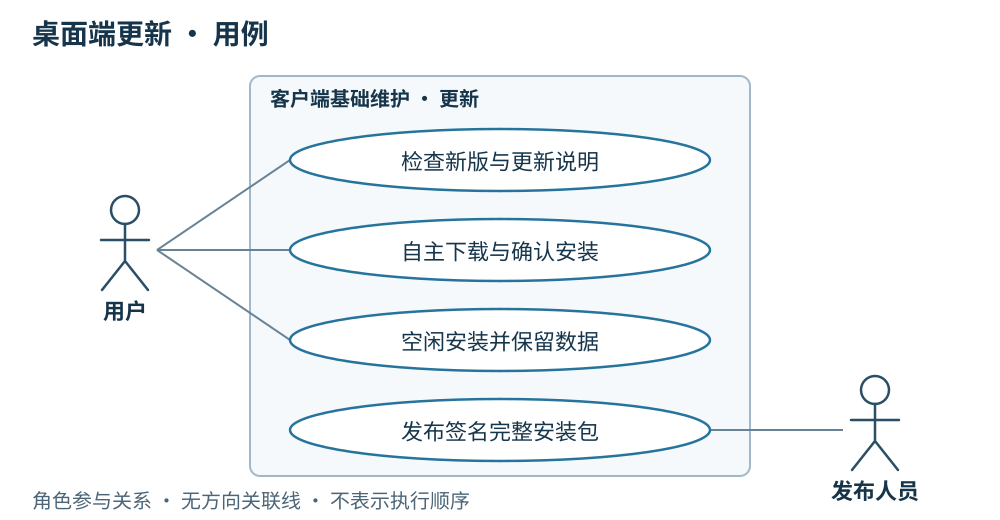

# 05 桌面端更新

串讲重点：**用户决定下载和安装时机，只有空闲时才能安装重启。** 桌面更新与 Skill、Agent 物料同步分别进行。

## US

### 界面设计

桌面更新位于设置中，展示当前版本、新版说明和下载进度。用户主动检查、下载并确认安装；页面明确区分下载中、待安装、等待任务结束和失败状态。

1. 作为用户，我希望启动后得知新版，也能手动检查，查看版本和更新说明。
2. 作为用户，我希望自己决定何时下载、何时安装，并在下载期间继续工作。
3. 作为用户，我希望更新等待任务结束，升级后保留自己的数据和配置。
4. 作为发布人员，我希望各平台完整安装包经过签名验证，再向客户端开放更新。

## 简要设计

客户端采用 Tauri 整包更新方案，从内网 HTTPS 静态站点读取清单和下载文件。首版覆盖 macOS arm64、Windows x64，一个稳定通道。前端、Tauri、Node、CEF 及随包运行时一起更新，builtinTool 随之更新；这不改变 Agent 使用专用 Chrome 的约定。

应用版本使用有效 SemVer，与 Skill、Agent 手填的 `v.1.0.0` 发布标签分别管理。首次带更新能力的客户端手动安装，之后才能应用内升级。

## 客户端

- 客户端交付流程在受控构建环境生成最终整包并签名；已安装客户端仅内置公钥，私钥不进入安装包。
- 主界面可用后非阻塞检查一次，设置保留手动入口；可稍后处理，不增加定时轮询。
- 展示适配当前系统、架构的更高版本；用户点击才下载，展示真实进度。
- 使用 HTTPS 校验和内置公钥验签；网络、清单、下载或验签错误明确提示，不安装、不退出当前应用。
- 下载成功只进入待安装，仍须用户确认；同版或更旧版本不覆盖当前应用。

## 详细设计

### 运行模型一：检查、下载并在空闲时安装

**条件：**存在适配当前系统、架构的更高版本，包下载和校验成功。主界面可用后检查一次，或由用户在设置中主动检查；两者之后使用相同流程。

[打开运行模型](./diagrams/runtime/05-update-success.html)

**结果：**下载后停留在待安装，用户确认后才再次核对执行活动；空闲时阻止新任务进入，完成运行时与浏览器进程清理，再交给安装器。安装与启动都完成才算成功。更新保留安装包外的会话、配置、脚本、运行证据及本地物料。

### 运行模型二：确认安装时仍有任务

**条件：**更新包已经校验成功，但用户确认安装时还有执行活动。

[打开运行模型](./diagrams/runtime/05-update-busy.html)

**结果：**客户端提示等待，不安装、不退出。任务结束只改变可安装条件，不代替用户确认；用户再次确认后，重新进入模型一的空闲检查和安装准备。任务先开始则安装等待，安装准备先开始则新任务被明确拒绝。下载完成和任务结束都不会自动安装。

### 运行模型三：下载或校验失败

**条件：**本次下载失败，或已下载的包未通过完整性校验、签名验证。图中的两种原因都是直接失败的替代情况，不是连续执行的两个步骤。

[打开运行模型](./diagrams/runtime/05-update-rejected.html)

**结果：**明确提示原因，不调用安装器，不退出当前应用。检查清单失败、同版或更旧版本、安装准备失败，也不能进入安装步骤；同版或更旧版本不覆盖当前应用。强退或崩溃按[任务执行与恢复](./07-任务执行与恢复.md)处理，不把升级作为任务续跑入口。

验收在两个平台真实已安装的旧版上完成：任务期间不安装、错误包被拒绝、重启后版本正确且数据可用。本期不做差分、静默安装、强制更新、自动回滚或下载断点续传；域名、公钥与平台验收环境属于实施前待配置项。旧规格中的审批场景不增加为本 MVP 功能。

## 服务端配合

更新站点为客户端提供检查与下载所需的发布产物：

- 接收客户端交付流程生成并签名的最终更新包；更新站点不持有签名私钥。
- 静态站点提供 `latest.json`、更新说明及两个目标的 HTTPS 下载地址和签名；内网下载不要求登录。
- 两个平台包与清单版本一致，同一版本的包、地址与签名不可变；验证产物都可下载后，最后发布清单。
