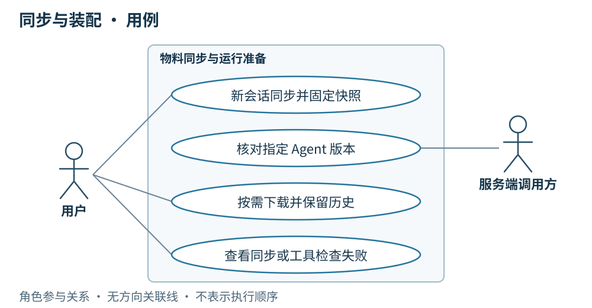

# 06 · 同步与装配：清单先行、物料按需

> 串讲重点：按 Agent 清单装配确定版本，缺什么下载什么；失败就停止本次运行。

## US

### 现有页面与缺口

现有 Web 只有通用的资源加载、失败与重试提示，**尚无版本核对、缺包下载或缓存版本界面**。这些状态应补在开始会话和资源版本位置，无需单独建立大型同步中心。

1. 作为用户，我希望新会话使用同步后的官方资源，已有会话继续使用开始时的快照。
2. 作为服务端调用方，我希望执行前核对指定 Agent 版本，避免客户端使用其他版本替代。
3. 作为用户，我希望只下载当前所需物料，并保留已下载的 Skill 版本轨迹。
4. 作为使用者，我希望同步或工具检查失败时看到明确原因，以便处理后重新发起。

## 简要设计

同步分两步：先获取版本清单，再按当前 Agent 的装配清单补齐缺失物料。不会为了同步清单下载全部历史包。官方资源按版本保存在本地，旧包不自动覆盖或清理；运行时选择对应版本装配。

HTTPS 负责清单和物料传输。WebSocket 负责调用和结果，不承担文件包同步。未上传的本地草稿可以直接实验，运行前固定完整快照，不要求先上传为官方版本。

## 服务端

- 提供官方已发布 Agent、Skill 的版本清单和缺失物料下载；Agent 的 MCP 配置或引用随清单关联。
- 远端调用明确所需 Agent 版本，客户端据此核对；具体字段和端点留到实现阶段确定。
- 保留已发布版本和标签的不可变关系。Skill 发布产生新 Agent 装配，不改写历史版本。
- 按现有身份体系开放相应读取和运维写入能力，不新增客户端账号体系。

## 客户端

- 官方新会话同步版本清单；每次远端调用核对所需版本，不匹配或缺少物料就先同步。
- 按清单下载缺失 Skill 包及其他 Agent 物料，复用本地已有的相同版本；同步失败则本次调用失败，不降级到旧版。
- 运行前检查所需 builtinTool；缺失时提示更新桌面端，不尝试通过 Skill 同步安装内置工具。
- 本地保存未同步编辑和缓存。默认目录为 macOS 的 `~/.omniops-bots`，Windows 的 `D:\.omniops-bots`。

## 详细设计

[打开可缩放交互图](./diagrams/06-sync.html)

| 阶段 | 判断 | 可观察结果 |
| --- | --- | --- |
| 核对版本 | 所需 Agent 和物料是否齐备 | 齐备则复用，缺失则下载 |
| 补齐物料 | 清单所需内容能否取得 | 失败即结束本次调用 |
| 检查能力 | 桌面端是否具备所需 builtinTool | 缺失则提示更新 |
| 固定装配 | 本次使用哪些版本和运行条件 | 生成快照后交给执行流程 |

“同步到新版本”和“改变当前会话”是两件事：同步可带来新的可用版本，但已开始的手动会话始终沿用原快照。远端调用则每次独立核对指定版本并创建会话。

MVP 不引入 Git 仓库、全量历史镜像或自动清理机制；具体磁盘布局无需在本轮确定。运行互斥、结果补传和重启恢复见[任务执行与恢复](./07-任务执行与恢复.md)。
