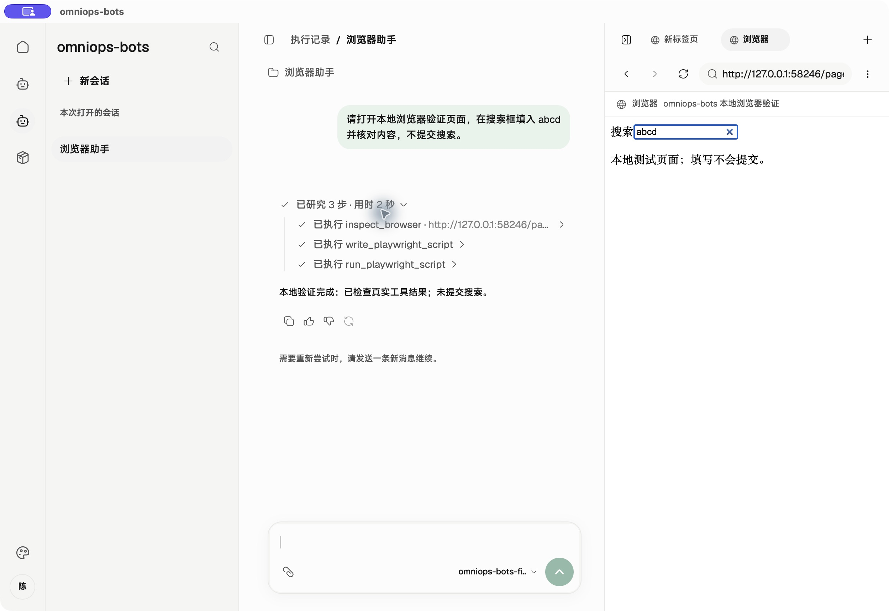
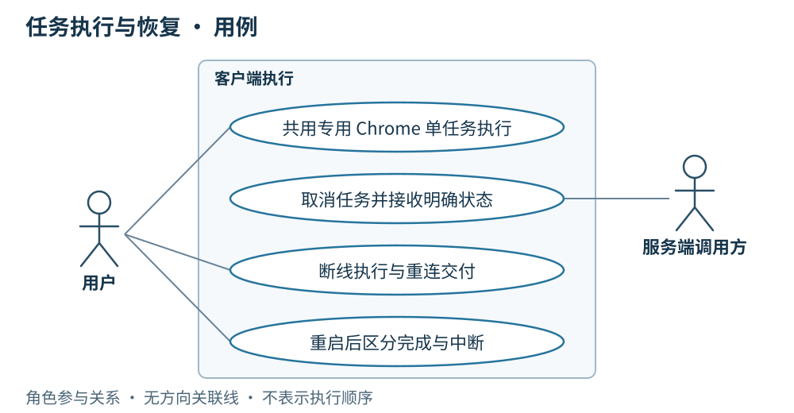

# 07 · 任务执行与恢复：执行一次、结果可补传

> 串讲重点：线上用户在服务端 Console 操作，服务端 Agent 以任务调用客户端 Agent；客户端后台管理 Chrome 执行与结果保存，向服务端交付状态和结果，逐条过程留在运维调试入口。断线后补传结果，重启后不续跑未完成任务。

## US

### 运维调试界面与线上基础状态

*历史 macOS 运维调试桌面实拍（不是线上用户入口，旧 Agent CEF 模式不代表当前双浏览器分工），展开真实执行的 `inspect_browser`、`write_playwright_script` 和 `run_playwright_script`；右侧 CEF 搜索框已填入 `abcd`，未提交。模型与目标页面为本地测试夹具。*

线上用户在 Console 发起业务、查看任务状态与最终结果，并经服务端请求取消；服务端 Agent 接收忙、失败、取消、超时、中断和结果交付状态，决定后续处理。客户端日常作为后台进程，仅对线上用户提供连接等基础状态与维护入口。完整本地会话、工具过程、任务横条与执行记录属于运维调试桌面；服务端发起的调试会话明确标识来源并保持只读。记录包含调用 ID、起止时间、结果或错误、运行快照，以及结果待确认、已交付或重启中断状态。远端调用、结果交付与线上基础状态界面仍待接入，不能以已有本地调试能力视为完成。

1. 作为线上用户，我希望从 Console 发起的任务由客户端后台使用专用 Chrome 执行，保留登录态，并让不同会话在各自标签页并发执行。
2. 作为线上用户，我希望在 Console 看到忙、取消、超时等任务状态和最终结果，客户端将其回传给服务端 Agent。
3. 作为线上用户，我希望客户端断线时任务继续执行，恢复连接后能在 Console 取得结果。
4. 作为线上用户，我希望重启后在 Console 知道哪些任务已经完成、哪些执行中断，不自动重做操作。
5. 作为运维人员，我希望通过调试桌面查看本地会话、逐条过程和执行证据，定位故障而不改变线上任务目标。

## 简要设计

Node.js 后端按需管理一个外部 Google Chrome 专用环境；运维调试工作台另保留独立的手动 CEF 页面。本地、实验和远端任务按 `threadId` 绑定各自标签页，以精确 `targetId` 寻址；不同会话可以并发，同一会话同时只接纳一轮。默认最多 4 轮并发，运维人员可在调试桌面的「设置 → 偏好设置」调整「并发任务上限」（1～64 的整数）；同一会话已有运行、其绑定页面正在手动导航或总容量已满时返回“忙”，客户端不排队。运维调试会话等待输入时释放运行容量，标签页与固定快照继续保留，下一轮复用同一页面。

会话页面与手动页面分开管理。任务结束、失败、取消或超时后仍保留所属页面，供查看与后续轮次复用；runtime 关闭时只释放它创建的会话页面，不关闭外部或手动页面。页面丢失时本次操作失败，不回退到当前选中页或其他会话页面。

所有标签页仍使用同一专用 profile，共享 Cookie、登录态和站点状态；独立页面不代表独立账号或后端业务资源，退出登录和切换账号可能影响其他会话。脚本沿用既有页面约束，不新增创建页面或 BrowserContext 的能力；弹窗不自动成为任务目标。

一轮任务可以包含多次模型调用，单次模型输出结束不等于任务结束。任务终止与结果交付分别处理：执行已结束但尚未收到服务端确认时，保留结果等待补传。

图编排由代码定义并随 desktop 发版，Agent 配置只负责提示词、Skill 和工具选择。每张图拥有自己的 input、state 和 output，不强制包含 messages；execution 统一管理生命周期、取消和 checkpoint，聊天展示与历史由 chat adapter 转换。图内允许原生并行分支，桌面也允许不同 thread 的 run 同时执行；每个 run 的浏览器目标在受理时绑定，之后不可随界面切换而改变。

使用同一目标页面的完整分支通过 `scope.browserFlow` 串行，锁覆盖导航、读取、模型判断、操作与验证；`scope.browserOperation` 复用已持有的流程范围并串行执行页面动作，独立调用时为本次动作取得流程范围。浏览器回调逸出的异常立即终止 run，关闭后续动作入口；可恢复业务失败须在该回调内转换为结果。普通 `scope.operation` 的业务失败仍可由图捕获并转换为 state 或分支结果。

未处理异常取消其他分支，锁定首个终止原因；等待已启动操作、连接清理与 checkpoint 写入排空后，单次调用 `settle` 保存历史或中止证据，再写最终 run 记录、发布 terminal 并释放该轮容量；其他会话继续运行，所属标签页保留供后续轮次查看和复用。进入 `settle` 前冻结本轮取消与超时；稍后的 stop 等待结算完成，不改变已交给结算阶段的执行结果。

任务状态与结果交付状态概览

[打开状态概览](./diagrams/07-execution.html)

## 客户端

- 仅在运维调试桌面展示逐条模型输出和工具调用过程；远端任务会话保持只读，正常执行不向服务端逐条传输过程内容。服务端 Agent 消费任务级状态、最终结果与快照，Console 展示线上用户所需状态和结果。故障排查时由运维在诊断入口准备指定 thread 的材料，经有权用户预览、同意后上传，见[运维与诊断上传](./09-运维与诊断上传.md)。
- 每轮采用统一、可配置的兜底超时。取消或超时后停止后续步骤，回传相应结果；已完成的 Chrome 操作不回滚。
- 遇到人工登录或验证直接失败，并向服务端 Agent 回传原因，由 Console 提示用户处理；用户按明确提示在专用 Chrome 完成必要验证后，在 Console 重新发起业务，由服务端 Agent 下发新任务，不暂停等待，也不要求打开完整调试桌面。
- 有任务运行时阻止正常退出并提示等待，结束后由用户退出；强制退出或崩溃按重启规则处理。

## 详细设计

以下每张顺序图对应一个独立运行场景。正常执行与结果确认见[客户端总体设计](./00-总体架构.md)。

### 偏好设置：并发任务上限

| 项目 | 规则 |
| --- | --- |
| 设置入口 | 运维调试桌面 → 设置 → 偏好设置 → 并发任务上限；显示当前有效值，修改后保存 |
| 默认与范围 | 默认 4；只接受 1～64 的整数，空值、小数、越界值均提示错误，不保存 |
| 适用范围 | 本地、实验与远端任务共用；准备、执行和停止排空期间均占用容量，等待用户输入不占用 |
| 保存与生效 | 保存到本机成功后，立即按新上限检查后续任务；重启后保留，不同步到服务端 |
| 下调时已有任务 | 保持运行，不取消；活动数量达到或超过新上限时拒绝新任务，直到低于上限 |
| 保存失败 | 明确提示失败，保留输入以便重试；仍使用保存前的有效上限，不显示已保存 |
| 读取失败 | 设置页明确显示错误并提供重试，不以默认值冒充当前有效值，也不覆盖无法读取或损坏的文件；重试重新读取磁盘。此前已确认的有效值继续生效；启动时没有有效值则拒绝新任务，资源和设置界面仍可打开 |

例如已有 4 个任务运行时把上限保存为 2，4 个任务继续执行；活动数量降至 1 后，才可再受理 1 个任务。上调上限则在保存成功后开放新增容量。同一会话仍只接纳一轮，独立标签页仍共享登录态。

桌面偏好保存在客户端数据目录的 `settings.json`，字段为 `maxConcurrentRuns`，以原子写入替换文件。启动时已保存的偏好优先；只有尚未保存偏好时才使用 `OMNIOPS_BOTS_MAX_CONCURRENT_RUNS` 作为初始值，未配置该环境变量则使用 4。现有环境变量不是已保存设置的覆盖入口。Web 演示仅在内存中演示设置，不写浏览器持久存储，也不代表桌面已保存。

4 是资源保护的初始默认值，64 是允许配置的边界，不表示已验证可稳定跑满。此项设置通过界面反馈读取、校验和保存结果，不新增日志、span 或监控指标；任务过程和执行记录沿用现有观测边界。

### 场景一：同会话运行中或并发容量已满

本地、实验和远端任务使用同一并发上限，但各自绑定独立标签页。图中表示同一会话已有任务，或默认 4 个运行容量已全部占用；仅有另一会话运行时，不应拒绝新任务。本会话绑定页面若正在手动导航，也暂时拒绝本会话新运行；其他页面仍可接纳任务。

[打开顺序图：场景一：同会话运行中或并发容量已满](./diagrams/runtime/07-busy.html)

本轮向服务端 Agent 返回忙，由 Console 展示暂不可执行；运维本地调试调用在调试桌面显示同样原因。不排队、不自动重试。等待输入时不占运行容量，保留所属标签页与快照；下一轮重新检查。不同会话的任务仍可同时运行在各自页面，切换当前展示页面不影响执行目标。

### 场景二：执行中 WebSocket 断线

客户端进程仍在运行。图中任务先执行完成，连接随后恢复；退避重连与执行可以并行。

[打开顺序图：场景二：执行中 WebSocket 断线](./diagrams/runtime/07-disconnect.html)

当前任务继续，结果与快照先保存本地。恢复连接后按原调用 ID 向服务端 Agent 补传，由 Console 更新任务状态与结果；确认之前保留，不重新执行。本机基础入口显示连接状态，详细交付记录仅在运维调试入口查看。

### 场景三：重启发现已完成、未确认的结果

上次任务已完成并持久化结果，但服务端尚未确认。

[打开顺序图：场景三：重启发现已完成、未确认的结果](./diagrams/runtime/07-restart-complete.html)

只向服务端 Agent 恢复结果交付，由 Console 展示完成结果，不装配或重跑任务。已有记录继续保留供运维排查。

### 场景四：重启发现未完成任务

客户端此前强退或崩溃，磁盘记录中任务未完成。

[打开顺序图：场景四：重启发现未完成任务](./diagrams/runtime/07-restart-incomplete.html)

向服务端 Agent 回报“执行中断、结果未知”，Console 向用户保留该含义；不续跑、不自动重试，已有记录留给运维排查，由服务端 Agent 决定后续处理。

新增运维设计将 LangGraph checkpoint 持久化到客户端 SQLite，供重启后按 thread 导出排查。它保留每个 run 的图状态证据，不改变本场景“不自动续跑”的约定；线上用户经 Console 发起后续业务、或运维继续调试会话时，均创建新 run。当前实现已将原生 LangGraph checkpoint 保存到本地 SQLite，每个 run 使用独立 graphThreadId，保留根图与子图 namespace；诊断导出、上传和服务端接收仍待实现，具体边界见第 09 章。

### 场景五：服务端按调用 ID 取消

远端任务正在执行，客户端收到取消请求。

[打开顺序图：场景五：服务端按调用 ID 取消](./diagrams/runtime/07-cancel.html)

Console 上的取消请求经服务端 Agent 按调用 ID 下发。客户端只停止该调用所属 run 的后续步骤并排空其已启动操作，保存并向服务端 Agent 回传取消结果，Console 据此更新状态；已完成操作不回滚，其他 run 继续执行。所属页面保留供运维查看，客户端远端调试会话保持只读。

### 场景六：本轮执行超时

每轮使用统一、可配置的客户端兜底超时。图中展示远端任务的结果交付。

[打开顺序图：场景六：本轮执行超时](./diagrams/runtime/07-timeout.html)

只停止超时 run 的后续步骤，记录并向服务端 Agent 回传“执行超时”，Console 展示终止原因；运维本地调试会话展示相同原因。其他 run 继续执行，所属页面保留；已完成操作不回滚，不自动重试。

### 场景七：需要人工登录或验证

图中为远端任务：Chrome 操作触发需要人处理的登录或验证。

[打开顺序图：场景七：需要人工登录或验证](./diagrams/runtime/07-login.html)

本次任务直接失败并向服务端 Agent 回传原因，Console 提示用户完成必要的本机登录或验证；基础维护入口可提供所需指引，运维调试入口保留详细证据。用户在专用 Chrome 处理后，经 Console 重新发起业务，由服务端 Agent 下发新任务，不暂停恢复原任务。

执行记录保存调用 ID、状态、起止时间与错误；快照保存实际装配与运行条件，不含密钥和 Token。本轮可观测范围是这些记录与运维调试桌面的过程展示，不新增监控平台。通信恢复不重复启动任务，但不承诺外部 Chrome 操作的副作用恰好发生一次。

## 服务端配合

为支持客户端接收任务并交付结果，服务端需要：

- 用户在 Console 发起业务或取消请求，由服务端 Agent 通过 WebSocket 发送任务调用、上下文和按调用 ID 发起的取消请求；后续调度由服务端 LangGraph 决定。
- 服务端 Agent 接收任务状态、最终结果、运行快照，并确认收到；Console 向线上用户呈现任务级状态、失败原因和结果，不以客户端调试桌面承接业务操作。
- 收到“忙”或“执行中断、结果未知”后决定后续处理；客户端不自动重跑。
- 按第 09 章提供独立的诊断接收与查询能力；诊断包回执与任务结果确认分别处理，收到 checkpoint 不触发任务恢复。
