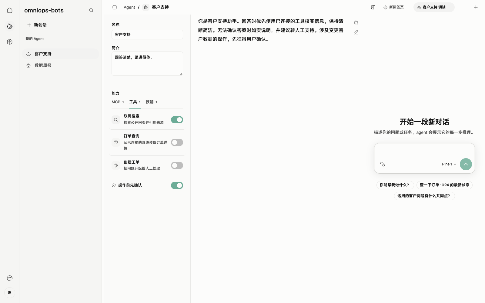

# 07 · 任务执行与恢复：执行一次、结果可补传

> 串讲重点：客户端统一管理 Chrome 执行、过程展示和结果保存；断线后补传结果，重启后不续跑未完成任务。

## US

### 界面设计

*界面实拍，图中使用演示数据。*

会话展示消息与工具调用过程，任务横条展示执行状态。服务端发起的会话明确标识来源并保持只读。执行记录包含调用 ID、起止时间、结果或错误、运行快照，以及结果待确认、已交付或重启中断状态。

1. 作为用户，我希望本地与远端任务共用专用 Chrome，保留登录态且不并发操作。
2. 作为用户，我希望客户端明确展示忙、取消、超时等状态，并把远端任务的结果回传给服务端。
3. 作为使用者，我希望断线时任务继续执行，恢复连接后能取得结果。
4. 作为用户，我希望重启后知道哪些任务已经完成、哪些执行中断，不自动重做操作。

## 简要设计

客户端管理一个专用 Chrome 环境，本地、实验和远端任务共用，每轮只允许一个任务执行。忙时直接返回“忙”，客户端不排队。手动会话等待用户输入时释放执行名额，下一轮重新检查；会话和固定快照继续保留。

一轮任务可以包含多次模型调用，单次模型输出结束不等于任务结束。任务终止与结果交付分别处理：执行已结束但尚未收到服务端确认时，保留结果等待补传。

任务状态与结果交付状态概览

[打开状态概览](./diagrams/07-execution.html)

## 客户端

- 展示逐条模型输出和工具调用过程；远端任务会话保持只读，不向服务端逐条传输过程内容。
- 每轮采用统一、可配置的兜底超时。取消或超时后停止后续步骤，回传相应结果；已完成的 Chrome 操作不回滚。
- 遇到人工登录或验证直接失败并说明原因，用户处理后重新发起，不暂停等待。
- 有任务运行时阻止正常退出并提示等待，结束后由用户退出；强制退出或崩溃按重启规则处理。

## 详细设计

以下每张顺序图对应一个独立运行场景。正常执行与结果确认见[客户端总体设计](./00-总体架构.md)。

### 场景一：Chrome 正忙

本地、实验和远端任务共用一个 Chrome 执行名额。图中已有任务尚未结束。

[打开顺序图：场景一：Chrome 正忙](./diagrams/runtime/07-busy.html)

本轮返回忙，不排队、不自动重试。手动会话及固定快照保留，等待输入时不占用名额；下一轮重新检查。

### 场景二：执行中 WebSocket 断线

客户端进程仍在运行。图中任务先执行完成，连接随后恢复；退避重连与执行可以并行。

[打开顺序图：场景二：执行中 WebSocket 断线](./diagrams/runtime/07-disconnect.html)

当前任务继续，结果与快照先保存本地。恢复连接后按原调用 ID 补传；确认之前保留，不重新执行。

### 场景三：重启发现已完成、未确认的结果

上次任务已完成并持久化结果，但服务端尚未确认。

[打开顺序图：场景三：重启发现已完成、未确认的结果](./diagrams/runtime/07-restart-complete.html)

只恢复结果交付，不装配或重跑任务。已有记录继续保留。

### 场景四：重启发现未完成任务

客户端此前强退或崩溃，磁盘记录中任务未完成。

[打开顺序图：场景四：重启发现未完成任务](./diagrams/runtime/07-restart-incomplete.html)

回报“执行中断、结果未知”，不续跑、不自动重试，已有记录保留，由服务端决定后续处理。

### 场景五：服务端按调用 ID 取消

远端任务正在执行，客户端收到取消请求。

[打开顺序图：场景五：服务端按调用 ID 取消](./diagrams/runtime/07-cancel.html)

停止后续步骤，保存并回传取消结果；已完成操作不回滚。客户端远端会话保持只读。

### 场景六：本轮执行超时

每轮使用统一、可配置的客户端兜底超时。图中展示远端任务的结果交付。

[打开顺序图：场景六：本轮执行超时](./diagrams/runtime/07-timeout.html)

停止后续步骤，记录并回传“执行超时”；本地会话展示相同终止原因。已完成操作不回滚，不自动重试。

### 场景七：需要人工登录或验证

图中为远端任务：Chrome 操作触发需要人处理的登录或验证。

[打开顺序图：场景七：需要人工登录或验证](./diagrams/runtime/07-login.html)

本次任务直接失败，客户端提示原因。用户在专用 Chrome 处理后发起新任务；远端任务由服务端重新调用，不暂停恢复原任务。

执行记录保存调用 ID、状态、起止时间与错误；快照保存实际装配与运行条件，不含密钥和 Token。本轮可观测范围是这些记录与客户端过程展示，不新增监控平台。通信恢复不重复启动任务，但不承诺外部 Chrome 操作的副作用恰好发生一次。

## 服务端配合

为支持客户端接收任务并交付结果，服务端需要：

- 通过 WebSocket 发送调用、上下文和按调用 ID 发起的取消请求；后续调度由 LangGraph 决定。
- 接收任务状态、最终结果、运行快照，并确认收到。
- 收到“忙”或“执行中断、结果未知”后决定后续处理；客户端不自动重跑。
