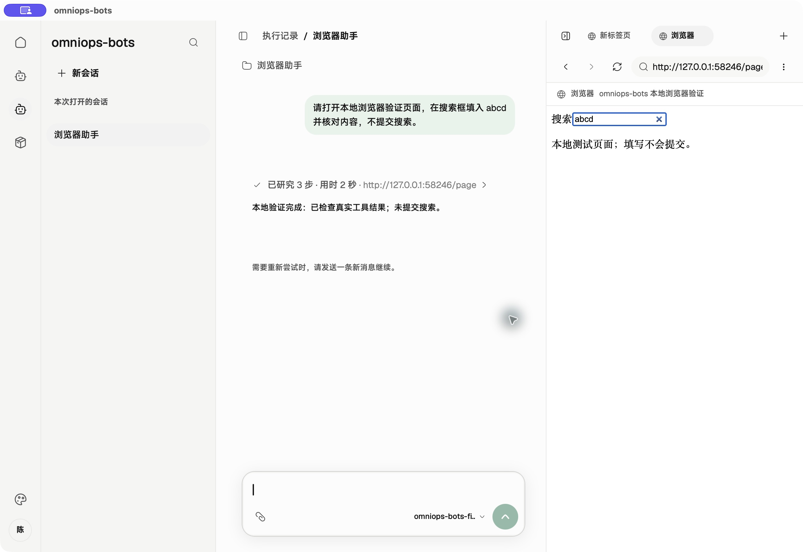
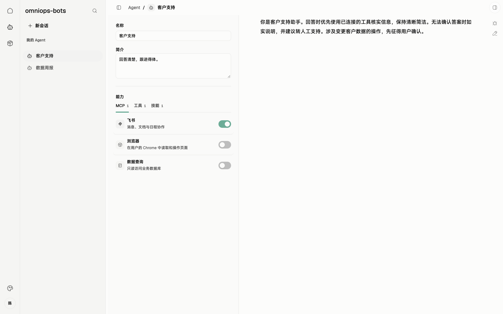
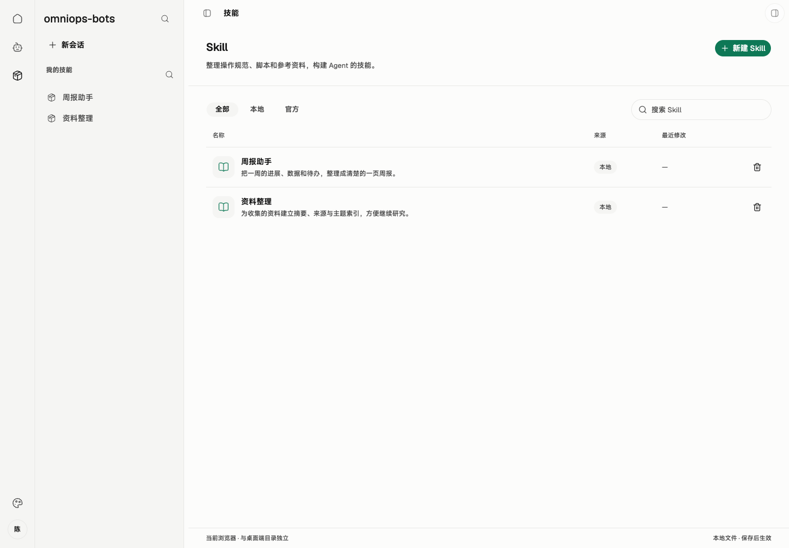

# 08 · 前端现状与缺口

> 串讲重点：围绕客户端页面和用户操作，说明界面、交互与执行能力的完成情况，最后列出所需的服务端配合。

## US

1. 作为串讲参与者，我能结合页面理解完整业务流程，并知道各项能力的完成情况。
2. 作为使用者，我能知道资源来自本地还是官方、使用哪个版本，以及任务执行和结果交付到了哪一步。
3. 作为运维人员，我在 Skill、Agent 页面完成编辑、实验与发布。

## 简要设计

前端由左侧导航、中央业务页面与右侧工作台组成。会话承载执行与交互，Agent 页面管理装配，Skill 页面管理文件包与版本，工作台展示浏览器和执行过程。视觉采用**暖灰底色、绿色强调、细边框、轻量圆角，以及 Geist / MiSans 字体**。

本章工作区截图已替换为 macOS 桌面包实拍，右侧是 Playwright 实际操作的内置 CEF 页面；后面的资源管理截图仍为前期 Web 页面与演示数据。下表依据当前本地 LangGraph 客户端实现区分已具备能力与剩余接入。

*本地测试模型驱动真实工具调用：Playwright 在内置浏览器的测试页面填入 `abcd`，执行结果与页面同屏展示。*

## 客户端

前端目标围绕四组业务流程组织：

1. **资源身份与发布**：Skill、Agent 页面区分本地与官方资源，管理版本、只读配置、草稿实验、运维上传和手填标签发布。
2. **同步与开始运行**：在新会话入口展示版本核对、缺失物料下载和工具检查；准备失败说明原因，准备完成固定快照。
3. **执行与结果交付**：按会话分别展示运行状态、执行过程和停止入口；工作台切换对应会话页面，切换不改变后台运行目标。不同会话可并发，同会话运行中、其页面正在手动导航或总容量已满时显示忙；服务端会话只读，执行记录呈现快照、结果待确认与重启中断状态。
4. **故障诊断上传**：从执行记录选择指定 thread，查看 checkpoint 与材料清单，提交后以服务端持久保存的回执确认接收。

「设置 → 偏好设置」提供「并发任务上限」，默认 4，可保存 1～64 的整数；保存后立即用于新任务受理，下调不取消现有任务，重启后保留。读取失败提供重试，保存失败保留输入与原有效值。Web 演示只在内存中保存。设置中的桌面更新入口计划展示检查、下载、待安装和失败状态，尚未实现。

### 完成情况

| 对应章节 | 已具备的界面能力 | 尚未完成的界面能力 | 业务接入边界 |
| --- | --- | --- | --- |
| 00 总体 | 导航、会话、工作台 | 登录身份、运维权限、连接与重连状态 | 现有 Token、权限和 WebSocket |
| 01 Skill | File Manager 包内管理、来源筛选、新建与复制、真实文件持久化、冲突与失败提示、官方包只读；保存本地草稿后选择 Agent 在新会话实验 | 官方历史版本切换、官方草稿维护、上传草稿与联动发布 | 服务端身份、草稿修订、发布和下载；本地完整包快照与实验装配已接入 |
| 02 MCP | 本地配置管理、连接测试、Agent 内能力勾选与详情、连接失败提示 | 官方来源及只读配置流程 | 随官方 Agent 同步配置；本地已接入真实 Streamable HTTP 连接、发现与工具调用，resource/prompt 不自动作为工具 |
| 03 builtinTool | 实际工具勾选清单、缺失工具失败提示 | 桌面更新入口 | 本机能力目录、运行前检查及运行中工具白名单已接入；更新下载与安装待接入 |
| 04 Agent | 本地/官方分组、本地新建/保存/复制、官方只读、配置与能力勾选、内容 ID/发布标签展示、开始新会话 | 官方草稿编辑、发布与版本选择流程 | 官方发布同步；本地 Agent 持久化、完整装配和会话固定快照已接入 |
| 05 桌面更新 | 当前没有更新入口 | 当前版本、检查、说明、下载进度、待安装、空闲时手动安装与错误提示 | 整包更新、验签、安装与任务互斥 |
| 06 同步装配 | 准备/失败状态、本机官方缓存身份、运行快照查看；已有会话沿用原装配 | 远端版本核对、缺包下载和版本轨迹 | 远端清单与下载；本地完整包捕获、缓存内容摘要校验、快照固定与篡改检查已接入 |
| 07 执行恢复 | 流式对话、真实工具过程、按会话运行状态与停止、独立浏览器页面及切换；不同会话默认最多 4 轮并发，偏好设置支持将上限保存为 1～64 并立即用于新任务，同会话运行中、其页面手动导航中或容量满时拒绝；超时/中断提示，执行记录含 run/thread ID、起止时间、结果/错误、运行快照，可继续原会话 | 远端会话来源及只读流程、结果待确认/已交付状态 | WebSocket 任务与取消、结果确认与补传；本地记录/会话持久化、兜底超时、重启标记中断且不自动重跑已接入 |
| [09 运维诊断](./09-运维与诊断上传.md) | 可复用现有执行记录与快照详情 | 按 thread 选择材料、脱敏预览、上传与接收状态；独立诊断导出入口 | SQLite checkpoint 持久化已接入；诊断导出、HTTPS 上传、服务端校验保存与回执仍待实现，Windows 实机加载还需验收 |
| [11 Provider](./11-Provider.md) | 会话入口展示当前可用的单模型 | 多 Provider／模型管理、自定义 base URL、手填模型名、可选 Key、默认项与新会话改选、选定模型手动连接测试 | 当前 Node runtime 从环境变量／`model.env` 读取单模型；系统凭据库和配置引用待接入，Rust provider 尚未接入桌面；本期不依赖服务端配置下发 |

*图为前期 Agent 页面。当前本地实现已支持从 Agent 开始新会话，以及从 Skill 页面选择 Agent 实验完整本地草稿；官方发布流程仍待接入。*

*本次 Web 界面实拍。Skill 列表和包内文件管理已实现；图片中的数据为演示内容。*

Skill 页面见 [01 SKILL](./01-SKILL.md)：已安装 `@beui-pro/file-manager-workspace` 并接入真实文件内容保存。浏览器使用 IndexedDB；桌面通过 JavaScript runtime 保存到 `.omnimind-ops/skills`。文件上传与服务端草稿上传、正式发布是三个不同动作，后两项尚未接入。

桌面 Skill 读取和 Agent 可选清单使用同一目录。`assembly.ts` 已在会话开始时捕获完整包、固定装配与内容身份；`graphs/browser-agent.ts` 通过只读 `FilesystemBackend` 与 `skills` 挂载所选快照，支持按需读取入口和引用文件。现有会话继续使用原快照，包缺失、被修改或 MCP 工具定义变化时明确失败，不能静默换成新版本。实际调用链见[Skill 存储与运行加载](../skill-storage-and-loading.md)。

完成情况与范围：

- **审批不属于本期 MVP 流程。** 真实本地运行不经过操作审批；旧截图和演示适配器中的审批内容不代表桌面执行流程，正式发布也无审核环节。
- **本地草稿实验已完成。** 先保存当前编辑，再选择 Agent 新建实验会话；运行时固定完整草稿，不修改模板 Agent 或已有会话。
- **Provider 管理仍待实现。** 第 11 章描述目标能力，不代表已有配置页面或系统凭据存储。当前桌面直接使用 Node `ChatOpenAI`；Rust provider 的文本流实现不能作为桌面多模型、工具调用或凭据管理已完成的依据。连接测试按选定模型发送固定最小请求，不读取会话或执行工具，保存配置不自动测试。
- **本地多会话并发已接入。** 每个 thread 固定浏览器页面；切换工作台不改变运行目标，停止仅作用于所选 run。真实 CDP 回归已覆盖一个页面导航阻塞时另一任务与脚本完成、独立取消、共享登录态及下一轮复用原页面；macOS 原生 CEF 隐藏页面的创建、切换与释放也已单独检查。历史单会话截图不作为这些并发行为的验证依据。
- **本地会话持久化不等于 checkpoint 持久化。** `.sessions` 保存消息和装配快照，`.records` 保存运行证据；图状态已由 execution 使用原生 SQLite saver 单独保存，诊断导出与上传仍待实现，见第 09 章。
- **服务端接入与桌面更新仍未完成。** 登录权限、官方同步/发布、WebSocket 任务与结果交付不能以本地链路通过作为完成依据。

查看前端源证据

- 启动与数据来源：[main.tsx](../../web/src/main.tsx)、[演示适配器](../../web/src/adapters/demo.ts)、[Tauri 适配器](../../web/src/adapters/tauri/index.ts)。
- 现有布局与 Agent 调试入口：[App.tsx](../../web/src/App.tsx)、[工作台调试会话](../../web/src/components/workbench/workbench.tsx)。
- Skill 文件操作：[Skill 管理页](../../web/src/components/skills/skill-library-screen.tsx)、[SkillLibrary 接口与本地行为](../../web/src/skills/library.ts)、[浏览器 IndexedDB](../../web/src/adapters/browser-skill-library.ts)、[Tauri 适配器](../../web/src/adapters/tauri/skills.ts)、[桌面文件存储](../../desktop/runtime/skill-library.mjs)。
- Agent 身份、持久化与完整快照：[assembly.ts](../../desktop/runtime/assembly.ts)、[AgentSource](../../web/src/agents/source.ts)、[Agent 界面](../../web/src/components/premium/agent-builder/agent-builder.tsx)、[Tauri 资源映射](../../web/src/adapters/tauri/resources.ts)。
- MCP 配置、真实连接与工具调用：[mcp.ts](../../desktop/runtime/mcp.ts)、[MCP 管理界面](../../web/src/components/premium/agent-builder/mcp-manager.tsx)、[MCP 能力弹窗](../../web/src/components/premium/agent-builder/mcp-capability-dialog.tsx)。
- 当前单模型来源与接入：[Node runtime 入口](../../desktop/runtime/main.mjs)、[模型列表接口](../../web/src/models/source.ts)；独立的 [Rust provider](../../crates/omniops-bots-provider/src/lib.rs) 尚未接入桌面。
- 图装配、执行与恢复边界：[graphs/browser-agent.ts](../../desktop/runtime/graphs/browser-agent.ts)、[runtime.mjs](../../desktop/runtime/runtime.mjs)、[execution/records.ts](../../desktop/runtime/execution/records.ts)、[执行记录页](../../web/src/components/runs/run-history.tsx)、[Tauri 运行适配器](../../web/src/adapters/tauri/runtime.ts)。
- 更新与同步接口范围：[应用依赖](../../web/src/app/dependencies.tsx)、[Agent 来源接口](../../web/src/agents/source.ts)、[Skill 来源接口](../../web/src/skills/source.ts)。桌面资源加载见 [resources.mjs](../../desktop/runtime/resources.mjs)；现有 Web 未接入官方物料下载或桌面更新流程。
- 视觉依据：[index.css](../../web/src/index.css) 第 13–14、57–92 行；[文档阅读样式](../../web/src/components/premium/docs-pages/docs-article.css) 第 20–25、41–83 行。

## 详细设计

前端状态按运行模型呈现。下面两种场景展示用户在客户端观察到的开始、运行和交付；各模块的其他失败情况见对应章节顺序图。

### 正常开始：准备完成后进入会话

[打开顺序图：用户发起会话的运行模型](./diagrams/runtime/00-manual.html)

界面先展示准备状态，准备完成后展示执行过程，结束后展示结果并允许下一轮输入。准备或工具检查失败时停在失败状态，按同步与 builtinTool 章节的运行模型处理。

### 执行中断线：区分执行结果与交付状态

[打开顺序图：断线继续执行与结果补传](./diagrams/runtime/07-disconnect.html)

界面同时表达连接状态与任务状态：连接断开时任务仍可运行，任务结束后可处于“结果待确认”，确认收到后转为“已交付”。连接恢复本身不触发重新执行。

## 服务端配合

客户端页面与业务接入依赖以下服务端能力：

- 提供已有登录身份与运维权限，客户端据此展示写入入口，服务端继续执行权限校验。
- 提供官方草稿修订、发布版本、版本清单与物料下载；Skill 发布联动受影响 Agent。
- 通过 WebSocket 调用与取消任务，接收状态、结果、快照并确认收到。
- 提供桌面更新清单和整包下载。
- 提供诊断上传身份与权限校验、指定 thread 材料接收、持久保存回执和运维只读查看；不因接收 checkpoint 启动原任务。
