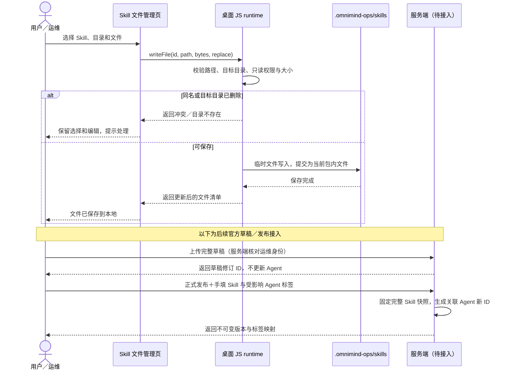
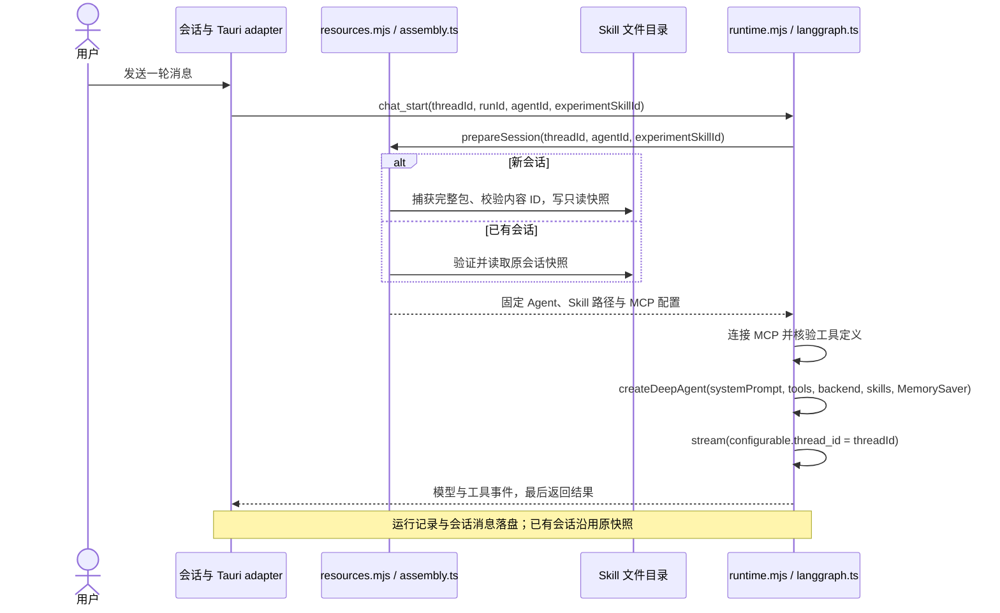
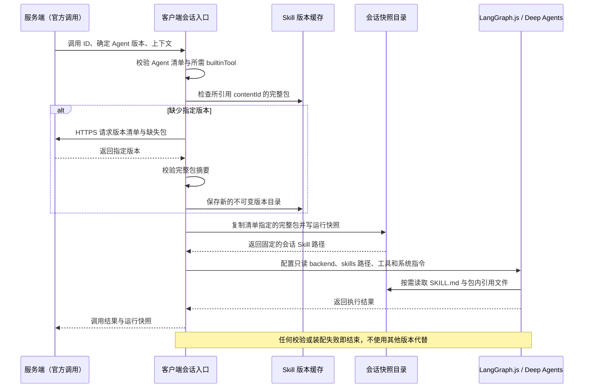

# 客户端 Skill 文件管理、版本与运行加载

我们正在构建一个在客户端管理 Skill、装配 Agent 并执行 Chrome 运维任务的桌面客户端。Skill 的真实文件目录默认为当前用户主目录下的 `.omnimind-ops/skills`，runtime 可通过 `OMNIOPS_BOTS_LOCAL_ROOT` 指定本地数据根目录。前端负责列表、包内文件操作与上传交互；桌面 JavaScript runtime 负责文件落盘；服务端负责官方草稿修订、发布与版本清单。

## 本次已实现的范围

- Skill 列表、包内文件管理共用 `SkillLibrary` 接口。浏览器预览通过 IndexedDB 保存，Tauri 桌面通过既有 `runtime_request` 写入本机文件系统；浏览器存储不代表已经写进桌面目录。
- 桌面支持创建本地 Skill、复制、文本与二进制文件上传、读取、创建目录、重命名、删除。成功提示表示文件操作已完成；关闭并重启客户端后文件仍在。
- 本地 Skill 可编辑；官方已发布目录只读，可复制到本地。文件级上传先保存当前本地包；本次没有接通服务端草稿上传、运维身份判定或发布接口，因此不会把一次文件上传显示成正式发布。
- 同一 Skill 目录供 `skills_list`、`agents_load` 的 Skill 选项及 `assembly.ts` 的完整包捕获使用。桌面执行由固定会话快照装配，不再依赖每轮将 `SKILL.md` 拼进提示词。
- 本地 Agent 配置已持久保存；开始新会话时捕获完整 Skill 包、计算内容摘要并写入只读快照，后续轮次验证并复用。Skill 页面可保存当前编辑、选择 Agent 并在新会话实验，模板和已有会话不变。
- 每个文件上限 20 MiB、每个包上限 100 MiB 和 1000 个文件／目录。上传时目标目录必须仍存在；同名文件须明确替换，大小写冲突不会自动改名。拒绝越界路径、符号链接及系统保留名称，替换先写临时文件再提交；提交前失败保留原文件。未知存储错误保留当前编辑，并提示刷新确认实际结果。

文件管理落盘、官方缓存只读、完整快照与固定装配已经实现。装配时校验本机官方缓存内容是否匹配其内容 ID；官方版本的远端下载与来源验证、草稿修订和发布联动仍待接入。

## 目录：可编辑包与不可变版本分别保存

桌面默认值由 `defaultSkillRoot(homedir())` 生成，例如 macOS 的 `~/.omnimind-ops/skills`。Windows 当前实现使用当前用户主目录下的 `.omnimind-ops\skills`，没有硬编码 D 盘。此前文档中的 `.omniops-bots` 不是本次 Skill 的目录；本次也不会自动迁移或删除旧目录。

```text
~/.omnimind-ops/skills/
├── local/
│   └── <localId>/                  # 已实现：可编辑的完整本地 Skill 包
│       ├── SKILL.md
│       ├── references/
│       └── assets/
├── .metadata/
│   └── <localId>.json             # 已实现：列表名称/描述，放在包外
├── releases/
│   └── <skillId>/
│       ├── tags.json              # 可读取：人工发布标签 → contentId
│       ├── <contentId-A>/          # 可读取、管理接口只读：完整版本 A
│       │   ├── SKILL.md
│       │   └── references/
│       └── <contentId-B>/          # 可读取、管理接口只读：完整版本 B
└── drafts/
    └── <skillId>/                 # 待接入：运维维护的官方草稿工作副本
```

当前本地管理 ID 为 `local/<localId>`；官方缓存 ID 为 `official/<skillId>/<contentId>`。这些是前端使用的不透明身份，包内路径始终相对于该 Skill 根目录。页面不接受任意主机绝对路径。缓存中的每个官方版本有独立身份，不会因另一版本存在而覆盖旧版本。

`.metadata` 保存客户端名称与描述，不作为包内文件，不参与目标发布包和内容指纹；运行入口名称与描述从 `SKILL.md` 的 YAML 元信息读取。导入文件不会覆盖这份元数据。复制官方 Skill 时，新建本地身份及元数据，复制完整文件集合；副本没有发布标签，修改副本不改变原版。

服务端与客户端采用相同的 `skills/releases/<skillId>/<contentId>/` 正式版本布局和 `tags.json` 映射。完整的两端目录对照、草稿修订分布、摘要算法与同步顺序见 [Skill 版本文件布局](./skill-version-layout.md)。

## 版本规则：完整包作为单位

| 对象 | 可编辑内容 | 版本标识 | 谁决定 |
| --- | --- | --- | --- |
| 本地 Skill | `local/<localId>` | 不设发布标签；运行前固定完整内容快照 | 当前用户 |
| 官方草稿 | 运维的本地工作副本；上传后保存服务端修订 | 服务端草稿修订 ID | 服务端保存；运维选择上传 |
| 官方正式 Skill | `releases/<skillId>/<contentId>` 不可变 | 内容 ID ＋人工填写 `v.1.0.0` 标签 | 运维填标签，服务端校验并发布 |
| 已发布 Agent | 固定的系统提示词、Skill 引用、builtinTool 和 MCP 配置 | 装配内容生成 Agent ID，另填人工发布标签 | 服务端发布 |

文件级上传只改变当前工作副本，不生成独立的文件发布版本。正式发布时收集整个包，包含入口、引用文档、脚本和二进制资源；实验日志、截图和执行结果不在包里。草稿保存不触发 Agent 更新；Skill 正式发布才一并更新受影响 Agent 的装配 ID 和人工填写的新标签。

客户端 `assembly.ts` 已实现完整包内容 ID 的生成与校验：路径采用 NFC、POSIX 相对路径，不符合要求则拒绝；按路径排序，记录目录及各文件的字节数、SHA-256；将规范化清单编码后计算 SHA-256，形成包的 `contentId`。时间戳、绝对目录、缓存展示元数据和人工标签均不参与指纹。任何文件字节、路径或目录集合变化都会产生新的包内容 ID。后续发布／同步服务必须使用一致的算法。

`tags.json` 的形状如下；`<contentId>` 表示实际 64 位十六进制摘要，不是字面字符串：

```json
{
  "v.1.0.0": "<contentId-A>",
  "v.1.0.1": "<contentId-B>"
}
```

标签不能重定向或重用。当前读取器只消费缓存标签映射，没有“新增标签”或“修改已发布文件”的客户端写接口。装配已验证本机包的摘要；正式同步接入时，还须校验服务端清单与来源，下载到暂存位置，校验通过后放入新的 `contentId` 目录。这段下载流程尚未实现，不能把手工放入目录的文件视为已经过服务端身份与发布验证。

### 运行模型：文件上传与正式发布



## LangGraph.js 当前实际如何加载

当前调用链为：`desktop/runtime/main.mjs` 启动，`resources.mjs` 提供资源接口，`assembly.ts` 捕获或验证会话装配，`runtime.mjs` 管理每轮生命周期，`langgraph.ts` 调用 `createDeepAgent`。`mcp.ts` 负责真实 Streamable HTTP MCP 连接、能力发现与工具调用。依赖锁定在 `desktop/runtime/package.json`：`@langchain/langgraph` 1.5.0、`@langchain/langgraph-checkpoint` 1.2.0、`deepagents` 1.15.0。

目前的配置是 Agent 的 `skillIds: string[]`。用户在 Agent 配置中勾选 Skill 后保存，`agent_save` 校验这些 ID 存在；`agents_load` 从当前 Skill 根目录生成可选资源。官方 ID 包含明确的 `contentId`，本地 ID 指向可编辑工作包。

```json
{
  "name": "浏览器助手",
  "description": "按任务要求操作内置浏览器。",
  "instructions": "按任务要求操作 Chrome。",
  "skillIds": ["local/<localId>"],
  "toolIds": ["inspect_browser", "read_playwright_script"],
  "mcpServerIds": []
}
```

这段是现有 Agent 的 `configuration` 形状，不是新加的配置文件。Agent 记录连同 `id`、来源、内容 ID 和可选发布标签保存在 `.omnimind-ops/agents/<agentId>.json`，可跨进程读取。本地配置可新建、保存与复制；官方记录只读。真实运行不包含操作审批开关。

`chat_start` 携带 `threadId`、`runId`、所选 `agentId` 和可选的 `experimentSkillId`。运行时先保存本轮占用记录，再调用 `prepareSession`：新会话捕获完整包，已有会话核验原快照。每个 Skill 必须有有效 UTF-8 `SKILL.md` 和 YAML 元信息，入口上限 256 KiB；单包文件、目录和字节上限沿用文件管理约束，一次装配总量不超过 256 MiB。缺少资源、内容摘要不匹配或必要 builtinTool 不可用时，开始模型／工具执行前失败。

`langgraph.ts` 已将完整包快照通过 `backend` 与 `skills` 挂载给 Deep Agents，模型按需读取入口及引用文件。快照保留二进制资源、相对路径和空目录；文件被保存或挂载不代表模型能解释任意二进制格式，也不使包内脚本自动执行。工具发现与实际调用都受所选能力白名单约束。

### 运行模型：当前本地会话装配



当前每轮仍新建 `MemorySaver`，图 checkpoint 仅在本轮内存中；`thread_id` 使用业务会话 ID，不因此获得跨重启 checkpoint。`run-store.ts` 已在 `.records` 保存运行证据、在 `.sessions` 保存消息和装配快照，下一轮由 runtime 恢复已有历史；失败或中断只恢复证据，不恢复待执行图任务。会话固定快照已实现。新增设计已确定将 checkpoint 存入 SQLite，并按 run 隔离、按业务 thread 聚合导出；该持久化与诊断上传尚未接入，见[运维与诊断上传](./requirements-walkthrough/09-运维与诊断上传.md)。

## 完整装配：当前本地实现与后续服务端接入

`assembly.ts` 已从当前本地清单选择具体文件并固定快照，`langgraph.ts` 显式把已选 Skill 的根目录传给 Deep Agents；后续仍需补齐远端版本核对和缺包下载。框架 `skills` 参数接收虚拟 POSIX 路径；`backend` 决定这些虚拟路径如何对应实际文件。一次运行只挂载选中的快照，不把包含全部历史版本的 `.omnimind-ops/skills` 作为搜索目录，避免同名 Skill 相互覆盖。[Deep Agents 的 `skills` 参数](https://reference.langchain.com/javascript/deepagents/index/CreateDeepAgentParams)

Agent 发布清单中的引用应固定内容 ID，标签只供人查看。例如：

```json
{
  "agentId": "<assembly-hash>",
  "releaseTag": "v.1.0.0",
  "skills": [
    {
      "skillId": "chrome-ops",
      "contentId": "<contentId>",
      "releaseTag": "v.1.0.0",
      "mountPath": "/skills/chrome-ops/"
    }
  ]
}
```

一次会话的装配已保存在 `.omnimind-ops/runs/<sha256(threadId)>/`，与 Skill 发布缓存分开。清单指定的官方完整包或本地完整快照复制到该会话的 `skills/<mountName>/`，保持包内相对路径，并写入 `assembly.json`。已运行会话继续使用自己的快照，后来编辑本地文件或缓存新官方版本不改变它；快照损坏时拒绝继续，不能重新捕获成另一份内容。脚本和截图等产物存于会话工作目录的独立位置，不写回只读 Skill。

当前 Deep Agents 配置使用 `FilesystemBackend({ rootDir: snapshot.directory, virtualMode: true })`，把虚拟路径限制在会话快照目录；通过 `permissions` 只允许读取 `/skills/**`，拒绝其他读写，并在工具中间件限制实际能力。`FilesystemBackend` 本身提供读写能力，仅指定 `rootDir` 不等同于只读。[FilesystemBackend API](https://reference.langchain.com/javascript/deepagents/backends/FilesystemBackend)

下面摘示已接入的配置关系；完整实现还包括受控系统指令、能力白名单中间件、取消信号与工具排空，见 [`langgraph.ts`](../desktop/runtime/langgraph.ts)：

```ts
import { createDeepAgent, FilesystemBackend } from "deepagents"

const backend = new FilesystemBackend({
  rootDir: snapshot.directory,
  virtualMode: true,
})

const graph = createDeepAgent({
  model,
  systemPrompt: snapshot.agent.configuration.instructions,
  tools: resolvedBuiltinAndMcpTools,
  backend,
  permissions: [
    { operations: ["read"], paths: ["/skills/**"], mode: "allow" },
    { operations: ["read", "write"], paths: ["/**"], mode: "deny" },
  ],
  skills: snapshot.skills.map(skill => skill.mountPath),
  checkpointer,
})

await graph.stream(input, {
  configurable: { thread_id: threadId },
  signal,
})
```

Deep Agents 会发现所选 Skill 的元信息，并按需读取入口和引用文件；应用负责把版本和权限约束变成实际可读的文件集合。LangGraph 的 `thread_id` 对应图状态，版本仍由应用自己的 Agent／Skill 清单固定。[Skill middleware](https://reference.langchain.com/javascript/deepagents/node/createSkillsMiddleware)；[LangGraph 图与 thread_id](https://docs.langchain.com/oss/javascript/langgraph/thinking-in-langgraph)

### 运行模型：待接入的官方调用与下载



本地手动会话已完成完整装配，后续轮次继续使用已有快照。上图的服务端远端调用、HTTPS 下载和结果回传仍是待接入流程；目标为每次远端调用新建独立会话并核对指定版本。这个设计不要求客户端实现服务端高可用、任务调度或发布审批。

## 服务端需要配合

服务端提供登录与运维身份结果，只有运维可上传官方草稿及正式发布。HTTPS 提供草稿修订、完整包清单／下载及原子联动发布；发布时接受人工标签，确保不可变且不重用。官方 Agent 清单固定 Skill 的 `contentId` 并带 MCP 配置。WebSocket 继续负责调用、取消、状态、结果和接收确认，具体协议另行定义。

## 本次可观测范围

本次文件管理没有新增网络遥测、指标或业务日志；校验、冲突和存储失败由接口返回并在页面展示。文件正文、上传字节和凭据不写入日志。现有 IPC 错误诊断沿用原实现，不为一次文件操作另加埋点；后续远端调用与发布接入时再按已确认的执行记录和运行快照边界补齐观测。
