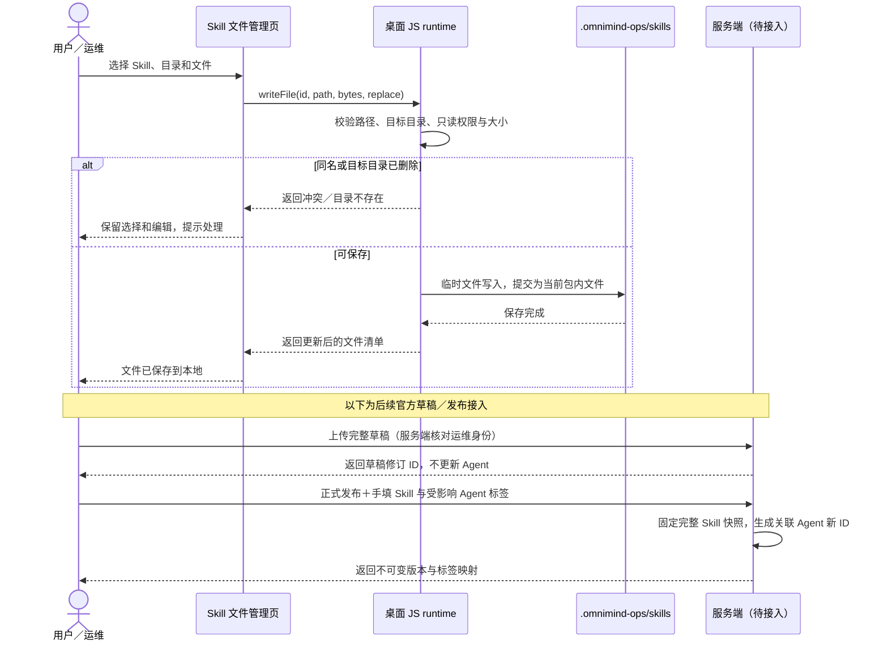
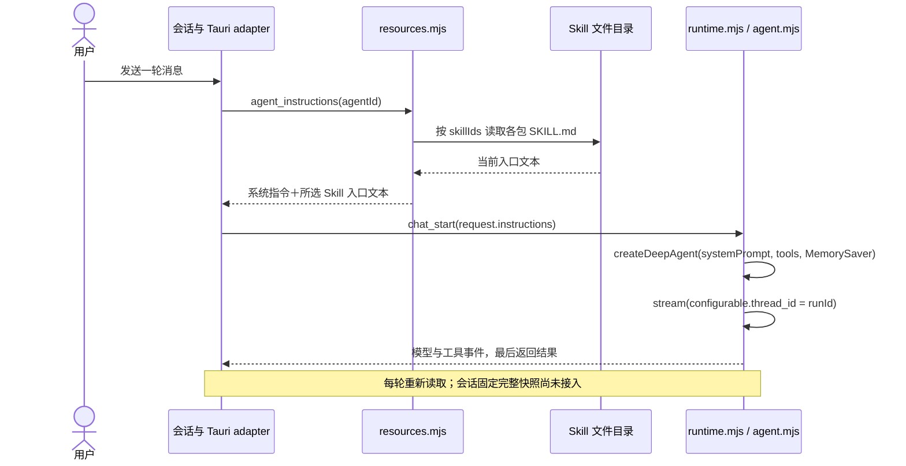
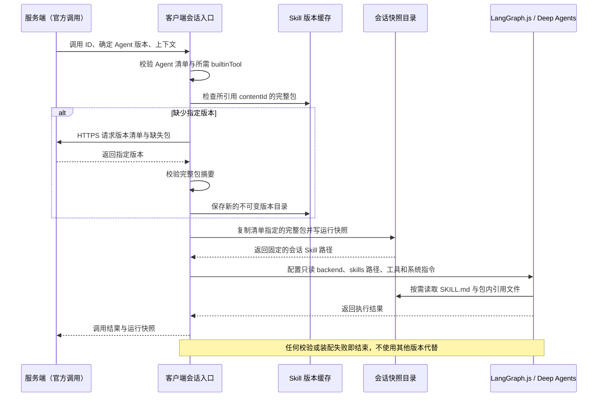

# 客户端 Skill 文件管理、版本与运行加载

我们正在构建一个在客户端管理 Skill、装配 Agent 并执行 Chrome 运维任务的桌面客户端。Skill 的真实文件目录固定为当前用户主目录下的 `.omnimind-ops/skills`。前端负责列表、包内文件操作与上传交互；桌面 JavaScript runtime 负责文件落盘；服务端负责官方草稿修订、发布与版本清单。

## 本次已实现的范围

- Skill 列表、包内文件管理共用 `SkillLibrary` 接口。浏览器预览通过 IndexedDB 保存，Tauri 桌面通过既有 `runtime_request` 写入本机文件系统；浏览器存储不代表已经写进桌面目录。
- 桌面支持创建本地 Skill、复制、文本与二进制文件上传、读取、创建目录、重命名、删除。成功提示表示文件操作已完成；关闭并重启客户端后文件仍在。
- 本地 Skill 可编辑；官方已发布目录只读，可复制到本地。文件级上传先保存当前本地包；本次没有接通服务端草稿上传、运维身份判定或发布接口，因此不会把一次文件上传显示成正式发布。
- 新目录同时供 `skills_list`、`agents_load` 的 Skill 选项和 `agent_instructions` 使用。没有只写管理目录、运行时仍读取旧目录的分叉。
- 每个文件上限 20 MiB、每个包上限 100 MiB 和 1000 个文件／目录。上传时目标目录必须仍存在；同名文件须明确替换，大小写冲突不会自动改名。拒绝越界路径、符号链接及系统保留名称，替换先写临时文件再提交；提交前失败保留原文件。未知存储错误保留当前编辑，并提示刷新确认实际结果。

文件管理的落盘、官方缓存的只读约束已经实现。官方版本的下载校验、草稿修订、发布联动、会话开始时完整快照与固定装配仍需要后续对接，不能以本次页面完成作为这些能力已完成的依据。

## 目录：可编辑包与不可变版本分别保存

桌面默认值由 `defaultSkillRoot(homedir())` 生成，例如 macOS 的 `~/.omnimind-ops/skills`。Windows 当前实现使用当前用户主目录下的 `.omnimind-ops\skills`，没有硬编码 D 盘。此前文档中的 `.omniops-bots` 不是本次 Skill 的目录；本次也不会自动迁移或删除旧目录。

```text
~/.omnimind-ops/skills/
├── local/
│   └── <localId>/                  # 已实现：可编辑的完整本地 Skill 包
│       ├── SKILL.md
│       ├── references/
│       └── assets/
├── .metadata/
│   └── <localId>.json             # 已实现：列表名称/描述，放在包外
├── releases/
│   └── <skillId>/
│       ├── tags.json              # 可读取：人工发布标签 → contentId
│       ├── <contentId-A>/          # 可读取、管理接口只读：完整版本 A
│       │   ├── SKILL.md
│       │   └── references/
│       └── <contentId-B>/          # 可读取、管理接口只读：完整版本 B
└── drafts/
    └── <skillId>/                 # 待接入：运维维护的官方草稿工作副本
```

当前本地管理 ID 为 `local/<localId>`；官方缓存 ID 为 `official/<skillId>/<contentId>`。这些是前端使用的不透明身份，包内路径始终相对于该 Skill 根目录。页面不接受任意主机绝对路径。缓存中的每个官方版本有独立身份，不会因另一版本存在而覆盖旧版本。

`.metadata` 保存客户端名称与描述，不作为包内文件，不参与目标发布包和内容指纹；当前本地名称也用于提示词中的 Skill 标识。导入文件不会覆盖这份元数据。复制官方 Skill 时，新建本地身份及元数据，复制完整文件集合；副本没有发布标签，修改副本不改变原版。

服务端与客户端采用相同的 `skills/releases/<skillId>/<contentId>/` 正式版本布局和 `tags.json` 映射。完整的两端目录对照、草稿修订分布、摘要算法与同步顺序见 [Skill 版本文件布局](./skill-version-layout.md)。

## 版本规则：完整包作为单位

| 对象 | 可编辑内容 | 版本标识 | 谁决定 |
| --- | --- | --- | --- |
| 本地 Skill | `local/<localId>` | 不设发布标签；运行前固定完整内容快照 | 当前用户 |
| 官方草稿 | 运维的本地工作副本；上传后保存服务端修订 | 服务端草稿修订 ID | 服务端保存；运维选择上传 |
| 官方正式 Skill | `releases/<skillId>/<contentId>` 不可变 | 内容 ID ＋人工填写 `v.1.0.0` 标签 | 运维填标签，服务端校验并发布 |
| 已发布 Agent | 固定的系统提示词、Skill 引用、builtinTool 和 MCP 配置 | 装配内容生成 Agent ID，另填人工发布标签 | 服务端发布 |

文件级上传只改变当前工作副本，不生成独立的文件发布版本。正式发布时收集整个包，包含入口、引用文档、脚本和二进制资源；实验日志、截图和执行结果不在包里。草稿保存不触发 Agent 更新；Skill 正式发布才一并更新受影响 Agent 的装配 ID 和人工填写的新标签。

内容 ID 的生成与校验需要发布／同步服务实现，约定为：路径规范化为 NFC、POSIX 相对路径；按路径排序，记录目录及各文件的字节数、SHA-256；将规范化清单编码后计算 SHA-256，形成包的 `contentId`。时间戳、绝对目录、缓存展示元数据和人工标签均不参与指纹。任何文件字节、路径或目录集合变化都会产生新的包内容 ID。

`tags.json` 的形状如下；`<contentId>` 表示实际 64 位十六进制摘要，不是字面字符串：

```json
{
  "v.1.0.0": "<contentId-A>",
  "v.1.0.1": "<contentId-B>"
}
```

标签不能重定向或重用。当前读取器只消费缓存标签映射，没有“新增标签”或“修改已发布文件”的客户端写接口。正式同步接入时，还须校验服务端清单与包摘要，下载到暂存位置，校验通过后放入新的 `contentId` 目录；本次没有实现这段下载与完整性验证，不能把手工放入目录的文件视为已经过服务端验证。

### 运行模型：文件上传与正式发布



## LangGraph.js 当前实际如何加载

仓库没有名为 `langgraph.ts` 的入口。当前客户端用的是 JavaScript 模块：`desktop/runtime/main.mjs` 启动，`resources.mjs` 读取资源，`runtime.mjs` 执行任务，`agent.mjs` 调用 `createDeepAgent`。依赖锁定在 `desktop/runtime/package.json`：`@langchain/langgraph` 1.5.0、`deepagents` 1.15.0。

目前的配置是 Agent 的 `skillIds: string[]`。用户在 Agent 配置中勾选 Skill 后保存，`agent_save` 校验这些 ID 存在；`agents_load` 从当前 Skill 根目录生成可选资源。官方 ID 包含明确的 `contentId`，本地 ID 指向可编辑工作包。

```json
{
  "name": "浏览器助手",
  "instructions": "按任务要求操作 Chrome。",
  "skillIds": ["local/<localId>"],
  "toolIds": ["inspect_browser", "read_playwright_script"],
  "mcpServerIds": [],
  "requireApproval": true
}
```

这段是现有 Agent 配置形状的说明，不是新加的配置文件。当前 Agent 配置保存在 runtime 内存中；本次只新增 Skill 文件的持久化，没有宣称 Agent 配置可跨进程重启恢复。

当前每轮发送之前，Tauri adapter 调用 `agent_instructions`；资源层重新读取已选 Skill 的 UTF-8 `SKILL.md`，拼接到 Agent 指令，再随 `chat_start` 传给 `createBrowserAgent` 的 `extraInstructions`。缺少 Skill、缺少有效入口或指令过长直接失败。文本来源限制为单文件 256 KiB，资源目录文本合计 32 MiB；Agent 最终指令合计最多 256 Ki 字符。

这条路径只把入口内容提供给提示词，**尚未将包内所有文件挂载到 Deep Agents 的 Skill 文件后端**。虽然管理页可以保存 `references/`、图片和其他资源，当前模型并不会因此自动获得这些文件的读取能力。`createDeepAgent` 当前没有传 `skills` 或 `backend` 配置，不能把“文件已上传”解释为“完整 Skill 已装配到一次运行”。

### 运行模型：当前入口读取路径



现有 `MemorySaver` 和 `thread_id` 用于单次运行的图状态与工具中断，不能替代 Skill 包版本管理，也不代表持久化会话快照。当前实现每轮会新建 checkpointer，下一轮历史消息由前端再次传入。此前确认的“会话固定开始时快照，新版本只在新会话生效”仍是必须完成的后续运行需求。

## 完整装配的目标：由清单选择具体文件，再交给 LangGraph.js

后续可以把装配入口命名为 `langgraph.ts`，但该名称不会让框架自动扫描文件。应用先解析 Agent 清单、补齐物料并固定运行快照，再显式把已选 Skill 的根目录传给 Deep Agents。框架 `skills` 参数接收虚拟 POSIX 路径；`backend` 决定这些虚拟路径如何对应实际文件。不能直接把包含全部历史版本的 `.omnimind-ops/skills` 当成一次运行的 Skill 搜索目录，因为同名 Skill 的多个来源存在覆盖次序。[Deep Agents 的 `skills` 参数](https://reference.langchain.com/javascript/deepagents/index/CreateDeepAgentParams)

Agent 发布清单中的引用应固定内容 ID，标签只供人查看。例如：

```json
{
  "agentId": "<assembly-hash>",
  "releaseTag": "v.1.0.0",
  "skills": [
    {
      "skillId": "chrome-ops",
      "contentId": "<contentId>",
      "releaseTag": "v.1.0.0",
      "mountPath": "/skills/chrome-ops/"
    }
  ]
}
```

一次会话的装配目录应放在 `.omnimind-ops/runs/<sessionId>/`，与 Skill 发布缓存分开。把清单指定的官方完整包或本地完整快照复制到该会话的 `skills/<mountName>/`，保持包内相对路径；同时保存运行清单。已运行会话继续使用自己的快照，后来编辑本地文件或同步新官方版本不改变它。日志和实验截图另存该会话的产物目录，不写回 Skill。

接入 Deep Agents 时，明确设置 `FilesystemBackend({ rootDir: snapshot.directory, virtualMode: true })`，把虚拟路径限制在会话快照目录；再通过 `permissions` 只允许读取 `/skills/**`，拒绝其他读写。`FilesystemBackend` 本身提供读写能力，仅指定 `rootDir` 不等同于只读。[FilesystemBackend API](https://reference.langchain.com/javascript/deepagents/backends/FilesystemBackend)

下面给出将来 `langgraph.ts` 的配置形状，已核对项目锁定的 Deep Agents 1.15.0 类型定义。`snapshot`、工具解析和会话生命周期仍需接入，当前没有这个运行入口：

```ts
import { createDeepAgent, FilesystemBackend } from "deepagents"

const backend = new FilesystemBackend({
  rootDir: snapshot.directory,
  virtualMode: true,
})

const graph = createDeepAgent({
  model,
  systemPrompt: snapshot.agent.instructions,
  tools: resolvedBuiltinAndMcpTools,
  backend,
  permissions: [
    { operations: ["read"], paths: ["/skills/**"], mode: "allow" },
    { operations: ["read", "write"], paths: ["/**"], mode: "deny" },
  ],
  skills: snapshot.skills.map(skill => skill.mountPath),
  checkpointer,
})

await graph.stream(input, {
  configurable: { thread_id: sessionId },
  signal,
})
```

Deep Agents 会发现所选 Skill 的元信息，并按需读取入口和引用文件；应用负责把版本和权限约束变成实际可读的文件集合。LangGraph 的 `thread_id` 对应图状态，版本仍由应用自己的 Agent／Skill 清单固定。[Skill middleware](https://reference.langchain.com/javascript/deepagents/node/createSkillsMiddleware)；[LangGraph 图与 thread_id](https://docs.langchain.com/oss/javascript/langgraph/thinking-in-langgraph)

### 运行模型：目标会话固定装配



手动会话也先完成相同装配；后续轮次继续使用已有快照。服务端每次远端调用新建独立会话，因此每次调用都核对指定版本。这个设计不要求客户端实现服务端高可用、任务调度或发布审批。

## 服务端需要配合

服务端提供登录与运维身份结果，只有运维可上传官方草稿及正式发布。HTTPS 提供草稿修订、完整包清单／下载及原子联动发布；发布时接受人工标签，确保不可变且不重用。官方 Agent 清单固定 Skill 的 `contentId` 并带 MCP 配置。WebSocket 继续负责调用、取消、状态、结果和接收确认，具体协议另行定义。

## 本次可观测范围

本次文件管理没有新增网络遥测、指标或业务日志；校验、冲突和存储失败由接口返回并在页面展示。文件正文、上传字节和凭据不写入日志。现有 IPC 错误诊断沿用原实现，不为一次文件操作另加埋点；后续远端调用与发布接入时再按已确认的执行记录和运行快照边界补齐观测。
