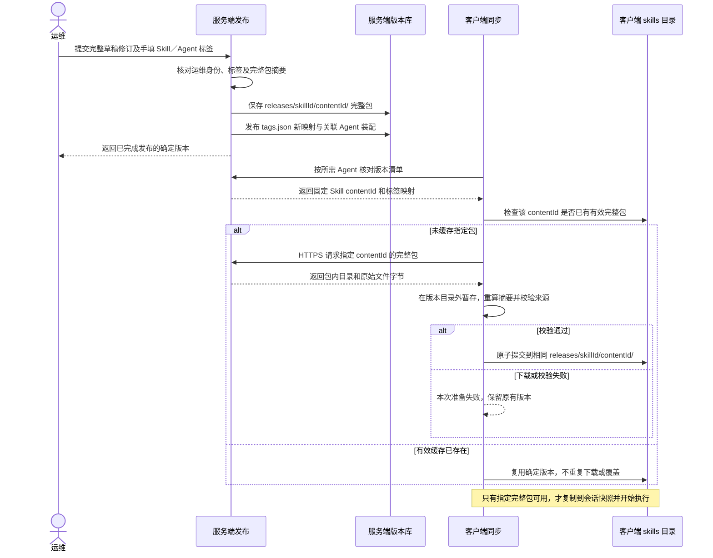

# Skill 版本文件布局：客户端与服务端统一约定

客户端与服务端使用同一套 Skill 正式版本相对路径、包内结构、内容摘要和标签映射。服务端保存正式版本全集，客户端按 Agent 所需版本下载并保留缓存；两端的根目录由部署环境决定，版本目录不做重新命名或重组。

本文是服务端发布与同步需要遵循的共同约定。客户端已有正式缓存读取和完整包摘要校验；服务端存储、发布和远端下载仍待接入。

## 正式版本在两端怎样存放

两端都把 `skills/` 作为 Skill 根目录，其下的正式版本布局一致：

```text
<数据根目录>/skills/
└── releases/
    └── chrome-ops/                    # 稳定的 skillId
        ├── tags.json                  # 人工标签 → 完整包 contentId
        ├── <contentId-A>/             # 一个不可变的完整版本
        │   ├── SKILL.md
        │   ├── references/
        │   │   └── login.md
        │   ├── scripts/
        │   │   └── inspect.js
        │   └── assets/
        │       └── example.png
        └── <contentId-B>/             # 修改后产生的另一个完整版本
            ├── SKILL.md
            ├── references/
            │   └── login.md
            ├── scripts/
            │   └── inspect.js
            └── assets/
                └── example.png
```

`<contentId-A>`、`<contentId-B>` 是示意名称，实际目录名为 64 位小写十六进制 SHA-256 摘要。每个目录直接包含完整包，不增加 `package/` 包装层，也不按标签复制一份目录。

| 对象 | 服务端 | 客户端 |
| --- | --- | --- |
| 数据根目录 | 部署配置的数据目录，例如 `/srv/omniops-data`；不规定部署盘符 | 默认 `~/.omnimind-ops`；配置本地根目录时以实际配置为准 |
| 正式完整包 | `<服务端根>/skills/releases/<skillId>/<contentId>/` | `<客户端根>/skills/releases/<skillId>/<contentId>/` |
| 标签索引 | `skills/releases/<skillId>/tags.json`，由正式发布写入 | 同一相对路径，缓存服务端确认的映射，客户端不自行改标签 |
| 包内文件 | 例如 `<contentId>/references/login.md` | 同一相对路径、相同原始字节，不改变编码、换行或文件名 |

假设本次 Agent 引用 `chrome-ops` 的版本 B，文件对应关系为：

```text
服务端：/srv/omniops-data/skills/releases/chrome-ops/<contentId-B>/SKILL.md
客户端：~/.omnimind-ops/skills/releases/chrome-ops/<contentId-B>/SKILL.md
运行时：~/.omnimind-ops/runs/<sha256(threadId)>/skills/<mountName>/SKILL.md
```

前两处是同一正式版本的存储与缓存；运行目录是该版本的会话只读副本。`langgraph.ts` 只挂载当前会话选中的 Skill，不能扫描整个正式版本库来决定使用哪个版本。

## 标签怎样对应版本

`tags.json` 是标签索引，不是包内容。其结构在两端完全一致：

```json
{
  "v.1.0.0": "<contentId-A>",
  "v.1.0.1": "<contentId-B>"
}
```

示例中的摘要占位符应替换为实际 64 位摘要。正式标签由运维手填，发布后不能重用、覆盖或改指向。新版本新增一个包目录和一个标签映射；同一 Skill 的完全相同内容可以复用同一包目录，不因新增标签复制内容。

Agent 装配固定 `skillId + contentId`，标签用于人查看。不能通过标签字符串排序或 `latest/` 可变目录代替确定版本；已有会话也不因标签索引更新而切换包。客户端同步版本清单不等于下载全部包，因此 `tags.json` 中可以存在尚未缓存的版本；真正运行前必须取得并校验指定完整包。

系统生成的发布元信息、上传者、发布时间、标签和传输清单保存在包外。不能向已经计算摘要的 `<contentId>/` 内补写这些文件，也不能把压缩包本身留在版本目录中，否则会改变完整包摘要。Skill 作者主动放入包内的资源文件仍属于包内容，正常参与版本计算。

## 草稿、正式版本和本地内容的边界

| 内容 | 文件位置与规则 |
| --- | --- |
| 服务端草稿修订 | `skills/drafts/<skillId>/revisions/<draftRevisionId>/` 直接保存本次上传的完整包；每次保存新增修订，保留旧修订，不产生正式标签、不联动 Agent |
| 客户端已下载草稿修订 | 如果运维需要下载某个修订，同样放入 `skills/drafts/<skillId>/revisions/<draftRevisionId>/`，保持原路径与字节；按需缓存，不要求下载草稿历史全集 |
| 客户端官方草稿工作副本 | `skills/drafts/<skillId>/working/`，承载未同步编辑；从某个修订复制后编辑，不直接修改已保存修订。上传时捕获完整内容，由服务端生成新的修订 ID |
| 客户端私有 Skill | `skills/local/<localId>/`，可自由编辑、不设正式标签；列表元信息放在包外的 `skills/.metadata/`，不要求服务端保存一份 |
| 会话运行副本 | 数据根目录的 `runs/<sha256(threadId)>/skills/<mountName>/`；运行快照、日志、截图和其他产物不写入正式包或草稿修订 |

需要两端一致的是**同一正式版本或同一草稿修订的相对目录与内容**。客户端的私有内容、未同步工作副本及会话运行目录各自承担本地职责，不作为服务端版本库的镜像。上述草稿修订与工作副本布局属于后续服务端接入约定，当前文件管理器尚未实现这套官方草稿读写。

`draftRevisionId` 标识一次保存，`contentId` 标识完整内容，人工标签标识一次正式发布，三者不能互相替代。正式发布选择确定的草稿修订并固定内容；Skill 与受影响 Agent 的新标签一次提交，只有完整包、Skill 标签和关联 Agent 版本均可取得时，才对外宣布发布成功。

## 两端必须计算出相同的 contentId

以当前客户端 [`packageContentId`](../desktop/runtime/assembly.ts) 的规则为共同契约：

1. 包内路径必须已采用 NFC、POSIX 相对路径，不符合则拒绝；服务端不能在发布或传输时悄悄改名。文件按原始字节处理，不做换行、编码或 BOM 转换。
2. 枚举全部文件与目录，包括空目录，不包含包根目录自身。目录条目包含 `path`、`kind: "folder"`；文件条目包含 `path`、`kind: "file"`、字节数 `bytes` 和文件字节的 `sha256`。拒绝重复路径及大小写冲突。
3. 条目按 `path` 的 JavaScript 字符串比较顺序排序，即 UTF-16 代码单元顺序；对象键也递归按该顺序排序。不能使用区域语言排序。
4. 对规范化条目数组执行与 `JSON.stringify` 一致的紧凑 JSON 编码，无缩进、无额外空格或末尾换行；将字符串编码为 UTF-8，再计算 SHA-256，得到小写 `contentId`。跨语言实现须保持相同转义规则，不能使用默认的全量 Unicode 转义输出。
5. 绝对路径、时间戳、权限位、包外元信息和标签不参与摘要。原始文件字节、路径或目录集合有变化，就必须重新计算内容 ID。

服务端发布时计算一次，客户端接收后独立计算并核对。摘要相同也不代替服务端身份与发布来源验证；当前客户端本机装配校验已实现，HTTPS 同步和来源验证仍待接入。

## 运行模型：发布版本并同步到相同目录



下载和发布的暂存内容放在正式版本目录外；完整性校验通过后再提交，读者不能看到半包。客户端收到与已有标签指向不一致的映射，或发现同一个内容 ID 对应不同字节时，拒绝本次同步并报告原因，不覆盖已有映射或历史包。服务端保留正式历史，客户端保留已经下载的历史包；本期不自动清理。

按周发布只增加新的确定版本和人工标签，不改变这套目录规则。服务端的高可用、具体 API 字段和存储部署方式另行确定；本次只补充文档约定，不实现服务端或同步代码。
