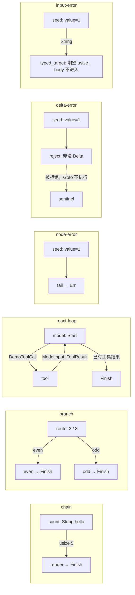

# Design

## Context

本设计落实已确认的最小执行框架：节点返回 Outcome，Scheduler 执行节点、应用 Delta 并路由。`Cluster` 是可复用的节点集合与查找入口，替代讨论中的 Plan；它不表示并行集群，也不保存静态边。Generation 完成不等于 Run 完成。

现有 `cognacta-core` 已承载公共业务对象、`Protocol` 和统一 `Error`，并依赖 `async-trait`、`bon`、`thiserror`、`tracing`。通用调度模块放在 core；CLI 专用图与节点留在 `cognacta-cli` 的私有 `cluster_demo` 模块。复用现有 Collector 与 Tokio 入口，无须新 crate 或运行时依赖。

## Goals / Non-Goals

目标：公开可独立调用的类型化节点接口；统一注册异构 Input/Payload；Run 借用 Cluster；单路串行 Goto/Finish；明确失败、状态原子性、最小观测；通过 CLI 装配六张确定性测试图、运行七个案例。

不包含：Send、并行、fan-in/join、静态条件边、图 DSL、自动恢复、重试、超时、步数限制、持久化、外部副作用回滚、真实模型/工具请求、Scheduler 新指标。本文仅为设计，不提前编写产品实现。

## Decisions

### 1. 根公开 API 与构造入口

core 根新增导出 `NodeId`、`State`、`NodeContext`、`NodeInstance`、`Outcome`、`Control`、`Node`、`Cluster`、`Run`、`RunStatus`、`Scheduler`；继续使用既有 `Error`、`ErrorKind`。bon 生成的 `NodeBuilder`、`ClusterStartBuilder` 及对应状态模块作为构造入口配套公开可达，不暴露 body 容器。`Data`、`ErasedNode`、`RunPhase`、注册容器、内部调用与观测辅助逻辑均保持私有。

下列是完整领域接口契约，省略方法体；bon 标注的函数给出输入类型、返回类型及校验入口，其公开 builder 调用见后文。生成的 builder 类型及必要状态模块须通过公开可达路径提供，调用方无需引用内部调度模块。所有异步 trait 及其 impl，包括 CLI 节点作者的 impl，统一使用 `#[async_trait]`；同步 State 不使用该宏。

```rust
pub type NodeId = String;

pub trait State: Send + Sync {
    type Delta: Send;
    fn apply_delta(&mut self, delta: Self::Delta) -> Result<(), Error>;
}

pub struct NodeContext<'a, S: State> {
    pub state: &'a S,
}

#[async_trait]
pub trait NodeInstance<S: State>: Send + Sync {
    type Input: Send;
    type Payload: Send;
    async fn run(
        &self, input: Self::Input, ctx: NodeContext<'_, S>,
    ) -> Result<Outcome<S::Delta, Self::Payload>, Error>;
}

pub struct Outcome<D, P> {
    pub state_delta: Option<D>,
    pub control: Control<P>,
}

pub enum Control<P> {
    Goto { target: NodeId, input: P },
    Finish,
}

pub struct Node<B> { /* private id: NodeId, body: B */ }
#[bon::bon]
impl<B> Node<B> {
    #[builder(start_fn = builder)]
    pub fn new(id: NodeId, body: B) -> Result<Self, Error>;
    pub fn id(&self) -> &NodeId;
}

pub struct Cluster<S: State> { /* private node registry */ }
#[bon::bon]
impl<S: State> Cluster<S> {
    pub fn new() -> Self;
    pub fn add<B>(&mut self, node: Node<B>) -> Result<(), Error>
    where B: NodeInstance<S> + 'static,
          B::Input: 'static, B::Payload: 'static;

    #[builder]
    pub fn start<'c, I>(
        &'c self, state: S, entry: NodeId, input: I,
    ) -> Result<Run<'c, S>, Error>
    where I: Send + 'static;
}

pub struct Run<'c, S: State> { /* private cluster, state, phase */ }
#[derive(Clone, Copy, Debug, Eq, PartialEq)]
pub enum RunStatus { Ready, Running, Completed, Failed }

impl<S: State> Run<'_, S> {
    pub fn state(&self) -> &S;
    pub fn status(&self) -> RunStatus;
    pub fn node_id(&self) -> Option<&NodeId>;
}

pub struct Scheduler { /* private representation */ }
impl Scheduler {
    pub fn new() -> Self;
    pub async fn drive<S: State>(
        &self, run: &mut Run<'_, S>,
    ) -> Result<(), Error>;
}
```

`Cluster`、`Scheduler` 的 `Default` 与 `new()` 等价。Node 的 id/body 私有，无 body 读取入口。`Node::builder().id(...).body(...).build()` 必须执行 `new` 的校验：ID 非空、无首尾空白、无控制字符；失败为 `InvalidRequest`。不自动修剪或改写 ID。Cluster 构造无业务参数，保持 `new()`，不增加空 builder。

`Cluster::add` 消费 Node，重复 ID 返回 DuplicateNode，保留原节点；没有覆盖 API。`start().state(...).entry(...).input(...).call()` 先验证入口存在，再装箱 Input 并创建 Ready；入口不存在时不产生 Run，也不执行任何 body。入口类型检查在执行阶段进行。`Run::node_id()` 在 Ready/Running/Failed 返回相应节点，在 Completed 返回 None。无 `state_mut`、`into_state`、公开 Run 构造器或 phase 修改入口。

以下示例只定义一个使用方 State/body 并调用公开 API，展示契约可达性，不是 Scheduler 的提前实现：

```rust
use async_trait::async_trait;
use cognacta_core::{Cluster, Control, Error, ErrorKind, Node, NodeInstance,
    NodeContext, Outcome, RunStatus, Scheduler, State};

struct Total(u32);
impl State for Total {
    type Delta = u32;
    fn apply_delta(&mut self, delta: u32) -> Result<(), Error> {
        let next = self.0.checked_add(delta)
            .ok_or_else(|| Error::new(ErrorKind::InvalidRequest, "total overflow"))?;
        self.0 = next;
        Ok(())
    }
}
struct Add;
#[async_trait]
impl NodeInstance<Total> for Add {
    type Input = u32;
    type Payload = ();
    async fn run(&self, input: u32, ctx: NodeContext<'_, Total>)
        -> Result<Outcome<u32, ()>, Error>
    {
        let _previous = ctx.state.0;
        Ok(Outcome { state_delta: Some(input), control: Control::Finish })
    }
}
async fn example() -> Result<(), Error> {
    let mut cluster = Cluster::<Total>::new();
    cluster.add(Node::builder().id("add".to_owned()).body(Add).build()?)?;
    let mut run = cluster.start().state(Total(1))
        .entry("add".to_owned()).input(2_u32).call()?;
    Scheduler::new().drive(&mut run).await?;
    assert_eq!(run.status(), RunStatus::Completed);
    assert_eq!(run.state().0, 3);
    assert_eq!(run.node_id(), None);
    Ok(())
}
```

### 2. 类型适配与共享状态

每个 body 固定一种 Input 与一种 Payload；不同 body 可以不同。注册要求 body/Input/Payload 为 `'static`，内部使用 `Data = Box<dyn Any + Send>` 和 `Box<dyn ErasedNode<S>>`。通用适配先 downcast Input，成功才调用 body，再将 Goto 的 Payload 装箱；State、Delta 始终为具体 S 与 S::Delta。没有公开 Adapter，也没有编译期跨节点类型匹配保证。

`NodeContext.state` 是共享只读借用；内部可变性仍须由节点作者遵守“只能返回 Delta 修改业务 State”的契约。`apply_delta` 只执行同步内存更新，必须先完成可能失败的校验再提交；返回 Err 时 State 与调用前相同。框架不要求 Clone，也不自动回滚任意 State 或外部副作用。

### 3. Run 所有权与 Scheduler 顺序

Run 持有 `&'c Cluster<S>`、独占的 S 和私有互斥阶段。多个 Run 可借用同一 Cluster，但拥有各自 State；存续期间不可通过 `&mut Cluster` 注册节点。Run 不持有完整 Error，不克隆 Input。

```text
Ready { node_id, input } → Running { node_id }
Running → Ready { next_node_id, next_input }   // Delta 成功 + Goto
Running → Completed                          // Delta 成功 + Finish
Running → Failed { node_id }                  // 查找/适配/body/Delta 失败
```

私有 `begin_step(&mut self) -> Result<(NodeId, Data), Error>` 先借用 phase：非 Ready 原样返回 RunNotReady；Ready 克隆 NodeId 构造 Running。`mem::replace(&mut phase, running)` 返回旧 Ready 的所有权，拆出原 NodeId 与 Input。防御性兜底恢复旧阶段并返回错误。检查与替换间无 await，持有独占借用；只克隆 ID，Input 原 Box 移出。

`drive` 串行循环：begin_step → 按 ID 查找 → 适配 Input → await body → 结束 State 共享借用 → 应用可选 Delta → Goto 写入 Ready 或 Finish 写入 Completed。Finish 成功返回 `Ok(())`。本步查找、适配、body 和 Delta 的错误先进入统一结算出口，再写 Failed 并返回完整 Error；不得通过外层 `?` 提前留下 Running。非法阶段调用不修改 phase。

Goto 目标与其 Input 在下一轮检查。A 的 Delta 已提交后，B 不存在或类型不匹配，Run 记录 Failed(B)，保留 A 的 State；Failed.node_id 表示失败的调用尝试位置，不保证 body 已进入。Delta 失败则不处理同一 Outcome 的 Goto/Finish。

取消 future 不增加取消阶段或恢复能力，可能留下 Running；后续 drive 返回 RunNotReady。panic 不转换为业务 Error，也不声称已结算；库不捕获 panic 并伪装为取消。

### 4. 统一 Error 与边界转换

保留当前 `#[derive(thiserror::Error)]` 的 core Error struct 及其全部既有公开构造/读取入口，不另设公共 SchedulerError。增加私有 `node_id: Option<NodeId>`，提供 `pub fn with_node_id(self, node_id: NodeId) -> Self` 与 `pub fn node_id(&self) -> Option<&NodeId>`；既有 Error builder 也可设置该可选字段。标准 `std::error::Error::source()` 仍返回原始来源链。

| ErrorKind | 位置与上下文 | 来源与状态 |
| --- | --- | --- |
| InvalidRequest（既有） | Node ID 校验失败 | 未创建 Node，无 Run |
| DuplicateNode | add，重复 ID | 不覆盖既有节点 |
| UnknownNode | start 或节点查找，目标 ID | start 无 Run；执行中 Failed(目标) |
| InputTypeMismatch | 适配层，目标 ID 与安全的期望类型名 | body 未进入；不宣称 Any 能提供实际类型名 |
| RunNotReady | drive/begin_step，当前节点若存在 | 保持阶段，无执行 |
| NodeExecution | body 返回 Err，调用节点 | 外层 Error 的 source 保存完整原 Error |
| StateDeltaRejected | apply_delta 返回 Err，当前节点 | 外层 source 保存完整原 Error；State 原样 |

适配层仅包装 body 的错误为 NodeExecution，不能把查找/类型错误一起包装，否则分类丢失。Cluster 的内部调用入口追加节点上下文；Scheduler 为 Delta 错误追加分类和节点。未知、重复、类型不匹配等框架校验错误没有虚构来源。统一 Error 的 message 是安全诊断，不写 Input、State、Delta 或原始外部错误文本。所有自有可失败 API 返回 `cognacta_core::Error`；State/NodeInstance 的实现也遵守该契约。

CLI 将既有 `Error::Generation(#[from] cognacta_core::Error)` 改为 `Core`，不增加第二个相同来源的自动转换。CLI 统一错误出口对新增调度分类输出固定分类名（例如 NodeExecution）和安全编码后的 node_id，禁止打印 body/Delta 原始错误正文与 source；其余 core 错误沿用现有展示方式，保持 chat 契约。CLI 是展示与退出码边界；不得把 Core 错误反向转换成 Provider 错误。保留 source 不授权 Debug 或完整来源链进入日志。现有 Generation `error_kind` 穷尽映射须为新分类补充固定字符串，并保持原分类语义不变。

### 5. CLI 装配六张图、运行七个案例

命令为 `cargo run -p cognacta-cli --features cognacta-test -- cluster-demo <SCENARIO>`；clap 值枚举接受下表七项。图、业务 State/Delta、普通测试 body 与装配逻辑都在 CLI 私有 `cluster_demo.rs`，只使用 core 公开 API；没有 JSON/YAML 图加载器、真实网络请求或生产工具协议承诺。

下图是 body 返回 Goto 的路径示意，不是静态 edge API：



| SCENARIO | 可观察结果 | 退出码 |
| --- | --- | --- |
| chain | count 接收 String hello、提交 length=5、Goto render(5_usize)；render 提交 output=len=5 后 Finish | 0 |
| branch-even | 输入 2_i64，route 选择 even，仅 even body 执行，提交 branch=even | 0 |
| branch-odd | 输入 3_i64，route 选择 odd，仅 odd body 执行，提交 branch=odd | 0 |
| react-loop | fake model → tool → model；ModelInput 为 Start/ToolResult，工具调用为私有 DemoToolCall；model_calls=2、tool_calls=1、answer=5 | 0 |
| node-error | seed 成功提交 value=1，fail 返回业务错误；Failed(fail)，value=1 | 1 |
| delta-error | seed 提交 value=1；reject 返回非法 Delta 与 Goto(sentinel)；Failed(reject)，value=1，sentinel 未执行 | 1 |
| input-error | seed 提交 value=1 并传 String；typed_target 需要 usize；Failed(typed_target)，value=1，body 未进入 | 1 |

正常 I/O 下，每次 stdout 恰好一个摘要行，字段顺序固定，以换行结尾；摘要由实际 Run 和 State 生成，不硬编码期望结果：

```text
status=completed length=5 output=len=5
status=completed branch=even
status=completed branch=odd
status=completed model_calls=2 tool_calls=1 answer=5
status=failed node=fail value=1
status=failed node=reject value=1
status=failed node=typed_target value=1
```

预期失败图也返回 CLI Core 错误以获得退出码 1；先依据 Run 的公开读取入口输出上述摘要。stderr 分别包含受控分类 NodeExecution、StateDeltaRejected、InputTypeMismatch 及安全的失败节点，不打印原始业务错误内容或 source，不混入 stdout，不将“预期失败”冒充命令成功。摘要或诊断输出失败时退出 1，不承诺摘要已交付，也不重新执行图。非法/缺失场景参数由 clap 返回 2，help/version 为 0。复用现有 Collector 生命周期与 Tokio runtime；将 CLI `async-trait` 增为 workspace 管理、受 `cognacta-test` 门控的正常依赖。feature 关闭时无 cluster-demo 子命令，不引入网络依赖。

### 6. 用户已确认的最小观测

新增 Run span 为 INFO、step span 为 DEBUG；Run 开始/完成事件 INFO，step 开始/完成 DEBUG，失败 WARN。step span 从本次节点尝试开始，完整覆盖查找、类型适配、body、Delta 与路由结算；不能只包 body await。Run span 覆盖已 poll 的 drive 生命周期。

| 边界 | 字段与语义 |
| --- | --- |
| Run 开始 / 完成 | 固定 event、phase；完成仅指 Finish 结算成功 |
| step 开始 / 完成 | 固定 event、安全 node_id、固定 control=goto/finish；成功表示 Delta 已应用 |
| 失败 | 固定 event、受控 error_kind、发生位置 node_id 若有；非法 drive 保持原状态 |
| 取消 | Run/活跃 step 的 DEBUG 事件，固定 phase；只表示 future 被丢弃，不改变 Run |

NodeId 仅用于日志/span：控制字符先编码，再按 UTF-8 边界截断，最终不超过 256 字节；不作为指标标签。禁止记录 State、Delta、Input、Payload、提示词/回复、错误正文、Error Debug 或完整 source。无需新公共日志门面，使用 tracing 标准 API 和模块私有格式化辅助即可。

观测在 future 首次 poll 后启动；从未 poll 的 future 无事件。成功/失败结算后释放 future 不重复记录取消；drop 观察区分正常取消与线程正在 panic，不把 unwind 标记为取消。观测不添加取消业务语义、失败恢复或 panic 捕获。本版先验证调度契约，不新增 Scheduler metrics；运行级指标口径后续确认。复用 Collector 的有界后台输出和宿主 Subscriber，不在 core 初始化 SDK，不改变业务结果、stdout 或退出码，也不改变既有 Generation 观测。

### 7. 验证边界

core UT 以“注册 Cluster → start → drive → 读取 State/status/node_id/Error”为主，使用手写 fake body 验证串行异构流转、Goto/Finish、Delta 顺序、前步提交保留、错误 source、目标体不进入。重复节点、未知入口/目标和非法阶段驱动通过同一公共边界验证；不把容器、装箱布局或私有 begin_step 作为测试 API。State 的“拒绝 Delta 时不变”另有最小直接契约检查，不宣称框架可自动保证所有第三方 State。

CLI 七案放入独立、无需外部服务的进程测试目标 `tests/cluster_demo.rs`，执行实际二进制，检查精确 stdout、退出码和安全 stderr；同时检查参数错误、help 与 feature 门控。预期错误案不得仅断言“非零”；必须核对失败节点、分类及保留 State。禁止将图装配逻辑复制进测试或直调私有函数。

观测检查未初始化、成功/失败只结算一次、未 poll、正常 drop、panic 不误报取消、NodeId 编码截断及内容不泄漏；复用 Collector 现有测试边界验证遥测故障/输出背压不改变业务。实现阶段运行 fmt、workspace check/clippy、无数据库 UT、单独 CLI 进程目标，以及依赖变更后的 cargo deny；不运行与本功能无关的数据库集成测试。本轮文档只检查 OpenSpec、内容、空白及文件结尾。

## Risks / Trade-offs

- 动态 Goto 的目标与 Input 到执行时才校验；换来简单的异构注册与单一适配路径。错误不回滚已成功提交的旧步骤。
- Run 借用 Cluster，不能脱离其生命周期或在借用期间修改节点集合；本版没有后台独立所有权需求，不引入 Arc。
- 每个 body 仅有一种 Payload；多分支须共享类型或显式 enum，框架不会自动解包 enum。State 的内部可变性与 Delta 原子性由作者遵守契约。
- 失败 Error 由调用方持有；丢弃返回错误后 Run 只能查询失败位置。未来若需要持久执行记录，须单独设计。
- 不设循环步数上限，用户图可能无限执行；CLI 示例均以确定条件终止。不把取消观测误当恢复协议。
- 扩展 ErrorKind 影响穷尽匹配，需同步已有 Generation 映射；新增调度分类不改变模型重试、Usage 或 Completed 语义。

## Migration Plan

实施按 core 契约/错误 → 注册适配/Run → Scheduler/观测 → CLI 图装配/进程验收推进。仅新增 Cluster API，不发布 Plan 别名。保留历史讨论文件与原有模型 API；本变更成为后续 Scheduler 实施依据。CLI 的 Core 错误包装是内部改名；现有 chat、Collector 初始化/关闭、feature 关闭行为与退出码必须回归保持一致。
