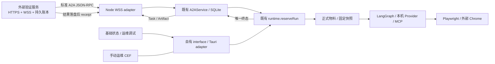

## Context

本设计以 2026-10-26 工作树和 `13fcd8b58af90a4a30015d0353f4b62dacf8dd92` 为核对基线，读取了用户已有的需求文档修改，不覆盖这些修改。需求来源为 [串讲 README](../../../docs/requirements-walkthrough/README.md)、核心章节、00–11 章，以及 [Agent](../../../docs/agent-version-layout.md)／[Skill](../../../docs/skill-version-layout.md) 正式包约定。完整追踪和验收矩阵见 [verification.md](verification.md)。本文中的新文件、接口和命令都是实施目标；本次不将它们标为已交付。

### 代码基线与实际缺口

| 边界 | 已存在的真实能力 | 本 change 补齐 |
| --- | --- | --- |
| 桌面入口 | `desktop/runtime/main.ts` 组装资源、Provider、SQLite、Chrome、手动 CEF、runtime；stdout 是 JSONL IPC | 平台会话、A2AService、WSS、维护接口与统一退出 |
| A2A | `a2a/index.ts`／`store.ts` 已实现；SDK 1.3.0、持久去重、共享容量、终态和回执；独立 HTTP/SSE 测试已存在 | 接入真实桌面入口和 WSS，不重写 Task 存储／执行引擎 |
| 远端执行 | `runtime.ts::reserveRun()` 已调用精确官方版本准备、本机模型、MCP、LangGraph | 接上正式包解析和 HTTPS 缺包下载；现状只核验本地单份配置 |
| 资源 | `assembly.ts`、`skill-library.ts` 有本地编辑、完整 Skill 捕获、只读快照和实验 | 正式 Agent 两文件、不可变版本、多版本目录、草稿上传与原子联动发布 |
| Provider | 多 Provider／模型、手动测试、默认项、系统凭据引用与运行绑定已实现 | 保留既有行为，验证远端不可覆盖；补 Windows 实机证据 |
| 浏览器 | 每 thread 固定外部 Chrome 页面；CEF 是独立 `__manual__` | 验证 WSS→真实 Chrome 闭环，保持页面锁和人工输入边界 |
| 前端 | user／operations 构建已存在，真实 Tauri adapter 与失败重试已存在 | user 收敛为连接／维护入口；受权运维调试；远端 thread 只读、执行与交付分开 |
| 维护 | 有两平台打包和 SQLite checkpoint | updater、按 thread 一致性导出、上传与最终回执 |
| 验证 | Node／web 单测、HTML 浏览器用例、Chrome 用例、独立 A2A 进程 | 可独立部署的 WS／HTTPS 对端、统一运行和分平台整包验收 |

需求的历史状态不覆盖较新的代码证据。例如第 08 章仍有待建界面描述，但代码已提供 edition 隔离；第 01 章最新 Markdown 工作区仍缺上传入口，底层可写文件并不证明该入口已完成。旧截图、旧验收统计、交叉构建和 browser fake 均只保留其原有证明范围。

### 与既有 OpenSpec 的关系

- [define-desktop-a2a-interface](../define-desktop-a2a-interface/contract.md) 是已实现模块契约。其 `tasks.md` 的 WSS 两项仍未完成，本设计承接这些工作；旧任务在实际实施及回归完成后关联关闭，本次不改勾选状态。
- 其 [wss-contract.md](../define-desktop-a2a-interface/wss-contract.md) 是暂缓草案。本设计采用单主体连接、SDK 标准派发、Upgrade 协商和取消等待边界，并在下面固定验证环境数值与认证配合条件。
- `SendMessage` 默认等待终态，只有 `configuration.returnImmediately=true` 先返回 Task；以已实现模块契约为准解释第 10 章“受理返回”的概述。
- 已发布 `observability-runtime` 不变。沿用需求已确认的“不新增专门日志、span 或指标”：业务状态、Task／Run／receipt 与测试报告已能证明本次边界，不新增 Node 遥测门面。测试耗时和断言统计是验收结果，不是生产指标。

## Goals / Non-Goals

**Goals:**

1. 线上链路在不打开运维调试桌面时完成：受信会话→WSS 调用→确定物料→本机执行→持久结果→平台确认。
2. 串讲中的资源、装配、运维、本地 Provider、更新和诊断都有明确接口、失败行为与验收归属。
3. 一个独立外部服务既可在本机独立进程运行，也可部署到另一台机器，用同一协议验证真实客户端；模型、MCP 和测试网站均使用确定性 fixture。
4. 一次执行尽量跑完独立用例并汇总所有失败；平台条件不足明确 `not-run`，不能得出全量通过。

**Non-Goals:**

- 不实现生产 Console、账号签发、服务端 Agent 业务编排或 PostgreSQL／Redis／NFS 高可用集群；外部服务端部署章是配合契约。
- 不增加远端模型配置／密钥下发、审批系统、自动周发布、自动重跑、挂起恢复、执行回滚或通用调度器。
- 不建设业务 Skill 专用评测集、探索资料自动上传或定时采集；验证 fixture 只证明客户端协议和执行能力。
- 不做差分／静默／强制更新、自动回滚或断点续传；不把 Cookie／profile／CDP 开放给外部服务。

## Decisions

### 1. 真实调用路径与模块所有权



WSS 只负责网络连接、身份绑定、消息校验、SDK 派发和有限发送。A2AService 继续拥有去重、Task、Run 映射、终态冻结和交付确认。runtime 继续拥有共享名额、graph、Provider、MCP、Chrome 与实际排空。选择这条路径是因为当前模块已具备完整生命周期；另写远端任务状态机或 Rust 业务后端会出现两份结算规则。

拟新增文件只围绕真实外部边界：

| 位置 | 职责和依赖 | 清理归属 |
| --- | --- | --- |
| `desktop/runtime/platform.ts` | HTTPS 会话、目录、精确版本、草稿／发布、诊断接收；复用 `input.ts`、`RuntimeError`、既有凭据来源与 zod | 关闭时取消本模块网络请求，不关闭借入 runtime／资源 |
| `desktop/runtime/a2a/wss.ts` | 接收 A2AService 与会话来源，连接单个配置网关；SDK 处理标准 A2A | 自有 socket、监听、定时器、请求等待和发送器 |
| `assembly.ts`／`resources.ts` 的增量 | 正式版本读取、缺包准备、现有 SessionAssembly 生成；继续复用 Skill 文件与快照逻辑 | 未提交暂存目录、会话快照与取消后的清理 |
| `desktop/runtime/diagnostics.ts` | 冻结 thread、逻辑 checkpoint 导出、预览描述、不可变包；独立启动时只加载读取模块 | 自有只读连接、冻结副本、临时包和导出租约 |
| Tauri 宿主与自有前端接口 | 标准 updater／系统凭据／原生生命周期；页面经 adapter 操作 | 宿主控制安装、应用退出及数据目录锁 |
| `desktop/verification/` | 独立验证服务、控制面、fixture、黑盒用例、汇总脚本；共用 runtime 的已锁定依赖 | 本次测试的子进程、临时数据、端口、Chrome 和报告 |

不为这些文件再建通用服务容器或插件框架。`ws` 是 WSS 客户端与验证服务都需要的直接生产依赖：需要公开读取 101 响应、`send` 完成回调、`maxPayload` 和 `bufferedAmount`；不能以“Node 内置 WebSocket 不支持 headers”为选型理由。ZIP 读写在确认当前依赖不能满足流式校验后添加最小直接依赖，禁止调用用户可控 shell 解包；两个新依赖决策均须锁定版本并通过打包检查。

### 2. 启动、身份与能力就绪

`main.ts` 的本地执行初始化不等待外部网络。启动本地资源／checkpointer／Provider／runtime 后发送既有 `ready`，再启动平台连接，单独发布连接状态；离线时运维仍可使用已有本地能力。后台任务只在真实身份、A2A 存储恢复、协商和 endpoint 校验完成后开放。

生产会话必须由既有平台登录／续期来源提供，`GET /api/session` 核验组织、caller、installation、权限与 `expiresAt`；凭据放安全头，不放 URL／普通配置／Task。一次取得 authorization 快照，用同一个值核验 session 并完成 Upgrade，不能先读取 A 的 session 再因续期拿 B 的头建连。服务端网关在 Upgrade 验证同一安装与主体，并保证连接只代表该主体转发。TLS 只认证网关，不单独证明转发调用者身份。101 不回显 principal，客户端不能侦测受信网关在内部恶意换 caller；委托一致性必须由平台提供实际证据，不能凭客户端 fixture 宣称已证明。一次连接固定一个 `{organizationId, callerId, installationId}`，可访问多个授权 tenant；换用户、组织、安装、版本或扩展必须重连。

首版 tenant 固定为 `agent/<agentId>/<contentId>`，限制在现有 identifier 长度内；它只是逻辑入口。版本目录接口返回标准 AgentCard，接口 URL 为配置的 WSS endpoint，binding 和 tenant 与请求一致。`resolveEndpoint(context, tenant, {signal})` 校验当前主体权限及三元组，不从 Message.metadata 采信身份，不允许覆盖成本地私有 Agent。已验证的卡片可按当前会话租约缓存；新 Task 的缺包下载在受理后的准备阶段发生，Get／List 不触发下载或执行。

没有真实平台会话时，显示“待登录／接入未配置”，不伪造默认 principal。验证服务采用专用静态 fixture token→明确主体与权限映射，配置文件只存 token 文件引用；其通过不能声称生产 SSO／委托链已验收。生产启用前必须用平台真实会话跑同一握手与隔离用例。

会话过期、已收到撤权或退出时封闭连接、清理等待；已受理 Task 继续执行并本地落盘。没有平台即时撤销通知就不承诺即时撤权，以当前有效期和逐请求检查为界。认证／协议错误进入 blocked，等待用户恢复或配置改变；网络错误有界退避重连。

### 3. 正式包、缓存与会话快照

正式目录严格沿用已有布局，不创建第二套注册表：

```text
<localRoot>/
  agents/<legacy-id>.json
  agents/releases/<agentId>/tags.json
  agents/releases/<agentId>/<contentId>/agent.json
  agents/releases/<agentId>/<contentId>/prompt.md
  skills/releases/<skillId>/tags.json
  skills/releases/<skillId>/<contentId>/<完整 Skill 内容>
  agents/drafts/<agentId>/working/
  skills/drafts/<skillId>/working/
  runs/
  checkpoints.sqlite
  a2a/a2a.sqlite
```

上表 legacy 文件只用于原有本地读取；正式调用必须走 releases，不能把 legacy 官方标记视为新正式包。正式 Agent 只有 `agent.json` 与 `prompt.md` 两个文件；MCP 是包内完整非敏感配置，Skill 是明确 `{skillId,contentId,mountPath}`，不经可变全局 ID 解析正式配置。Prompt 在图外读取后进入现有 `instructions`，graph 编排仍随代码交付。

复用 `assembly.ts::packageContentId` 的路径、UTF-16 排序、紧凑 JSON 与 SHA-256 规则，测试对照独立黄金向量。Agent 配置的排版和 Prompt 换行属于原始字节，下载不得重新序列化。ZIP 传输摘要、正式包 contentId、legacy 配置摘要、assemblyContentId、运行指纹和 Task 结果摘要分别命名及保存，不能相互代用。

下载顺序：精确版本 manifest→有界暂存下载→检查 ZIP 字节摘要→逐项安全读取→检查文件清单和完整包 contentId→同步文件与目录→同一文件系统原子 rename→读取正式目录装配。Agent 可由 manifest 给出两个受限原始文件地址，Skill 使用 ZIP。二者都保持原始内容，包外保存版本元数据。URL 仅允许配置的 HTTPS 物料 origin 列表；跨 origin 不转发 Authorization，不跟随未知重定向，失效地址重新取同一版本 manifest。没有明确允许的 origin 就拒绝，不把任意模型返回 URL 当下载源。

本地上限沿用下游读取约束：单文件 20 MiB、单包传输／展开各 100 MiB、1000 条清单项、目录深度 32、路径 1024 字节、一次会话装配 256 MiB；服务端限制更小时取较小值，传输中累计计数，不能只信 Content-Length。并行下载最多 2 个；同一包复用本进程在途准备，但每个等待者取消独立，仅最后等待者离开才中止共享下载。拒绝绝对／越界路径、链接、设备文件、重复与大小写冲突、NFC 冲突、空段、zip bomb 和清单外条目，空目录也保留。

校验失败、存储失败、权限失败或取消只删除本次暂存；已有缓存与编辑保留。同版本已存在则核验并复用，冲突不覆盖。缓存命中仍核验 manifest／文件归属，不以目录存在代表完整。尚未下载版本只存在标签映射中，不能被误认为可运行。无自动清理历史；空间不足明确失败。

`resources.prepareSession` 在当前装配路径增量支持精确正式版本和 AbortSignal；缓存／网络准备计入既有 preparing 和运行超时。官方包、固定 MCP 配置、Provider 和完整 Skill 复制成功后，才进入 graph 和工具执行。失败释放预留名额并产生安全失败；不删除能力、换旧版、改默认模型或偷偷执行半套装配。已有 thread 快照保持原组合，后续编辑、目录更新不改变它。

### 4. 草稿、发布与运行指纹

本地保存、上传草稿、正式发布是三种操作。当前 Markdown 工作区补文件上传入口，沿用真实文件接口及同名替换／跳过／取消，不写两套存储。官方正式内容在前后端均只读；编辑先复制到 working，本地私有资源仍可自由编辑和完整快照实验。

上传前捕获不可变包和摘要，`Idempotency-Key`、`expectedRevision` 随该次提交持久保存；期间继续编辑属于下一份 working。草稿 HTTP 上传使用 `multipart/form-data` 的 `manifest`（schemaVersion、文件清单、contentId、expectedRevision）与 `package`（ZIP 原始字节），解析边界受同一上限约束。查询返回已保存修订及文件 manifest，不要求实验通过。超时使用原键和原字节重试；原键换内容为 409。

发布 Skill 必须先获得 `publish-preview` 的完整受影响 Agent 集合和基线，由运维手填 Skill 与每个 Agent 的新标签；服务端再次核对集合、基线、修订与标签，一次提交全部正式版本。失败保留旧标签与草稿，不显示部分成功。仅改 Prompt 则发布 Agent；模型参数不进入发布。提交即本人确认，不引入审批人／自动周发布。

运行指纹在装配成功、graph 启动前计算，组成清单保存到 snapshot 和 Run，格式如下：

```json
{
  "fingerprintVersion": 1,
  "agent": {"agentId": "inspection", "contentId": "64位实际包摘要"},
  "skills": [{"skillId": "ops", "contentId": "64位实际包摘要", "mountPath": "/skills/ops/"}],
  "provider": {"protocol": "openai-chat-completions", "baseUrl": "https://model.example.invalid/v1"},
  "modelId": "fixture-model",
  "modelRevision": null,
  "parameters": {"temperature": 0}
}
```

上例是形状说明，实施用真实摘要。Skill 按 skillId、contentId、mountPath 的 UTF-16 顺序排序，键递归规范化后 SHA-256；参数来自实际传给模型的有效设置，本机显式默认先展开，上游未知默认不编造。参数名称采用实际请求语义，包含适用的 temperature、max_tokens、parallel_tool_calls、thinking 等；FP-01 对照 fixture 实收字段，不能只校验哈希变化。Provider 身份取实际规范 URL（保留有效 base path）与协议，不取展示名、Key 或 credentialRef；模型修订不可取得用 null 表示未固定。草稿先捕获完整不可变内容摘要。runId、用户输入、输出、时间不参与。

沿用现有 Provider 管理与系统凭据，本地默认组合供远端任务固定。在 `reserveRun()` 取得准入时同步发起 `providers.pin()`，先排入与配置保存共用的现有串行队列，再进行受理事务和网络下载；将 Promise 拒绝当场转换为受控准备结果，避免未处理拒绝。异步取凭据／创建模型在准备阶段，失败作为该 Run 的准备失败。未成功受理的预留释放绑定；长下载期间修改默认值也不改变已受理 Task。任务输入不得覆盖 Provider、model、Key 或本地路径。历史回退只选择原指纹组成，为新会话／新显式任务准备；不可用就失败，不改历史标签，不重跑旧 Run。不实现专用业务效果评测平台，指纹也不保证远端模型／MCP 或图代码完全可复现。

### 5. WSS binding 与确定限额

客户端连接 `/api/clients/connect`，只接受 wss URL，无 userinfo、fragment 或凭据查询串，不跟随重定向；本机和跨机验证均使用 HTTPS／WSS 及显式可信证书，不另开不安全协议开关。Upgrade 双向确认：

| 项 | 固定值／行为 |
| --- | --- |
| binding | `urn:omniops:a2a:binding:wss-jsonrpc:v1`，不塞入 WebSocket subprotocol |
| A2A-Version | 请求与 101 响应均为 `1.0`，缺失不回退 0.3 |
| A2A-Extensions | 必含 `urn:omniops:a2a:extension:delivery-receipt:v1`，用 SDK Extensions 解析／去重 |
| 准备完成 | HTTP 头校验与 ws open 全部成功，凭据仍有效；仅 upgrade 事件不能接任务 |
| 卡片 | streaming=true、pushNotifications=false、extendedAgentCard=false；逐入口调用 SDK validateVersion 检查 binding |
| 消息 | 每个完整文本消息一个 JSON-RPC 2.0 请求；不增加 type/payload/schemaVersion、心跳业务帧或流结束帧 |

正常派发复用 `JsonRpcTransportHandler.handle()`、`ServerCallContext`、SDK 错误映射。只有 `omniops/ConfirmTaskDelivery` 单独识别并经相同身份、版本、扩展和 tenant 校验。原 JSON 预检在 SDK fromJSON 前检查原始类型；每 RPC 建新 context，只有该连接可信 principal，没有原始认证头。JSON-RPC id 是非空受控字符串或安全整数，数字 1 与字符串 "1" 不同；同连接活跃 id 重复则关闭连接，避免响应歧义。拒绝 batch、notifications、二进制业务和对端 result/error。

固定首版限额如下；配置允许收紧，放宽必须两端同步并回归，构造时交叉校验响应封套能容纳完整 Task：

| 限额 | 值 | 结算范围 |
| --- | --- | --- |
| A2A request／Task／JSON depth | 256 KiB／1 MiB／32 | 序列化 UTF-8 字节、深度含根；沿用 service 校验 |
| A2A waiters／subscriptions | 64／16 | 该服务总等待者／活动订阅 |
| WSS message／project headers | 2 MiB／8 KiB | 重组后消息／项目协商头总字节；Authorization 值另限 8 KiB，全部 HTTP 握手头合计 16 KiB |
| 每连接 in-flight RPC／stream | 32／16 | 先限额再建异步工作，留短请求名额 |
| outbound messages／bytes | 32／8 MiB | 应用队列＋在途及 socket 缓冲，计帧开销 |
| 首次连接预算 | 10 s | 凭据取得、TLS、项目头、open 合计，不按阶段重置 |
| 单 RPC 等待 | 120 s | 只结束等待，不改变 Task 执行超时 |
| WebSocket Ping／Pong | 每 20 s／等待 10 s | 使用协议控制帧；超时断线 |
| 网络重连 | 0.5–30 s 退避并抖动 | 最多一个定时器和一次尝试，成功归零 |
| adapter.close／应用退出 | ≤3 s／总 10 s | adapter 时间取两者剩余预算较小值 |

本地、实验、远端共用并发设置（默认 4，1–64）；WSS RPC 数量不是执行容量。长流消费不能串行阻塞 Get／Cancel。流复用原 id 逐个发送标准 StreamResponse；终态结束该流，连接仍可用。生成器非终态结束视作本 RPC 异常，查 Task 确认，不能伪造 completed。出站满、写失败或超时关闭／清理传输等待，不等待对端消费才结算 Task，不丢帧后伪装完整流成功。

### 6. 执行、交付与恢复的两个状态

| 情况 | 执行结果 | 对端恢复动作 |
| --- | --- | --- |
| 同 messageId 同不可变输入 | 原 Task；去重先于容量 | 查询原 Task，不新增 Run |
| 同 messageId 改输入 | 标准冲突 | 用新 messageId 明确发起另一任务 |
| 新任务 busy | 持久 REJECTED，无 Run／新页面 | 原消息仍拒绝；以后显式新消息 |
| 断线／取消订阅／RPC 等待超时 | Task 继续执行和持久化 | 已知 taskId 用 Get／Subscribe；未知则原消息重投 |
| CancelTask | 先停止中，真实排空并落盘后 CANCELED | 完成结果已固定则不可取消 |
| 登录／验证／缺输入／执行超时 | FAILED 与安全原因，无暂停续跑 | 人工处理后新消息、新 Run／graphThreadId |
| 客户端异常重启 | 终态原样；未完成收敛 FAILED／interrupted-unknown | 仅恢复查询与交付，不续 graph／模型／浏览器 |
| 发送成功、ACK 未落盘 | 执行已终态，交付待确认 | 查询相同结果并重试确认 |

终态摘要沿用既有 `taskResultSha256`，RFC 8785 规范化 `{id,contextId,status,artifacts}`，缺省 artifacts=[]；不含 history／metadata／摘要自身。验证服务以原 Task 和索引一起持久保存后才调用 receipt；receipt 同摘要幂等，错摘要、未终态和落盘失败均不能宣称已交付。平台本地业务消费记账也必须幂等，不能因 ACK 丢失重复产生业务消费。

重连不补播历史 token／工具过程，也不增加恢复执行 RPC。表中的“取消订阅”只指调用方停止本地消费；WSS 没有远端退订消息，不能用 CancelTask 代替退订。该流在既有 120 秒等待截止或整条连接关闭时由接收端清理，期间仍受流数／字节预算约束；若要立刻回收所有等待可关闭共享连接并重新查询，Task 本身继续。断开的旧 generation 回调不能写入新 socket 或新 principal；所有 socket 消费、监听、定时器有确定 owner。保留 SDK 1.3.0 typed client 对 data:null 的已知限制，协议验收另用原始标准 JSON-RPC wire 核对 null，不伪造“上游已修复”。

### 7. 新增外部边界的公开调用契约

以下是实施时必须暴露的最小边界；字段沿用第 10 章对应记录，所有 Promise 失败用 RuntimeError 分类，原始依赖错误只保留 cause。未列出的内部 helper 不公开。

| 导出／完整调用签名 | 输入与输出 | 构造、取消和生命周期 |
| --- | --- | --- |
| `createPlatformClient({baseUrl, allowedDownloadOrigins, getAuthorization, limits}): PlatformClient` | baseUrl 为 HTTPS origin；getAuthorization 签名 `(options:{signal:AbortSignal})=>Promise<string>`；limits 含 requestTimeoutMs、maxJsonBytes、maxPackageBytes、maxExpandedBytes、maxEntries、maxDepth、maxFileBytes、maxPathBytes；返回下列方法 | 校验所有 URL／正安全整数，默认验证配置取 15s／2MiB／100MiB／100MiB／1000／32／20MiB／1024；不在构造时联网；自有请求共用关闭信号 |
| `client.session(options:{signal?:AbortSignal}): Promise<VerifiedSession>` | 返回 schemaVersion=1、organizationId、callerId、installationId、expiresAt、受控 permissions；核验后才用于 principal | 401／403 安全拒绝，响应身份与凭据作用域不符拒绝；不把响应正文当 Token |
| `client.credentials(options:{signal?:AbortSignal}): Promise<{authorization:string,session:VerifiedSession}>` | 调用 getAuthorization 一次，以该值请求并核验 session，返回同一头值与其受信会话；只在主入口／WSS 接入中使用，不经 IPC 给页面 | 校验 header 字符／大小及剩余有效期；返回的 WSS 凭据从同一个结果生成，不拼接两次读取的身份与头；失败释放本次请求 |
| `client.resolveEndpoint(context:ServerCallContext, tenant:string, options:{signal:AbortSignal}): Promise<OfficialEndpoint>` | 复用既有 ResolveEndpoint 类型与 AgentCard；验证授权和 exact version | 不下载包；取消只结束解析，不关闭 service |
| `client.fetchPackage(reference:{kind:'agent'|'skill',id:string,contentId:string}, options:{signal?:AbortSignal}): Promise<DownloadedPackage>` | 返回经验证暂存目录、文件 manifest 和 contentId；`DownloadedPackage` 还有 `discard():Promise<void>`，提交前由调用者负责释放 | 消息／下载流有界；失败自动清理；成功所有权转交资源准备方，不能把暂存路径交页面 |
| `client.createResource(request:{kind:'agent'|'skill',name:string,idempotencyKey:string}, options:{signal?:AbortSignal}): Promise<ResourceIdentity>` | 返回 schemaVersion=1、kind、服务端新 id，无正式版本 | 本地新建不调用；幂等键与原请求一起保存 |
| `client.uploadDraft(request:DraftUpload, options:{signal?:AbortSignal}): Promise<DraftRevision>` | DraftUpload={kind,id,directory,contentId,expectedRevision:string|null,idempotencyKey}；Revision={schemaVersion:1,draftRevisionId,contentId,savedAt,revision} | directory 只来自冻结暂存，不接受页面任意路径；取消／超时不等于未提交，保留原键／包供查询重试 |
| `client.previewSkillRelease(request:{skillId:string,draftRevisionId:string}, options:{signal?:AbortSignal}): Promise<ReleasePreview>` | Preview={schemaVersion:1,contentId,baseline,affectedAgents:[{agentId,expectedContentId}]} | 只读；基线是有界受控字符串，提交原样核验 |
| `client.publish(request:SkillRelease|AgentRelease, options:{signal?:AbortSignal}): Promise<ReleaseReceipt>` | SkillRelease={kind:'skill',id,draftRevisionId,releaseTag,baseline,affectedAgents:[{agentId,expectedContentId,releaseTag}],idempotencyKey}；AgentRelease={kind:'agent',id,draftRevisionId,releaseTag,expectedContentId:string|null,idempotencyKey}；Receipt={schemaVersion:1,releaseId,versions:[{kind,id,contentId,releaseTag}]} | expectedContentId=null 仅表示该资源尚无正式版本，服务端原子校验“仍无版本”；已有版本须精确 CAS。标签严格沿用人工 v.1.0.0 形式；超时保留原提交，不重生成标签 |
| `client.diagnosticLimits(options:{signal?:AbortSignal}): Promise<DiagnosticLimits>` | {schemaVersion:1,formatVersions,maxPackageBytes,maxExpandedBytes,maxFiles}，均经上限校验 | 失败不开始网络上传；仍允许按本机保守上限导出待以后上传 |
| `client.uploadDiagnostic(request:{uploadId:string,packageFile:string,bundleSha256:string}, options:{signal?:AbortSignal}): Promise<DiagnosticUploadState>`；`client.diagnosticStatus(uploadId:string, options:{signal?:AbortSignal}): Promise<DiagnosticUploadState>` | packageFile 只能是本次冻结包；状态为 pending／received／failed，received 含 diagnosticId、uploadId、threadId、bundleSha256、receivedAt、incomplete 和 missing[] | 202 映射 pending；摘要或 thread 不符拒绝；未知提交先查询；失败不删包，材料变化换 uploadId |
| `client.close(options:{deadline:number}): Promise<void>` | performance.now 同一单调时钟绝对期限 | 幂等停止请求；不关闭借入资源，不延长宿主期限 |

`ResourceIdentity` 为 `{schemaVersion:1,kind,id}`；所有资源 ID、摘要、时间、权限、目录与列表长度在请求／响应边界校验。列表接口的 cursor／limit 与 items／nextCursor 由现有资源 interface 扩展，版本、修订和诊断详情只返回对应章所列 DTO，不把 HTTP Response 或原协议错误暴露到页面。

WSS 公开入口完整沿用并收窄旧草案：

```ts
type WssCredentials = Readonly<{
  authorization: string;
  principal: A2APrincipal;
  expiresAt: string;
}>;
type WssLimits = Readonly<{
  maxMessageBytes: number; maxHeaderBytes: number;
  maxInFlightRequests: number; maxStreams: number;
  maxOutboundMessages: number; maxOutboundBytes: number;
  connectTimeoutMs: number; callTimeoutMs: number;
  heartbeatIntervalMs: number; pongTimeoutMs: number;
  reconnectMinMs: number; reconnectMaxMs: number; closeTimeoutMs: number;
}>;
type WssStatus = Readonly<{
  state: 'connected' | 'reconnecting' | 'blocked' | 'closing' | 'closed';
  reason?: 'network' | 'authentication' | 'forbidden' | 'protocol' | 'backpressure' | 'unknown';
}>;
type A2AWssOptions = Readonly<{
  url: string;
  service: A2AService;
  getCredentials: (options: Readonly<{origin: string; signal: AbortSignal}>) => Promise<WssCredentials>;
  limits: WssLimits;
}>;
interface A2AWssAdapter {
  getStatus(): WssStatus;
  subscribe(listener: (status: WssStatus) => void): () => void;
  close(options: CloseOptions): Promise<void>;
}
declare function connectA2AWss(options: A2AWssOptions, callOptions?: CallOptions): Promise<A2AWssAdapter>;
```

仅导出 connect、接口和其调用者需要的上述类型，A2APrincipal／A2AService／CloseOptions／CallOptions 从现有 `a2a/index.ts` 复用。首次连接成功才 resolve；首次失败清理后拒绝，main 保留 blocked／reconnecting 状态并负责再次尝试。返回后的原构造 signal 不接管整条连接生命周期。subscribe 提供独立安全快照，listener 抛错不改变 Task 或连接业务结果；取消订阅是幂等移除。

调用公开 SDK／service 入口的最小派发示例（trusted 来自同一已核验凭据快照，request 已完成原报文预检）：

```ts
import { createHash } from 'node:crypto';
import { canonicalize } from 'json-canonicalize';
import { JsonRpcTransportHandler, ServerCallContext } from '@a2a-js/sdk/server';

const owner = 'omniops-v1:' + createHash('sha256').update(canonicalize([
  trusted.organizationId, trusted.callerId, trusted.installationId,
])).digest('hex');
const context = new ServerCallContext({
  user: { isAuthenticated: true, userName: owner },
  requestedVersion: '1.0', requestedExtensions: [receiptUri],
  state: new Map<string, unknown>([
    ['omniops.principal', trusted],
    ['omniops.waitSignal', waitSignal],
  ]),
});
const handler = await service.protocolFor(context, tenant);
const response = await new JsonRpcTransportHandler(handler).handle(request, context);
```

owner 规范来自既有 [contract.md](../define-desktop-a2a-interface/contract.md)，不导入 store 私有 helper，也不另建身份编码法。标准调用由 SDK setTenant 一次；receipt 分支同样构造 context，再显式 setTenant 一次后调用 service.confirmTaskDelivery。service 实际激活 receipt 扩展，不把 requested 集合直接当 activated。

构造错误为 invalid-request；身份为 authentication／forbidden；网络为 unavailable；协议不兼容为 protocol；容量为 resource-limit；主动等待取消为 aborted；落盘为 storage。内部保留 cause，IPC 只用 safeError 摘要。新增类别须同步既有安全映射，不发送依赖错误链。A2A 标准错误仍由 SDK 类型／数字码返回，不套 HTTP schemaVersion。

只经公开入口的组装顺序是：主入口创建 platform client→创建既有 resources/runtime→以 client.resolveEndpoint 创建 A2AService→取得受信 session→connectA2AWss→订阅安全状态投影。关闭顺序见第 10 节。此调用顺序不读取任何模块私有存储或字段。

### 8. 外部 WS 验证服务

服务路径为 `desktop/verification/server.mjs`，使用 Node 26.11.1，在独立进程监听 HTTPS／WSS；不能 import 客户端 runtime、A2AService、store 或 assembly helper 来产生期望结果。允许共用官方 A2A／MCP SDK 和已锁定网络／ZIP 依赖，摘要对照独立黄金向量。生产客户端不启动该 server。

外部服务的 WSS caller 只补该自定义 binding 的分帧、RPC id 关联和有限流消费，复用 SDK 对象、序列化和错误。标准 ClientFactory 的 HTTP transport 不直接连接 WSS；原独立 HTTP/SSE 验收继续作为标准 SDK 互操作证据，两种传输分别记录。

单服务配置包含监听地址、TLS cert/key 文件、数据根、fixture token 文件与主体映射、物料集、已签名更新静态目录和受限控制面；路径都必须绝对。服务启动成功先完成数据／配置检查，返回只含安全地址、端口和 fixtureSet 摘要的 ready 消息。独立服务 stdout 不占用客户端 JSONL IPC，但同样不输出 Token／模型正文／完整协议；证据正文只在专用本地 fixture 数据目录受权保留。

| 外部接口 | 服务承担的真实验证行为 |
| --- | --- |
| `GET /api/session` | 固定测试凭据核验、明确权限／到期／安装；错误身份不能升级 |
| `/api/agents`、`/api/skills` 及 `/versions/...` | 第 10 章的目录、分页、确定版本 manifest／标准 AgentCard、原始包和受限下载；不存在不替代版本 |
| 创建资源、`/drafts`、`/publish-preview`、`/releases` | 完整草稿保存、expected 基线、Idempotency-Key、完整关联集和原子发布；故障点实际位于提交前／后 |
| `WSS /api/clients/connect` | 接受客户端主动连接，完成真实 101 协商，下发标准 A2A；不建立私有任务协议 |
| `/updates/stable/latest.json` 与包地址 | Tauri 原生 manifest、两个目标已签名整包；只保管已签名产物，更新签名私钥不部署到服务 |
| `/api/diagnostics/limits`、`/thread-uploads/{uploadId}`、列表／详情／附件 | 校验单 thread ZIP、路径／摘要／容量／权限，持久保存包及索引才返回最终回执；附件只读下载 |
| 模型／MCP／测试业务页 | 固定 Chat Completions fixture、真实 HTTP MCP 和唯一 fixtureMarker 的可检查页面操作，拒绝外部付费依赖 |

测试服务自行持久化一份有界 SQLite 账本，使用已有 better-sqlite3，不建生产数据库框架。调用意图在发送前提交，包含稳定 messageId、组织／caller／安装、确定 tenant 和输入摘要／fixture 引用；取得 taskId 后补映射。终态原 Task、摘要和 `receivedAt` 一事务提交后才确认。消费以 taskId+结果摘要唯一记账，重复结果不重复消费。服务崩溃后沿原 messageId／taskId 恢复查询，不产生新执行身份。草稿／发布先暂存内容，再以事务切换公开索引，未提交物料对目录不可见；诊断包 fsync／rename 后提交索引才回执。

每次隔离运行最多 4096 个调用意图，单 Task 1 MiB、请求 256 KiB；数据根新增业务材料总计最多 1 GiB，已签名更新产物为只读 fixture，不复制进账本根。达到上限拒绝新意图／上传并报告 resource-limit，不静默删除仍需对账的记录。外部服务采用与客户端相同的消息／流／发送预算；故障注入的更小限额只影响该子例，不能成为无限队列测试后门。

控制面只监听独立 loopback 端口或父进程 IPC，带每次运行随机控制凭据。跨机测试通过运维显式转发访问 loopback，不能把控制 API 暴露在业务 WSS 端口。控制命令是固定枚举：丢下一响应／receipt、断开连接、延迟模型／MCP、暂停读取、指定握手缺头／错版、损坏下一包、指定存储提交点失败；无任意代码、路径或 shell 参数。每个注入指定场景 ID、次数与最大持续时间，到期复位，避免污染后续场景。

最小跨机部署是同一份源码、Node 和 runtime 的 npm 锁定依赖，加配置／fixture 目录及受信 TLS；不用 Compose 集群。服务 cert 与更新签名是两类材料。测试 CA 通过系统／Node 信任配置显式加入，禁止 NODE_TLS_REJECT_UNAUTHORIZED=0。全套测试依赖本机固定配置中的测试模型/MCP URL；不能把服务端下发模型配置混入产品协议。

CLI 配置为 UTF-8 JSON，拒绝未知键和非 1 版本；下面 TS 是完整首版配置形状，不执行代码。路径字段均绝对；字符串 ID／时间／URL／摘要按前述约束逐项校验。预算由本文固定，不为每个 CLI 重造任意调参表。

```ts
type ServerConfig = {
  schemaVersion: 1;
  listen: { host: string; port: number };
  publicOrigin: string; // HTTPS origin，WSS 用相同 host/port
  tls: { certFile: string; keyFile: string };
  dataRoot: string;
  fixtureRoot: string; // 包含版本化 manifest、原始包及已签名更新产物
  identities: Array<{
    tokenFile: string;
    principal: A2APrincipal;
    permissions: Array<'official-read' | 'official-maintain' | 'task-call' | 'diagnostic-own' | 'diagnostic-read'>;
    expiresAt: string;
  }>;
  control: { host: '127.0.0.1' | '::1'; port: number; secretFile: string };
};
type VerifyConfig = {
  schemaVersion: 1;
  target: 'darwin-aarch64' | 'windows-x86_64';
  peer: { mode: 'managed'; configFile: string } | {
    mode: 'external'; publicOrigin: string;
    controlOrigin: string; controlSecretFile: string;
  };
  fixtureManifest: string;
  fixtureTokenFile: string;
  trustedCaFile?: string; // 不提供时用系统信任，原生测试仍需系统显式信任
  runtime: { nodeExecutable: string; directory: string };
  isolatedRoot: string;
  reportRoot: string;
  installation?: {
    version: string; executable: string; packageFile: string; packageSha256: string;
    previousVersion: string; previousPackageFile: string;
    sourceCommit: string; sourceTreeSha256: string;
  }; // full 必填；contract 不据此宣称安装包已验证
};
```

`managed` 由 runner 启动独立服务进程并读取 ready，`external` 连接已部署服务；controlOrigin 必须是本机 loopback 的独立受权端口／显式隧道端口，不能指向 publicOrigin。fixtureManifest 包含 fixtureSetId、每文件 SHA-256、指定 Agent/Skill 版本及非敏感预期结果，必须与服务 ready 中的摘要相同。测试根必须为空或带匹配本次运行标记，禁止真实应用数据根；`reportRoot` 不得位于待清理临时根内。Node、架构、安装包摘要和源码身份先校验，再执行用例。配置与报告中都不内嵌 token/key 值。

### 9. 基础状态、更新和诊断

前端沿用 `DesktopRuntime`／资源自有接口和 Tauri adapter，新状态增加 connection（已连接／重连／离线及受控原因）、execution 和 delivery 三份投影。user 默认只有基础连接／维护；operations 是运维构建入口且操作需真实权限，edition 不是授权。远端 thread 可检查结果但不允许本地追加；本地调试 thread 继续既有会话。共享页面不直接 fetch、读磁盘或调用 Tauri；桌面初始化失败保持错误与重试，不切 demo。

更新直接使用 Tauri updater 的标准整包验证／安装能力，Rust 只承载宿主插件和系统操作，业务准入仍在 Node。启动 ready 后异步检查一次，手动检查复用；更高有效 SemVer 且目标架构匹配才展示。下载由用户触发、真实进度、验签后待安装；再次确认时在同一个 runtime 同步准入临界区检查本地／实验／远端执行、预留及绑定页导航，并设置维护闸门，不能先查空闲后异步再上锁。

运行活动先进入则提示等待，结束不自动安装，用户必须再次确认；安装闸门先进入则新任务明确拒绝。增加 `runtime.beginMaintenance(): {release():void}`，返回幂等释放租约，关闭中／忙时安全拒绝；本地 start、reserveRun、navigate 和实验入口共享检查。准备失败释放闸门并保留当前应用；下载失败、摘要／签名错不调用安装器。进入实际安装前按一个总预算关闭连接、任务、存储和浏览器；重启版本及数据可读才算更新成功。

诊断入口复用现有执行记录，按业务 thread→runId→graphThreadId 和所有 checkpoint_ns 读取。新增 `runtime.reserveThreadExport(threadId:string): {release():void}`，与 start／reserveRun／navigate／prepareSession 共用该 thread 的同步互斥；目标 preparing／running／stopping 时拒绝，用户可自行停止后再试。租约期间排空该 thread 已发起写入并冻结 JSON 记录及 SQLite 一致性读结果，记录截止 checkpoint／事件序号后释放，其他 thread 可继续。不能跨 thread 写入或按聊天消息推造 checkpoint。

正常实例只增加现有 runtime 的公开方法 `runtime.exportThreadDiagnostics(request:DiagnosticExportRequest, options?:CallOptions):Promise<DiagnosticExport>`；`DiagnosticExportRequest={threadId:string,includeAttachments:string[],outputDirectory:string}`，includeAttachments 是已关联附件 ID 数组，outputDirectory 来自受权原生目录选择。返回 `DiagnosticExport={uploadId:string,threadId:string,packageFile:string,bundleSha256:string,manifest:DiagnosticManifest,preview:DiagnosticPreview}`；Manifest 是第 09 章的格式版本、run 映射／截止点／文件 SHA／缺失项记录，Preview 是材料名称、大小、脱敏与缺失说明，不含认证头。runtime 已持有 resources／history／records／checkpointer，内部取得上述租约后委托 diagnostics.ts 的内部编码函数，不新增一套依赖容器。取消释放锁、读事务和本次临时包；原任务、原件和已有不可变包不删除。错误复用 invalid-request／busy／storage／resource-limit／aborted；无法证明 thread 归属的材料不入包。

包包含 manifest、thread、每 run 记录／快照、完整可解释 checkpoint 父链和 pending writes、明确选择的附件；只导出逻辑记录，禁止整库／WAL／SHM 或“复制全库再删其他 thread”。逐项类型与格式版本记录，无法安全解释标 missing，不执行附件或反序列化代码。脱敏作用于副本，排除 Key、头、Cookie、profile、环境文件；自由文本和截图必须可预览、选择及明确同意。包不承诺可执行恢复。

主桌面打不开时，由同一安装提供独立诊断启动模式，只初始化只读数据访问，不创建 Provider／Agent／MCP／Chrome。宿主用 Rust 标准文件锁取得 localRoot 所有权后启动 sidecar；正常模式和独立模式共用锁。正常实例还在运行则独立入口连接其既有宿主诊断能力或提示退出后重试，不另开并发读取进程、不用 PID 猜锁是否过期。进程崩溃由 OS 释放锁；独立模式在运行恢复改写前记录磁盘状态，坏库仍收集可证明归属的 JSON 并标 checkpoint-missing，不修库。

该模式公开 `exportOfflineThreadDiagnostics(options:DiagnosticExportRequest & {localRoot:string}, callOptions?:CallOptions):Promise<DiagnosticExport>`，调用前置为宿主已取得 localRoot 独占 OS 锁；函数校验目录归属／非链接／只读访问，以自己打开的只读连接冻结材料并在 finally 关闭，不调用 createDesktopRuntime 或正常启动恢复。在线模式和离线模式共用内部逻辑包编码与脱敏；附属 `listOfflineDiagnosticThreads(options:{localRoot:string,cursor?:string,limit?:number}, callOptions?:CallOptions):Promise<{items:Array<{threadId:string,title:string,lastUpdated:string,checkpointAvailable:boolean}>,nextCursor:string|null}>` 使用同一锁前置，limit 默认 50、上限 100，cursor 绑定本地目录修订，只列可证明归属的 thread；修订改变要求重读，不静默漏项。页面只经宿主受权 interface 传 thread 和目录选择结果，不能任意指定 localRoot。

上传前读取服务端 limits，固定包／uploadId／SHA 后展示接收服务和账号，用户明确提交。202 只表示待确认；超时先按同 ID 查询，已接收必须核对相同摘要、diagnosticId、receivedAt 和不完整原因。重试同包同 ID；材料变化换 ID。导出／上传失败保留原材料，不启动模型补跑或浏览器补拍。

### 10. 退出与失败隔离

main 将所有关闭操作使用同一 `performance.now()+10000` deadline：先禁新准入→adapter.close→A2AService.close→platform.close→runtime.close→credentials／checkpoint→结束 sidecar。每个步骤失败仍尝试后续清理，剩余预算不重置；到期记录安全关闭失败并由宿主完成进程回收，不能宣称未排空资源已释放。普通网络断线绝不调用 service.close。

失败不改变已冻结终态，不以遥测或测试报告写入失败重试业务。测试报告落盘失败使验收失败；生产遥测关闭失败维持既有业务退出语义。Node stdout 只用于 IPC，新增网络库不得输出协议／日志到 stdout；敏感哨兵检查覆盖 stderr、IPC、Task metadata、普通报告和服务错误响应。诊断包正文属于知情授权材料，不能反过来写进普通日志。

### 11. 一次执行与证据门槛

实施后提供 `server.mjs` 和 `verify.mjs`，完整命令、配置与逐项用例见 [verification.md](verification.md)。先跑前置与现有检查，再起独立服务和真实 `main.ts`，外部仅经协议提交：空缓存→确定包→固定 Provider／MCP→Chrome 页面副作用→checkpoint／Run→Task→服务端持久接收→receipt。浏览器测试、真实 Tauri、系统凭据与整包升级分别判定，不能拿 fake IPC 替代原生证据。

`contract` 只证明所列协议场景；`full` 还要求该主机目标的真实安装包门槛。macOS ARM64 与 Windows x64 各跑一次，最终 merge 要求同候选版本、源码／dirty 摘要、兼容 fixtureSet 和两份完整报告。一次命令收集所有可独立继续的失败；缺前置的依赖用例标 not-run，绝不强行运行错误环境或直接跳过。

每用例包含 ID、前置、操作、可观察断言、证据、状态、时间；状态仅 passed／failed／not-run。退出码 0 为本次声明范围全过、1 为断言失败、2 为配置／环境不足或必需项未执行；若兼有失败优先 1。仅 merge 所有必需平台和场景通过才能使用“客户端完整验收通过”。本次提案只验证文档及规格，产品任务仍全部待实现。

## Risks / Trade-offs

- [平台未给真实会话／单主体委托] → fixture 可先验证协议；生产接入明确 blocked，不从正文伪造 caller。需要平台提供登录、有效期和安装归属样本。
- [当前本地 Agent 摘要与正式包不兼容] → 双路径读取、正式引用必走 releases，旧快照标明旧格式，不批量改写身份。
- [外部模型／MCP 可变] → 固定非敏感运行选择并留实际能力快照；指纹不保证行为可复现，不自动替换／重跑。
- [SQLite 与 JSON 跨文件非原子] → 按 thread 停新轮次并排空写入后冻结，读事务保持一致；失败不给完整导出结论。
- [独立服务和客户端共用 SDK 可能同错] → 增加原始 wire、独立摘要向量和实际 Chrome 副作用断言，不只比较两个同源对象。
- [测试配置可能指向个人数据／真实模型] → 所有测试使用专用绝对 dataRoot、profile、fixture model allowlist，前置校验禁止已有非测试目录；测试失败也有界清理。
- [机器／签名环境缺失] → 对应整包用例 not-run、完整验收不通过；交叉构建或 fixture 签名不能冒充真实系统验收。

## Migration Plan

1. 保留当前本地读写与既有测试，先建立独立服务、协议用例和摘要黄金向量；新命令不存在／缺能力时报告真实未完成。
2. 增量加入正式目录读取和 HTTPS 缓存；现有本地 Agent 和 Skill 不移动，旧历史只读兼容，正式包不复用旧配置摘要。
3. 在 main 显式组装 A2AService 和 WSS；接入配置缺失时本地仍可运行，线上基础入口显示未连接。验证恢复、权限和共享名额后才启用远端任务。
4. 补官方草稿／发布与运维权限，保留未同步 working；客户端和测试服务都验证原子可见与幂等。
5. 加基础维护、诊断、updater 和原生目录锁；两个目标真实旧版安装→新版升级→数据重开。数据库若需升级先保留恢复副本，不清空重建。
6. 全量运行、合并两平台报告，再申请外部平台真实联调。关闭新连接配置可回退到离线本地使用；已有正式缓存、Task／receipt 和历史不删除，业务操作不可回滚，不自动降级数据库／应用。

## Open Questions

实现路线与验证环境契约已确定；以下是部署输入，缺失时明确阻止相关生产／平台验收，不以默认假值填补：

- 外部平台的真实登录／续期来源、caller 委托保证、expiresAt 和安装身份映射及可用的撤权机制。
- 生产网关／物料允许 origin、可信 TLS、更新站点、公钥和两平台已签名旧／新版安装产物。
- 可执行 Windows x64 安装、系统凭据、CEF 与升级验收的主机；测试服务跨机运行时的受信 TLS 和 loopback 控制转发。

`ws`／ZIP／Tauri updater 的具体锁定版本在实施任务中依据公开 API、锁文件和原生打包验证确定；不改变本文选定边界，不以未锁依赖声称实现完成。
